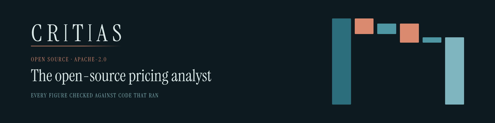

<p align="center">
  <a href="https://critias.ai">
    
  </a>
</p>

# Critias

[](https://github.com/critias-ai/critias-pricing-agent/actions/workflows/macos.yml) [](https://github.com/critias-ai/critias-pricing-agent/actions/workflows/windows.yml) [](LICENSE)

Critias is an open-source pricing analyst: a local browser application for AI-assisted pricing and gross margin analysis. Ask questions about CSV, Excel, text and Markdown files and get answers whose figures are checked against the code that produced them, with native tables and Plotly charts read straight from the computed results.

Built on [Pi](https://pi.dev) ([earendil-works/pi](https://github.com/earendil-works/pi)), the open-source agent harness. Pi supplies the model layer, the agent loop, and tool calling; this project adds the pricing skills, the data checks, and the figure verification on top.

The application combines an assistant-ui chat interface (React), a Fastify server, the [Pi](https://pi.dev) agent SDK, DuckDB, seven bundled pricing skills (Pricing Plugin 0.4.12) and a visualization skill. Calculations run locally. Model requests go to OpenRouter, or directly to OpenAI.

**Status: experimental research preview (0.5.0).** Native macOS setup, component, Python and browser tests, and live runs of the single-analyst workflow on synthetic and public datasets have been checked. Real-business-data validation and native scale testing are still pending. See [how the harness works](pricing-harness/docs/architecture.md) and the [verification records](pricing-harness/docs/releases/).

## Features

- One continuing analyst session per conversation. It works in SQL over typed views of your files and in recorded Python scripts, and follow-ups keep the population, period and basis agreed earlier.
- Seven pricing skills: intake, margin analysis, opportunity scan, recommendations, pricing design, rollout planning and triage, with knowledge and method cards.
- Checked replies: every substantial number must appear in the output of a query or script that ran. Tables and charts are built from frozen result files, never from model text.
- Data findings: before the first question on a set of files, seven code-based detectors flag suspect rows (formats, spelling variants, missing keys, duplicates, broken products, date order, values far from their peers). The analyst asks how to treat them; nothing is cleaned automatically.
- Confirmed business context in `.pricing/context.md`, written only for facts you confirm, and conversation history in a sidebar.
- Local chart and table interactions (hover, zoom, search, sort) with no model requests, and live step progress while a question runs.
- Per-question limits on time, model calls and tool calls, cancellation, and connection recovery.
- A headless interface for scripted questions and a graded evaluation loop.

Skills and dependencies are pinned. The provider and model are set in `pricing-harness/.env`; the app never switches models or updates its bundled skills by itself.

## Requirements

- macOS or Windows for the supplied setup and launch scripts. Windows also needs [Git for Windows](https://git-scm.com/download/win): the analyst runs its shell commands in Git Bash.
- Node.js 22.19 or later and Python 3.12.
- An OpenRouter API key (or Pi's stored credentials) and a model ID. Any OpenRouter ID works, including ones newer than Pi's catalogue. An OpenAI key works with a direct Node launch.
- Internet access for installation and model requests. Chromium is only needed for the development browser tests. Docker isn't needed.

## Quick start

Run these commands from the repository root:

```bash
cd pricing-harness
bash scripts/setup-macos.sh
cp .env.example .env
```

Set a key and a model for the provider you use in `.env`: `OPENAI_API_KEY` and `OPENAI_MODEL`, `OPENROUTER_API_KEY` and `OPENROUTER_MODEL`, `GEMINI_API_KEY` and `GEMINI_MODEL`, or `ANTHROPIC_API_KEY` and `ANTHROPIC_MODEL`. The app uses the first provider that has both, in that order. With a stored ChatGPT login (Pi's `~/.pi/agent/auth.json`), set only `OPENAI_MODEL`. Keep the file out of Git. Then launch with a separate business workspace. An optional second argument overrides the model for one launch:

```bash
bash scripts/start-macos.sh "$HOME/PricingHarnessWorkspace"
```

Open [the local application](http://127.0.0.1:4317). The launcher creates the workspace if needed. Restart after changing `harness.config.json` or `.env`; the thinking level is chosen in the interface, beside Send; stop with Ctrl+C. Model requests use your credentials and can incur provider charges.

Add a file and ask, for example: “Which products contributed most to the change in gross margin between these years?” Confirm column meanings, currency, calendar, cost treatment and comparison scope when asked. See [local setup](pricing-harness/docs/local-setup.md) for model selection, direct Node and OpenAI launches, headless use and every setting.

### Windows

Install Node.js 22.19 or later, Python 3.12 (with the `py` launcher) and Git for Windows. In PowerShell, from the repository root:

```powershell
cd pricing-harness
powershell -ExecutionPolicy Bypass -File scripts\setup-windows.ps1
copy .env.example .env
```

Set the key and model in `pricing-harness\.env` as above, then launch:

```powershell
powershell -ExecutionPolicy Bypass -File scripts\start-windows.ps1 "$HOME\PricingHarnessWorkspace"
```

## Configuration

`pricing-harness/harness.config.json` holds the port, upload cap, DuckDB memory and threads, per-question limits (`seconds`, `modelAttempts`, `toolCalls`), and settings for the evaluation runner; the provider and model come only from `.env`. Unknown keys and invalid values stop startup. Environment variables override the file:

| Variable                   | Purpose                                    | Saved value                    |
| -------------------------- | ------------------------------------------ | ------------------------------ |
| `PRICING_PROVIDER`         | Force one provider (`openai`, `openrouter`, `google`, `anthropic`) | first with a key and model |
| `PRICING_MODEL`            | Override the model of the chosen provider  | from `.env`                    |
| `PRICING_THINKING_LEVEL`   | Starting thinking level; the interface changes it per question | `medium`   |
| `PRICING_PORT`             | Local HTTP port                            | `4317`                         |
| `PRICING_MAX_UPLOAD_BYTES` | Maximum size per uploaded file             | `2147483648` (2 GiB)           |
| `PRICING_DUCKDB_MEMORY`    | DuckDB memory budget (not a total RAM cap) | `4GB`                          |
| `PRICING_DUCKDB_THREADS`   | DuckDB threads                             | `4`                            |
| `PRICING_ANALYSIS_SECONDS` | Time limit per question                    | `900`                          |

The launchers set the workspace and Python path. For direct Node or headless launches, set `PRICING_WORKSPACE` and an absolute `PRICING_PYTHON`, with the key and model in `.env` as described in [local setup](pricing-harness/docs/local-setup.md).

## Data and local access

Keep business workspaces outside this repository. Each workspace stores:

```text
PricingHarnessWorkspace/
├── files/        # Original source files, never modified
├── analyses/     # One record per question: outcome, events, steps, usage
├── outputs/      # Report downloads from earlier versions; new answers stay in chat
└── .pricing/     # Confirmed context, conversations, analyst work, checkpoints, caches
```

You can copy large CSVs into `files/` before launch; startup registers them without moving them. Every sheet of a workbook becomes its own table. Formula cells without saved values stay unknown.

Prompts and tool results, including file excerpts, contain business data and go to your model provider. Use data you are allowed to share with them. Charts and tables render locally, and the interface blocks requests to other sites.

The analyst can read and write files and run shell commands with your user's permissions. Running the app is not an operating-system sandbox. The server binds to `127.0.0.1`, refuses requests from other hosts and origins, and has no login. A source that changes during a question fails that question, but the app doesn't restore it. See [the test protocol and operating limits](pricing-harness/docs/acceptance.md).

## Development and tests

Run from `pricing-harness/` after setup:

```bash
.venv/bin/python -m pip install -r requirements-dev.txt
export PLAYWRIGHT_BROWSERS_PATH="$PWD/.cache/browsers"
node node_modules/playwright/cli.js install chromium
npm run build
npm run typecheck
npm test
npm run test:python
npm run test:browser
```

These tests make no paid model requests. The browser suite uses a labelled offline fixture, so passing it doesn't establish live model correctness. Build first, because the packaging tests inspect the compiled app.

For UI development, run `npm run dev` with the backend environment variables set and `npm run dev:ui` in a second terminal. Vite serves the interface on port `5173` and proxies the backend on port `4317`.

[The evals README](pricing-harness/tests/evals/README.md) explains the graded eval loop. `npm run eval:oracle` is free and checks every case's answer key. Live evaluations need credentials and can incur charges. The answer keys in `tests/evals/keys/` come from synthetic or public data, are kept out of the analyst's workspace, and deliberately committed. Scale tests run only when enabled ([test protocol](pricing-harness/docs/acceptance.md)).

## Repository layout

| Path                       | Contents                                                                                      |
| -------------------------- | --------------------------------------------------------------------------------------------- |
| `pricing-harness/src/`     | Server, analyst workflow, workspace storage and the assistant-ui React interface              |
| `pricing-harness/bundled/` | Pinned pricing skills, the visualization skill and the Python data tools                      |
| `pricing-harness/scripts/` | macOS setup and launch scripts, evaluation runner and latency report                          |
| `pricing-harness/tests/`   | Unit, integration, Python, browser, evaluation and scale tests                                |
| `pricing-harness/docs/`    | Setup, architecture, data definitions, test protocol, design history and verification records |
| `PROJECT_GUIDE.md`         | Public project summary                                                                        |

Commit source code, lockfiles, documentation and synthetic fixtures. The ignore rules exclude credentials, installed dependencies, builds, local workspaces, conversations, caches, scratch folders and agent state.

## Validation limits and open work

Real-data acceptance needs confirmed business definitions and independently derived expected results. Synthetic scale benchmarks don't establish capacity for arbitrary customer files. Dependency advisories recorded during local setup remain open; review the [recorded findings](pricing-harness/docs/releases/mac-local-verification-2026-10-07.md) before distributing a release. Spreadsheet formula recalculation, automatic data cleaning, report or PDF export and hosted multi-user operation are out of scope.

## Contributing

See [CONTRIBUTING.md](CONTRIBUTING.md). Ask questions in [Discussions](https://github.com/critias-ai/critias-pricing-agent/discussions), report bugs in [Issues](https://github.com/critias-ai/critias-pricing-agent/issues), and report vulnerabilities privately as [SECURITY.md](SECURITY.md) describes. Release notes are in the [changelog](CHANGELOG.md).

## License and attribution

Critias is licensed under the [Apache License 2.0](LICENSE). The bundled Pricing Plugin keeps its [original MIT license](pricing-harness/bundled/pricing-plugin/LICENSE) and source provenance. See [third-party notices](pricing-harness/THIRD_PARTY_NOTICES.md) and [bundle versions](pricing-harness/bundled/versions.json).
