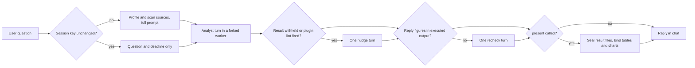

# How the pricing harness works

This page describes the current code. `docs/design/HLD.md` and `LLD.md` describe the original report design, which has been retired. `docs/releases/` holds dated evaluation evidence.

## Processes

| Process        | Code                                                           | Lifetime                                               |
| -------------- | -------------------------------------------------------------- | ------------------------------------------------------ |
| Browser UI     | `src/ui/` (React, assistant-ui, Plotly)                        | While the page is open                                 |
| Server         | `src/server.ts`, `src/application.ts` (Fastify on `127.0.0.1`) | While the app runs                                     |
| Analyst worker | `src/agent/workflow/worker.ts`, forked by `stage-runner.ts`    | One per question                                       |
| Python tools   | `bundled/harness-tools/*.py`                                   | One SQL process per question, plus short-lived scripts |

The browser talks to the server over HTTP and server-sent events (`/api/events`). Only the worker calls the model provider. The server also fetches OpenRouter's public model list once to price a model ID that Pi's catalogue doesn't know.

## One question, start to finish

1. **Run controller** (`runs.ts`). Accepts one question at a time and treats a repeated `requestId` as the same run. It hashes every source, writes `analyses/<run>/run.json` and hands the question to a new `WorkflowOrchestrator`. Every workspace source is used: the browser always sends an empty file list.
2. **Fresh or follow-up** (`orchestrator.ts`). The session key is a hash of the bundle fingerprint and each source's path and hash, stored in `state.json`. A follow-up with an unchanged key sends only the question and a deadline. A changed key (new bundle, or added or changed sources) clears the analyst folder and builds the full prompt (`stage-prompt.ts`). That prompt holds the question, deadline, `context.md`, the source list, the path to column profiles, the full text of the routing skill, shared rules and metric verification, and the compact data findings.
3. **Worker and budget** (`stage-runner.ts`, `budget.ts`). The worker asks the server before every model call, tool call and retry. The server debits the per-turn limits (`seconds`, `modelAttempts`, `toolCalls`, and at most two retries). It stops the run when a limit is spent, after three identical operation/result pairs, or when the provider stops reporting usage. On finish, cancel or timeout, the worker's whole process group is killed.
4. **Analyst** (`worker.ts`, `session.ts`, `role-prompts.ts`). One Pi session per conversation in `.pricing/workflow/<conversation>/analyst/`, resumed on follow-ups, with compaction on. Pi lists the seven pricing skills, `analysis-visualize` and every knowledge card. Its tools:

   - `query` (`query-tool.ts` → `query_server.py`): DuckDB SQL over one typed view per CSV file or workbook sheet. Views the analyst creates last for the conversation. A result shows up to 100 rows, and `save` writes the full result to a CSV.
   - `execute_analysis`: runs a Python script under `record_execution.py`, which records the workspace files it read. Scripts stop after 120 s.
   - `bash`, `read`, `write`, `edit`: Pi's built-ins. Python run through `bash` is recorded like `execute_analysis` (`shell-evidence.ts`). `write` and `edit` may target only the analyst folder and `.pricing/context.md`.
   - `present`: shows tables and charts from CSV files that an executed query or script wrote.

   Every query or script run leaves an `execution-*.txt` output in the analyst folder. These outputs are the evidence the reply check reads.

5. **Hooks** (`nudges.ts`). These hooks act on tool calls and results. `skill-read` holds the first calculation until a task skill and a knowledge card have been read (at most twice). `source-read` holds once a script that reads a source file directly instead of through SQL. The others: `no-installs`, `context-append-only`, `reuse-scripts`, `error-hints`, `plugin-lints`, `slow-query`, `repeated-sql`, `runaway-stream`, `focus-thinking` and `pacing`. `PRICING_HOOKS_OFF=name,name` switches hooks off. Three more checks run inside the SQL process: `same_rows.py` can stop a statement whose combined totals cover different rows, and `peer_ratio.py` and `offsets.py` add notes about outlier rows and returns that cancel sales.
6. **Nudge** (`orchestrator.ts`, `nudges.ts`). At most one extra turn in the same session: when the analyst ran analyses but replied with only a question, or when a plugin lint (`bundled/pricing-plugin/skills/references/lints.json`) fires on the reply.
7. **Reply check** (`reply-figures.ts`). Every number in the reply with three or more significant digits must match, at the reply's precision, a number in an executed output. A printed fraction shown as a percentage counts, as does the difference of two supported numbers. Bare numbers from 1900 to 2100 are read as years and skipped. If any don't match, one recheck turn runs. Numbers still unmatched are delivered with a notice that names them.
8. **Seal and deliver** (`checkpoints.ts`, `exploration.ts`). If the analyst called `present`, each CSV it named must be an unchanged output of an executed query or script. Those files are copied with their hashes into `checkpoints/<id>/`, and tables and charts are built from the copies, so displayed values are the files' values, never the model's text. After delivery the checkpoint and every source are hashed again. A change withdraws the views and marks the run "no verified answer".

There is no coordinator, verifier or assurance label. "Double-check this" is an ordinary follow-up turn.

## Data checks before a fresh session

`source-profiles.ts` runs `profile_source.py` on each CSV and XLSX source (up to 10 sheets per workbook) to get inferred types, null and blank counts, ranges and frequent values. `data-findings.ts` runs `data_findings.py`, whose seven detectors flag rows that fail the column's main format (D1), spelling and shape variants (D2), keys missing from a reference (D3), duplicates (D4), a column that breaks a product of two others (D5), future or reversed dates (D6), and values a power of ten, ×12 or a sign away from their group median (D7). Both results are cached by file content. In the prompt, profiles are capped at 40,000 characters and findings at 12,000; the full list stays in `findings.json` and `flags.parquet`. Sources or checks that couldn't be read are always listed as gaps. Code only flags rows. The analyst names the findings that affect its answer, asks the user how to treat them, and applies only treatments the user confirmed. A detector failure is logged and never blocks a run.

All source loading goes through `data_workspace.py`: strict CSV parsing (UTF-8, delimiter detected), every column first read as text into a cached DuckDB file, and a typed view only where casting loses no present value. A CSV whose first row holds data gets columns `column1..N`, and the analyst is told to ask for names.

## Where state lives (inside the business workspace)

| Path                                                     | What it is                                                                                                                                                                                      |
| -------------------------------------------------------- | ----------------------------------------------------------------------------------------------------------------------------------------------------------------------------------------------- |
| `files/`                                                 | Original uploads. Never modified.                                                                                                                                                               |
| `.pricing/context.md`                                    | Confirmed business facts. The analyst adds to it, through the `pricing-intake` skill, only facts the user confirmed. Existing bullet lines can't be removed or reworded through `write`/`edit`. |
| `.pricing/files.json`                                    | Registered sources with their hashes.                                                                                                                                                           |
| `.pricing/source-profiles.json`                          | Column profiles written for the last fresh session.                                                                                                                                             |
| `.pricing/data-cache/`                                   | Prepared DuckDB copies of sources, and cached findings. Safe to delete; rebuilt from sources.                                                                                                   |
| `.pricing/sessions/`                                     | The app's root Pi session, which provides each new conversation's ID.                                                                                                                           |
| `.pricing/workflow/current.json`                         | The conversation that reopens when the app starts.                                                                                                                                              |
| `.pricing/workflow/<conversation>/conversation.json`     | The chat as shown in the UI, with its title and last-updated time.                                                                                                                              |
| `.pricing/workflow/<conversation>/state.json`            | Session key, settled lints and hashes of result files the analyst may present.                                                                                                                  |
| `.pricing/workflow/<conversation>/analyst/`              | The analyst's session, scripts, queries, execution outputs, provenance files and its DuckDB database (`qdb/`).                                                                                  |
| `.pricing/workflow/<conversation>/checkpoints/<id>/`     | Frozen result files and `checkpoint.json` for delivered tables and charts.                                                                                                                      |
| `analyses/<run>/run.json`, `events.jsonl`, `steps.jsonl` | One run: outcome, budget and cost, every worker event (secrets redacted) and the UI steps.                                                                                                      |
| `outputs/`                                               | Report downloads from earlier versions. New runs don't write here.                                                                                                                              |

## Settings

`harness.config.json` holds the model, runtime settings, one per-turn limit block (`seconds`, `modelAttempts`, `toolCalls`) and evaluation settings. `src/defaults.ts` holds the built-in fallbacks. `PRICING_*` environment variables override both.

## Safety boundaries

- The server accepts requests only from the local host and port, and has no other authentication. The UI is served with a Content-Security-Policy that blocks outside requests, and markdown in replies is rendered without raw HTML.
- Environment variables named like keys, tokens, secrets, passwords or credentials are removed before any shell or Python process starts, and their values are redacted from logs.
- The SQL process allows only queries, `DESCRIBE`/`SHOW`/`SUMMARIZE`/`EXPLAIN`, creating or dropping views and tables, and `COPY`. It turns off external access and limits file access to the analyst folder.
- `bash` is a real shell with the user's permissions. The write limits and the append-only rule on `context.md` apply to the `write` and `edit` tools, not to shell commands. Running the app is not an operating-system sandbox.

## Skills

The bundled Pricing Plugin (version in `bundled/versions.json`) provides seven task skills (intake, analyze, scan, recommend, design, execute, triage), shared rules, knowledge and method cards, and reply and code lints. `bundled/harness-skills/analysis-visualize` explains `present`. `bundle.ts` checks skill metadata, links and versions at startup and fingerprints the whole `bundled/` tree. A changed fingerprint starts a fresh analyst session in every conversation.

## Evaluations

`npm run eval:oracle` checks the answer keys for free. Live evaluations are paid and need explicit approval; see `tests/evals/README.md` and `docs/acceptance.md`.
