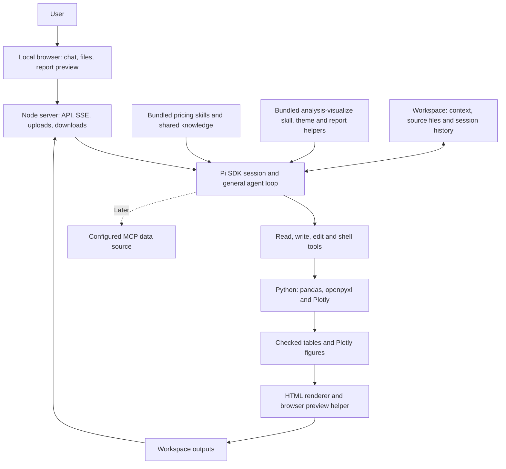
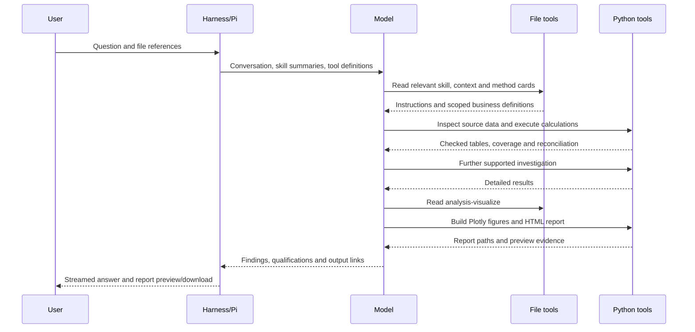

# Pricing Harness — High-Level Design
> **Superseded.** This describes the original HTML-report design, which is retired. For the current workflow see [architecture](../architecture.md).

**Date:** 7 October 2026

**Status:** Original design proposal, retained as architectural context. See the [application README](../../README.md) and [verification record](../releases/mac-local-verification-2026-10-07.md) for implementation and acceptance status.

**Audience:** Project owner and implementer.

**Purpose:** Build a small, useful local pricing analysis application quickly, then extend it through demonstrated use.

## 1. Intended outcome

The user launches a local browser application, opens a pricing workspace, supplies CSV/XLSX sales data and relevant business documents, and asks commercial questions. The agent reads appropriate skills and business context, executes calculations, investigates supported findings, and returns an answer with downloadable tables and interactive HTML reports.

The first release serves one user, one workspace per server process, and one active agent run at a time. It uses a configured model provider rather than building a provider setup interface. The application is local; using a cloud model still sends the selected prompt and tool-result content to that provider.

Success means that a real transaction dataset can support verified analysis, visible exclusions, qualified recommendations, and a readable interactive report. A browser chat that produces plausible explanations without executed calculations does not meet that goal.

The current pricing package is B2B oriented. The harness must allow a manually bundled broader package to replace it later, without changes to business workflows in application code. Broader B2C, ecommerce and SaaS coverage must be established through relevant methods and test cases.

## 2. Scope and decisions

| Area | First-release decision |
|---|---|
| Runtime | Embed the Pi SDK in a local Node/TypeScript process. |
| Interface | React/Vite chat, uploads, progress, Stop, and output preview/download. |
| Pricing knowledge | Bundle a fixed, complete copy of the pricing skills and shared resources. |
| Updating | Change bundled resources deliberately during development and ship a new harness package. No release polling, installation-time plugin fetch, or automatic plugin update. |
| Visualization | Python Plotly, a bundled visualization skill, a shared theme, and a reusable HTML report template. |
| Analysis tools | Pi file tools and shell execution of Python with pandas and openpyxl. |
| Storage | Workspace directories and Pi session files. |
| Input formats | CSV, XLSX, UTF-8 text and Markdown. Other documents can be stored, but parsing support is added deliberately. |
| Outputs | Interactive self-contained HTML, CSV result tables and reproducible scripts; small answers remain in chat. |
| Data connections | Local exports initially. Add an existing MCP data source when a concrete use case justifies it. |
| Deferred | Accounts, team authorization, audit infrastructure, hosted multi-user deployment, workflow engine, universal ingestion, PDF/PPTX export and plugin marketplace. |

Use one charting engine initially. Plotly was selected because the agent can generate figures directly from its Python result tables and export interactive HTML. Browser-native Plotly rendering from figure JSON remains a possible later interface improvement; Dash would introduce another application server and is unnecessary for this design.

## 3. Architecture



### Responsibilities

| Component | Responsibility |
|---|---|
| Browser | Submit questions, show streamed responses and meaningful progress, upload files, stop work, and preview/download outputs. |
| Local server | Own the active Pi session, workspace paths and API; bridge session events to SSE; manage file transfers and process lifecycle. |
| Pi | Manage model interactions, tool execution, conversation persistence and skill resource discovery. |
| Pricing skills | Establish definitions and evidence requirements, choose applicable pricing methods, and guide analysis and recommendations. |
| Visualization skill | Choose useful visuals, generate Plotly figures from checked results, assemble reports and inspect rendered outputs. |
| Python and SQL tools | Execute data checks and numerical calculations. SQL enters through a later data connection. |
| Packaged report helpers | Apply consistent presentation, render supplied figures/tables and produce preview evidence. They contain no pricing methodology. |

The model selects investigative steps through Pi's general loop. Application code does not implement a sequence such as intake → scan → analyze → recommend. Explicit tasks enter the relevant skill directly.

## 4. Application and workspace layout

The application package and working business data are separate.

```text
pricing-harness/                         Application package
├── package.json
├── package-lock.json
├── requirements.txt                    Pinned Python dependencies
├── src/
│   ├── server.ts
│   ├── agent.ts                        Central session factory
│   ├── workspace.ts
│   ├── files.ts
│   └── ui/
│       ├── App.tsx
│       ├── Chat.tsx
│       ├── Composer.tsx
│       └── Outputs.tsx
├── bundled/
│   ├── versions.json
│   ├── pricing-plugin/
│   │   ├── plugin.json
│   │   ├── LICENSE
│   │   └── skills/
│   │       ├── pricing-intake/SKILL.md
│   │       ├── pricing-analyze/SKILL.md
│   │       ├── pricing-scan/SKILL.md
│   │       ├── pricing-recommend/SKILL.md
│   │       ├── pricing-design/SKILL.md
│   │       ├── pricing-execute/SKILL.md
│   │       ├── pricing-triage/SKILL.md
│   │       ├── knowledge/              Complete shared tree
│   │       ├── references/             Complete shared tree
│   │       └── pricing-intake/references/context-outline.md
│   └── harness-skills/
│       └── analysis-visualize/
│           ├── SKILL.md
│           ├── references/
│           │   ├── chart-selection.md
│           │   └── html-reporting.md
│           ├── scripts/
│           │   ├── plotly_theme.py
│           │   ├── render_report.py
│           │   └── preview_report.mjs
│           └── assets/report.html
└── tests/
    ├── integration/
    └── evals/                          Development-only; excluded from distribution
```

```text
acme-pricing/                           Working business project
├── .pricing/
│   ├── context.md                      Confirmed reusable business facts
│   └── sessions/                       Pi-owned session files
├── files/                              Original uploads and reference documents
├── analyses/
│   └── run-id/
│       ├── analysis.py
│       ├── results.csv
│       ├── figures/                    Plotly figure JSON
│       ├── report.json                 Small report description
│       ├── run.json                    Development/reproduction metadata
│       └── previews/                   Rendered screenshots and browser diagnostics
└── outputs/
    └── run-id/
        ├── report.html
        └── results.csv
```

The first tree abbreviates individual skill assets: copy the entire `skills/` tree without flattening or dropping any files. In particular, each skill's references to `../knowledge/` and `../references/` must continue to resolve.

Package only the pricing runtime resources, original MIT license and version metadata. Evaluation inputs, answer keys, previous reports and local company context do not belong in the installed package.

## 5. Direct wiring of bundled skills

### 5.1 Packaging contract

1. Select a pricing source commit deliberately. The reviewed baseline is plugin `0.2.0`, commit `2da2b3f0257aeaa7f386bfeb828692dc95d7b8d7`.
2. Copy its complete `skills/` tree, `plugin.json` and license into `bundled/pricing-plugin/`.
3. Add the application-owned `analysis-visualize` skill beside that package. Do not modify the pricing package to add presentation instructions.
4. Record the source commit, package version and visualization skill version in `bundled/versions.json`.
5. Include `bundled/` as ordinary application assets in development, the built distribution and the eventual installer/package.
6. Resolve resource paths relative to the installed application, independently of the selected business workspace.

Pi reads the skill files from disk. The pricing `plugin.json` is retained for identification and version information; the harness does not need a generic plugin installation mechanism to load these known skill directories.

The source package's [installation guidance](https://github.com/critias-ai/critias-pricing-plugin/blob/main/INSTALL.md) requires preserving the complete shared-file layout. The [Pi resource loader](https://github.com/earendil-works/pi/blob/27c7b6ff48ccca57694a960e4af10529f77deae6/packages/coding-agent/src/core/resource-loader.ts) supports explicit additional skill paths.

### 5.2 Session factory

Use a single factory from both the browser server and evaluation runner. It loads the seven pricing entry points and the visualization entry point explicitly, verifies their discovery, and constructs a Pi session.

The API baseline below was inspected against Pi source `1.0.4`, commit `27c7b6ff48ccca57694a960e4af10529f77deae6`. Pin the installed SDK and lock its dependencies; compile this wiring against that installed package during implementation. This is an architectural wiring example, not a tested application implementation.

```typescript
import { join } from "node:path";
import {
  createAgentSession,
  DefaultResourceLoader,
  getAgentDir,
  SessionManager,
  SettingsManager,
  type CreateAgentSessionOptions,
} from "@earendil-works/pi-coding-agent";

const pricingSkills = [
  "pricing-intake", "pricing-analyze", "pricing-scan",
  "pricing-recommend", "pricing-design", "pricing-execute",
  "pricing-triage",
];

const HARNESS_PROMPT = `
You work in a business analysis workspace.
Read the applicable skills and use their supporting references.
Confirmed business context is in .pricing/context.md.
Source files and documentation are in files/.
Use tools for calculations and keep source files unchanged.
Save reproducible work in analyses/ and deliverables in outputs/.
For useful charts or an HTML report, read analysis-visualize.
Describe material exclusions and unresolved inputs beside findings.
`;

export async function createPricingSession(options: {
  workspaceRoot: string;
  bundledRoot: string;
  bundleFingerprint: string;
  model: NonNullable<CreateAgentSessionOptions["model"]>;
  newConversation?: boolean;
}) {
  const { workspaceRoot, bundledRoot, model } = options;
  const agentDir = getAgentDir();
  const sessionDir = join(workspaceRoot, ".pricing", "sessions");

  // Explicit app settings keep resource loading reproducible.
  // Provider credentials/model access are supplied through Pi separately.
  const settingsManager = SettingsManager.inMemory({
    packages: [], extensions: [], skills: [], prompts: [], themes: [],
  });

  const loader = new DefaultResourceLoader({
    cwd: workspaceRoot,
    agentDir,
    settingsManager,
    noSkills: true,                // Explicit paths below still load.
    noExtensions: true,
    noPromptTemplates: true,
    noThemes: true,
    noContextFiles: true,           // Business context is read as a file.
    additionalSkillPaths: [
      ...pricingSkills.map(name =>
        join(bundledRoot, "pricing-plugin", "skills", name)),
      join(bundledRoot, "harness-skills", "analysis-visualize"),
    ],
    systemPromptOverride: () => HARNESS_PROMPT,
    appendSystemPromptOverride: () => [],
  });
  await loader.reload();

  const { skills, diagnostics } = loader.getSkills();
  const expected = [...pricingSkills, "analysis-visualize"];
  const discovered = new Set(skills.map(skill => skill.name));
  if (diagnostics.length || discovered.size !== expected.length ||
      expected.some(name => !discovered.has(name))) {
    throw new Error("Bundled skills are incomplete or inconsistent");
  }

  let sessionManager = options.newConversation
    ? SessionManager.create(workspaceRoot, sessionDir)
    : SessionManager.continueRecent(workspaceRoot, sessionDir);

  const savedBundle = sessionManager.getEntries()
    .filter(entry => entry.type === "custom" &&
      entry.customType === "harness-bundle")
    .at(-1);
  const compatible = savedBundle?.type === "custom" &&
    savedBundle.data === options.bundleFingerprint;
  if (!compatible) {
    if (sessionManager.getEntries().some(entry => entry.type === "message")) {
      sessionManager = SessionManager.create(workspaceRoot, sessionDir);
    }
    sessionManager.appendCustomEntry("harness-bundle", options.bundleFingerprint);
  }

  const { session } = await createAgentSession({
    cwd: workspaceRoot,
    agentDir,
    model,
    settingsManager,
    resourceLoader: loader,
    sessionManager,
    tools: ["read", "bash", "edit", "write"],
  });
  return session;
}
```

The server creates workspace directories before calling this factory and supplies a fingerprint derived from the packaged runtime resources/version metadata. It obtains the configured model through Pi's model/provider infrastructure; credentials remain on the server side. In-memory settings here control resource discovery, not conversation persistence.

The current Pi SDK accepts tool names as strings. Its prompt construction still advertises discovered skills when a custom prompt prefix is provided and file-reading tools are present. Therefore the harness need not manually concatenate skill contents into its system prompt. See the checked [SDK factory](https://github.com/earendil-works/pi/blob/27c7b6ff48ccca57694a960e4af10529f77deae6/packages/coding-agent/src/core/sdk.ts) and [prompt construction](https://github.com/earendil-works/pi/blob/27c7b6ff48ccca57694a960e4af10529f77deae6/packages/coding-agent/src/core/system-prompt.ts).

Only the eight packaged skills are loaded initially. Optional project skills can later be added through an explicit workspace path, with duplicate-name checks, without changing the packaging mechanism.

### 5.3 Manual maintenance

Replacing a plugin means deliberately replacing the bundled runtime tree, updating version metadata, running acceptance checks and building a new harness package. Installed applications never check GitHub for plugin changes. The installer uses its included plugin copy.

A development edit to a skill takes effect in a fresh session after resource loading. Store the bundle fingerprint in Pi's custom session metadata; ordinary restarts resume a matching session, while a changed bundle starts a fresh conversation and preserves the earlier transcript. Pi's custom metadata entries are stored without entering model context. This avoids representing old work as having been produced by the new methods. Business context remains in the workspace during application upgrades. See [Pi session metadata](https://github.com/earendil-works/pi/blob/27c7b6ff48ccca57694a960e4af10529f77deae6/packages/coding-agent/src/core/session-manager.ts).

## 6. How the agent uses context and skills

At session creation, Pi advertises skill names, descriptions and paths. It does not inject every knowledge card or dataset. When a request matches, the model reads the corresponding `SKILL.md`, then follows its references. This is progressive loading of relevant instructions.

The harness prompt gives file locations and operational conventions. The pricing skill gives analytical guidance. `.pricing/context.md` supplies confirmed definitions, mappings, calendar, currencies, units and scoped policies. Source documents supply evidence. Dataset inspection supplies the actual current schema and coverage.

Existing confirmed context can be reused unless disputed or inapplicable. A root-level or attached `context.md` can be reviewed through intake and applicable previously confirmed facts imported. Document-derived claims, inferred mappings and new proposals remain provisional until validated. New exports still require numerical and comparability checks.

Ordinary chat replies can confirm a proposed business definition; this does not require an authorization subsystem. Findings, hypotheses and temporary assumptions stay in the answer/report, rather than being silently saved as company facts.



The sequence is illustrative. The model may ask a clarification, continue independently supported work, or return a small answer without a report. Skill selection is model behavior and must be tested; registering a skill does not guarantee its use.

## 7. Tools and runtime dependencies

| Capability | Initial implementation |
|---|---|
| Read skills, context and text | Pi `read`. |
| List/profile files and execute analysis | Pi `bash`, launching the configured Python interpreter. |
| Save scripts, context updates and deliverables | Pi `write`/`edit`, or Python through shell execution. |
| CSV and XLSX | pandas and openpyxl. `.xls` is outside the initial support promise. |
| Financial arithmetic | Python calculations with explicit rounding; Decimal/scaled integers where exact monetary thresholds require them. |
| Charts | Python Plotly Express/Graph Objects and the packaged theme. |
| Report composition | Bundled `render_report.py` using Jinja2 and `assets/report.html`. |
| Actual report inspection | Bundled Node Playwright helper, Chromium, and Pi reading the resulting PNG previews with an image-capable model. |

Use a Node version supported by the pinned Pi package; the inspected `1.0.4` source requires Node `>=22.19.0`. Lock Node dependencies and Python dependencies. Use an explicitly configured Python environment with installed libraries; the agent should not need to install dependencies during an analysis.

Initially target a local development installation: install Node dependencies, create the Python environment, install its pinned requirements and install the Playwright browser once. A combined desktop installer is a later convenience feature. Native Windows shell support is a later portability task; macOS/Linux or Windows with a configured compatible shell is the initial execution assumption.

Check credentials/model availability, Python packages, skill inventory and preview-browser availability at startup. A missing analysis dependency blocks the affected capability with an actionable error. If the preview browser or image input is unavailable, report generation can still produce HTML, but the agent must disclose that visual inspection was unavailable.

Built-in shell tools execute trusted local programs. Setting a working directory is not an operating-system sandbox. This design does not claim filesystem or network isolation.

## 8. Data analysis and the representative margin question

Representative request:

> How have the margins of product group X fared in the last five years? Highlight products whose margin deviated from the average by 500 bps or more. Do granular analysis on any parts with more than 50k revenue.

### 8.1 Establish scope

Resolve the margin definition, revenue/cost fields, product-group membership, calendar, currency and adjustment treatment. Also establish whether the five years are complete fiscal/calendar years or a rolling interval; whether the benchmark is annual or over the whole interval; and whether 50k revenue is annual or cumulative.

Confirmed context can settle these choices. Otherwise ask a targeted clarification before the dependent calculations. The worked protocol below assumes annual gross margins, five complete fiscal years, the annual weighted group benchmark and a 50k annual revenue threshold in reporting currency. These are walkthrough assumptions, not silent defaults for real work.

### 8.2 Inspect and compute

Read relevant schemas and samples; check dates, numeric parsing, row grain, joins, units, currency and signed adjustments. Verify the availability and meaning of costs. Preserve original values and expose parse failures. Treat a missing cost as unknown, not zero. Check historical product mappings when group membership changes.

For each product-year, calculate supported revenue, COGS, gross profit, units and margin. Calculate group-year values from totals:

```text
product margin = (product revenue − product COGS) / product revenue
group margin   = (group revenue − group COGS) / group revenue
deviation_bps  = 10,000 × (product margin − group margin)
outlier        = abs(deviation_bps) >= 500
detail_needed  = product revenue > 50,000
```

The group benchmark is sales-weighted. Classify thresholds before display rounding. Zero/negative denominators and missing coverage need explicit treatment. A bounded partial result must state its coverage and cannot silently stand for the requested complete population.

Outlier detection and the detailed-analysis threshold are separate selections. Report all outliers, and investigate all qualifying high-revenue products, including those whose margins are close to the benchmark. Exactly 500 bps qualifies; exactly 50k revenue does not qualify under the wording above.

Reconcile product sums to group totals and explain excluded coverage. Use transaction or monthly detail to inspect qualifying products by period, channel, customer, realized price, unit cost and adjustments where available. Separate accounting drivers from unsupported commercial causes.

### 8.3 Preserve and present evidence

Save the executable script, checked result tables and method notes. Keep full raw data in Python or the source system; return bounded summaries to the model. Database aggregation can later reduce data before it reaches Python or model context.

Use the same result files for reported figures, charts and downloads. Record input identifiers/hashes, relevant definitions, script path, model/settings and application/plugin/library versions in `run.json`. This small reproduction record supports development; an enterprise audit service is deferred.

## 9. Plotly visualization design

### 9.1 Chart choice

The `analysis-visualize` skill chooses visuals according to the decision and available evidence. It reads the pricing skill's checked results and does not introduce competing pricing definitions.

| Analytical question | Preferred visual | Useful interaction |
|---|---|---|
| How did a metric evolve? | Line chart with clear period labels and gaps for unavailable values. | Hover exact values; show/hide series. |
| Which products differ from a benchmark? | Sorted horizontal deviation bars with a zero line and threshold markers. | Hover revenue, margin, benchmark and deviation. |
| Which anomalies are material in revenue? | Revenue vs deviation scatter plot with 50k and ±500-bps reference lines. | Hover product/year; select a period. |
| Are deviations persistent? | Product × year heatmap with a diverging colour scale centred on zero. | Hover exact deviation and coverage. |
| How do categories compare? | Sorted bars with a meaningful common baseline. | Hover values; choose a period/category. |
| What reconciles a change? | Waterfall only when a supported bridge reconciles. | Hover contributions and residuals. |
| What is the distribution? | Histogram or box plot with stated population. | Hover ranges/counts or group summaries. |

Start with line, bar, scatter and heatmap examples. Use additional Plotly chart types when the task and evidence justify them. Do not plot hundreds of overlapping product lines. An overview may use a clearly labelled shortlist; the downloadable table retains the full requested result.

For the representative margin request, the natural report contains a group trend, a revenue/deviation scatter, an outlier view, and qualifying-product details. Choose the smallest useful set; not every report needs every chart.

### 9.2 Theme and semantics

Package one Plotly template defining typography, palette, margins, gridlines, hover styling and responsive sizing. Use consistent colours for series and signed deviations, with labels or shapes supporting interpretation. Disable distracting animation in analytical reports.

Carry units explicitly. A margin rate stored as `0.30` is formatted as `30%`; a deviation stored as `500` is formatted as `500 bps`. Use truthful titles describing scope, period, metric and price/cost basis. Distinguish missing values from recorded zero. Essential conclusions and material qualifications remain visible outside tooltips.

Domain calculations occur upstream in Python/SQL. Browser interactions select or display prepared results. The annual group benchmark remains the benchmark for the stated group/year when a product view is selected. A requested new comparison population requires a new calculation or an explicitly prepared alternative benchmark.

## 10. Interactive HTML report pipeline

### 10.1 Generation

1. The agent saves checked result tables and creates Plotly figures in Python from those tables.
2. It saves figures as Plotly's native JSON representation and a small `report.json` describing the report.
3. `render_report.py` loads those figures and CSV table references, applies the theme, escapes text and uses the packaged HTML template.
4. The helper writes a temporary report and publishes the final `outputs/run-id/report.html` only after successful generation.
5. The preview helper renders the actual HTML, checks browser errors, and captures images. The agent inspects the images and corrects material readability problems.
6. The final answer links to the HTML and CSV, explains the principal findings, and states material limitations or unavailable verification.

Use Plotly's existing figure schema. Do not introduce a custom chart specification language or a dashboard engine.

### 10.2 Small report description

The proposed report helper accepts the following simple content contract:

| Field | Purpose |
|---|---|
| `title`, `scope` | Human-readable report identity and analytical basis. |
| `findings` | Short plain-text conclusions based on checked results. |
| `charts` | Ordered entries containing figure JSON paths, captions and qualifications. |
| `tables` | CSV paths, captions, column formats and display limits. |
| `limitations` | Material unresolved inputs, exclusions and evidence limits. |
| `method` | Definitions, calculation script reference and concise method note. |

This is a rendering contract, not persisted business context or a workflow definition. Tables can have an explicit display limit while complete CSV downloads remain available. Validate referenced files and required fields before rendering; a broken figure must not be silently omitted from a supposedly complete report.

### 10.3 HTML behavior

Produce a self-contained HTML file with inline CSS, system fonts, prepared data and a single embedded copy of Plotly.js. Insert each figure as an HTML fragment; include the JavaScript bundle once and omit repeated copies for subsequent figures. Multiple inline library copies would unnecessarily increase file size.

Reports open locally without a chart-rendering service or CDN. Embedded Plotly adds several megabytes to an exported report; this is acceptable initially. Package-size optimization can follow real usage. Include only the aggregated/detail data needed for the report rather than an entire source dataset.

The report contains a title/scope, conclusions, charts, detail tables, limitations and a brief method section. Its chart data and visible tables are included in the HTML; the complete CSV result remains a separate downloadable artifact. Hover, zoom and legend toggling work within Plotly. Add a simple year/product selector only where useful, operating on prepared data. Multi-chart filtering and new-data drill-down are explicit later application work.

The browser previews the report in an iframe with scripts allowed and an isolated origin. Download actions are provided by the harness outside that iframe. The exported HTML remains independently usable. PDF export is outside the first-release promise.

### 10.4 Preview contract

`preview_report.mjs` uses Playwright/Chromium to open the generated file, wait for charts to render, capture console/page errors and save screenshots covering every report section. Its returned paths and diagnostics are read through ordinary agent tools. A vision-capable model reads the actual screenshots; DOM checks alone do not establish readability.

Release tests also exercise narrow and desktop viewports, hover content, legend controls and any selectors. If browser or image inspection is unavailable, distinguish generated HTML from visually inspected HTML and provide the user with the available artifact and stated limit.

## 11. Proposed bundled visualization skill

The following is proposed content for `bundled/harness-skills/analysis-visualize/SKILL.md`. It is an HLD specification for implementation and behavioral testing, not an installed or validated skill in this document-writing task.

```markdown
---
name: analysis-visualize
description: Use when presenting verified business analysis with charts, interactive Plotly visuals, or a self-contained HTML report.
---

# Visualize verified analysis

1. Read the checked result files, analytical scope, metric definitions,
   evidence limitations and requested format. Use the existing calculated
   values. If a required result or definition is unresolved, return to the
   relevant analysis instead of inventing values.
2. Read references/chart-selection.md. Select the smallest useful set of
   charts for the user's decision. State scope and exclusions. Keep full
   requested results in a downloadable table when an overview is shortened.
3. Build Plotly figures in Python from the checked tables. Apply
   scripts/plotly_theme.py. Use correct currency, percentage and bps
   formatting, supported benchmarks and unrounded threshold classifications.
   Missing values remain missing. Explain the finding beside each chart.
4. Save figure JSON and a report description under analyses/<run-id>/.
   Read references/html-reporting.md and use scripts/render_report.py with
   assets/report.html to create outputs/<run-id>/report.html. Embed Plotly.js
   once, with no CDN dependency, and include CSV results and material limits.
5. Use scripts/preview_report.mjs to inspect the actual HTML. Read the
   resulting screenshots, check browser diagnostics, and correct clipped
   labels, unclear units, unreadable text or misleading encodings. If visual
   inspection is unavailable, state that limitation without claiming it passed.
6. Return a concise findings-led answer with links to the HTML and result
   tables, material qualifications and a brief reproduction/method reference.
   Small factual answers can stay in chat; produce reports when useful or requested.
```

`chart-selection.md` contains the chart decision table, a few worked examples and rules for units, benchmarks, missingness and information density. `html-reporting.md` specifies the report description, helper arguments and expected report sections. `plotly_theme.py` and the HTML template centralize presentation choices.

The helper command contracts to implement are:

```text
python <skill-root>/scripts/render_report.py
    --report <analysis-run>/report.json
    --output <output-run>/report.html

node <skill-root>/scripts/preview_report.mjs
    --input <output-run>/report.html
    --output-dir <analysis-run>/previews/
```

The model resolves `<skill-root>` from the loaded skill's actual location; these angle-bracket names describe command parameters. The helpers are ordinary trusted scripts invoked through the existing execution tool, not new pricing-specific tools.

## 12. Browser, API and session lifecycle

The main screen contains the conversation, composer/attachments, progress/Stop and an outputs area with preview, open and download actions. Show the active workspace and configured model. A small status view exposes available skills and dependency health. Do not initially add model configuration wizards, project administration or dashboards.

Suggested API surface:

| Endpoint | Responsibility |
|---|---|
| `GET /api/session` | Current conversation snapshot and activity state. |
| `POST /api/messages` | Accept a question with uploaded-file identifiers; start one run and return its identifier. |
| `GET /api/events` | SSE stream of text, tool activity, errors and settled status. |
| `POST /api/cancel` | Abort active work through Pi and return the resulting state. |
| `POST /api/session/new` | Create a fresh conversation when idle. |
| `POST /api/files` / `GET /api/files` | Upload and list workspace files. |
| `GET /api/outputs` | List final deliverables. |
| `GET /api/outputs/:id` | Preview/download a validated output file. |
| `GET /api/status` | Versions, loaded skills and dependency readiness. |

Subscribe to Pi events before prompting. Bridge text and useful tool activity to SSE; summarize long tool results for the interface. Use the completion of the prompt lifecycle/settled state rather than treating the first low-level `agent_end` event as final when retries or recovery may continue.

Reject another analysis request while one is active; the first UI does not expose steering or a job queue. Cancellation awaits Pi's abort/idle transition. A browser disconnect does not submit the question again. Reconnection fetches the authoritative session snapshot and reattaches the stream; persistent SSE replay storage is unnecessary initially.

On restart, resume the latest Pi session for the workspace when its bundle fingerprint matches; a changed bundle starts a new conversation. Creating a new conversation replaces the active session and rebinds event subscriptions. Preserve prior transcripts. Browser history is a view of Pi's conversation state, not a separately maintained conversation database.

## 13. Errors and basic operating constraints

- Fail visibly when bundled skill discovery/reference checks fail; do not continue with a silently incomplete pricing package.
- Return tool errors to the model so it can inspect and correct calculations. An unresolved business-basis choice requires clarification rather than a guessed financial result.
- If data supports only a subset, present the bounded result with counts/value coverage where available and identify remaining gaps.
- If report rendering or preview fails, retain valid calculations and state the affected output limitation. Do not advertise a missing report as complete.
- Keep unfinished report files clearly marked and outside the final deliverable list. Cancellation does not roll back prior local calculations or file writes.
- Bind the application to loopback, retain credentials server-side, validate upload/output paths and use opaque artifact identifiers for browser access.

These are basic local application behaviors. Accounts, authorization policy, approval workflows and audit services remain deferred. The application is initially intended for trusted personal workspaces and trusted packaged skills.

## 14. Testing and acceptance protocol

### 14.1 Test pack

Create a small fresh suite of approximately 10–15 cases around the first sales dataset. Each case supplies source files, a prompt, applicable confirmed context, and scripted clarification replies when those replies are part of the scenario. Independently prepare expected figures and behavioral criteria.

Use a clean workspace per case and a runtime-only copy of the bundled skills. Keep evaluator keys, previous outputs and reviewer reports out of the agent's file access. Merely placing keys in a neighbouring directory is not sufficient if unrestricted tools can access them: configure evaluation tool access or run the solver in a separate input-only environment. This is test isolation, not a production permissions system.

The pricing repository's [evaluation documentation](https://github.com/critias-ai/critias-pricing-plugin/blob/main/evals/README.md) distinguishes structural checks from model behavior and says its legacy fixtures are deprecated as the current acceptance suite. Reuse their independently derived arithmetic as reference material; do not label them as completed fresh end-to-end acceptance.

### 14.2 Checks

| Layer | Required checks |
|---|---|
| Package/resources | All seven pricing skills and the visualization skill load; names are unique; references, helpers, template and license exist; installed paths work outside the application directory. |
| SDK/server | The pinned SDK wiring compiles; events stream; cancel settles; reconnect/resume does not duplicate work; bundle changes start a fresh conversation without deleting history; file identifiers resolve correctly; source files remain unchanged. |
| Arithmetic | Independently verified revenue/profit/margin totals; weighted benchmarks; reconciliation before rounding; exact threshold-boundary behavior. |
| Data handling | CSV/XLSX parity; missing costs; numeric-format ambiguity; signed returns/credits; duplicate/join issues; missing years and comparable scope. |
| Reasoning | Appropriate methods are read; gaps are disclosed; unsupported causes, optimal prices and guaranteed scenario benefits are not asserted. |
| Context | Confirmed definitions persist; unvalidated document claims and analytical findings stay outside confirmed context; another project's facts are not reused without applicability checks. |
| Visualization | Chart data agrees with checked results; percent/bps/currency labels are correct; reference lines and captions agree; missing values and overview limits are visible. |
| HTML | Opens with network unavailable; one Plotly.js bundle; no missing figures or browser errors; readable desktop/narrow layouts; working hover/legend/selector behavior. |
| Reporting | Chat, chart, table and CSV figures agree; complete requested results are downloadable; method, scope and material limitations accompany the report. |

Include a dedicated case that exposes the difference between an outlier and a qualifying high-revenue part, plus values exactly at 500 bps and 50k. Include missing-cost and changing-cost cases so revenue findings do not become unsupported margin or profit claims.

### 14.3 Development protocol

1. Freeze the dataset/case versions, pricing commit, SDK version, Python dependencies and model settings for a baseline.
2. Compute evaluator totals independently using a spreadsheet or separate script; do not derive the answer key from a model's response.
3. Establish visualization behavior without the proposed visualization skill, then run the same cases with it. Use this comparison to validate that the skill improves selection, presentation and report creation.
4. Run the same session factory used by the application. Record numerical results, behavior checks, artifact quality, duration and cost when exposed by the runtime.
5. Use automatic checks for totals, boundaries and rendered artifact properties; review explanations and actual screenshots manually.
6. Run a few smoke cases for small edits and the full small suite after material changes to skills, runtime, model or rendering helpers. Repeat critical cases three times before accepting a changed combination and investigate inconsistent results.
7. Preserve each important failure as a regression case, identify whether it belongs to the harness, skill, data interpretation or calculation, and make a focused correction.

Numerical cases must reconcile within explicitly declared display tolerances. All critical checks must pass, including no material fabricated claims, hidden exclusions or unit errors. Wording can vary. A few repeated passes provide initial release confidence, not proof of universal reliability.

## 15. Build sequence and checkpoints

| Stage | Deliverable | Completion checkpoint |
|---|---|---|
| 1. Data and benchmark | Three representative questions, a data dictionary and independent expected results. | Correctness and useful output are defined before interface work. |
| 2. Headless agent | Fixed bundled pricing skills, central Pi factory and Python execution. | A real question produces executed, reconciled results and saved tables. |
| 3. Plotly/reporting | Proposed visualization skill, theme, HTML helper and actual browser preview. | An offline interactive report agrees with the underlying results and passes visual inspection. |
| 4. Browser shell | Chat/SSE, uploads, Stop, report preview/download and session resume. | The same tested analysis works through the interface and survives reopening. |
| 5. First-release acceptance | Installed-package checks and the fresh small evaluation suite. | Critical numeric, behavioral, context, interaction and artifact checks pass. |
| 6. Targeted expansion | A selected broader business model or one useful external data connection. | New capabilities have their own evidence-backed methods and acceptance cases. |

Every stage uses the same skill package and session factory. Keep a single Now / Next / Later backlog. Add functionality when a real task demonstrates its value rather than completing every idea from the original brainstorm.

## 16. Later extensions and effort boundary

For broader businesses, preserve the application and expand the bundled domain methods/context with tested semantics: returns, taxes and channel fees for ecommerce; recurring revenue, billing/recognition, subscriptions and usage for SaaS. B2B/B2C buyer categories and SaaS/ecommerce operating models overlap and should not become mutually exclusive application types.

For a later MCP connection, use the chosen Pi version's explicit SDK extension setup and native configuration. Current SDK sessions require the MCP extension, the discovery/codemode extensions appropriate to tool exposure, and extension binding. Do not assume a suitable BigQuery or Pricefx server exists until checked. Start with one justified source. The initial factory's intentional suppression of ambient extensions must be revised explicitly to include that connection capability. [Pi MCP documentation](https://pi.dev/docs/latest/mcp)

DuckDB can be introduced as a Python/SQL execution dependency if file size or query needs warrant it, before considering a new analytical service. PDF export, additional document parsers, richer cross-chart interactions, installers and stronger execution restrictions remain separate incremental work.

The expected bespoke code remains in the low thousands of lines: roughly 900–1,800 for the browser/server/session glue, 250–600 for reporting/theme/preview helpers and 300–600 for testing, excluding bundled pricing instructions, third-party libraries and generated analysis scripts. This is a planning estimate; HTML reporting and actual preview add work beyond the earlier chat-only estimate.

## 17. Design verification status and references

The pricing layout, current SDK signatures and Plotly HTML approach were checked against documentation/source while preparing this HLD. No application, helper or model evaluation was executed as part of this document-writing task. The proposed skill and SDK wiring require implementation and the acceptance checks above before being described as working.

Reference material:

- User-supplied **Pi-Based Pricing Harness — Brainstorming Document**, treated as exploratory guidance.
- [Pricing Plugin README, reviewed source commit](https://github.com/critias-ai/critias-pricing-plugin/blob/main/README.md).
- [Pricing system structure](https://github.com/critias-ai/critias-pricing-plugin/blob/main/PRICING_SYSTEM.md).
- [Pi SDK documentation](https://pi.dev/docs/latest/sdk) and [skills documentation](https://pi.dev/docs/latest/skills).
- [Pi resource loader, inspected commit](https://github.com/earendil-works/pi/blob/27c7b6ff48ccca57694a960e4af10529f77deae6/packages/coding-agent/src/core/resource-loader.ts).
- [Pi SDK factory, inspected commit](https://github.com/earendil-works/pi/blob/27c7b6ff48ccca57694a960e4af10529f77deae6/packages/coding-agent/src/core/sdk.ts).
- [Pi package/runtime requirements](https://github.com/earendil-works/pi/blob/27c7b6ff48ccca57694a960e4af10529f77deae6/packages/coding-agent/package.json).
- [Plotly interactive HTML export](https://plotly.com/python/interactive-html-export/) and [theming](https://plotly.com/python/templates/).
