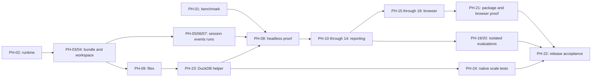

# Pricing Harness — Low-Level Design and Implementation Plan
> **Superseded.** This describes the original HTML-report design, which is retired. For the current workflow see [architecture](../architecture.md).

This original implementation plan is retained as design context. See the [application README](../../README.md) and [verification record](../releases/mac-local-verification-2026-10-07.md) for implementation and acceptance status. The task checkboxes describe the original plan rather than a current progress tracker.

**Goal:** Build a small local application that answers pricing questions from CSV/XLSX data with executed analysis, bundled skills, and useful interactive Plotly reports.

**Architecture:** A Node process embeds Pi and serves a React application. Pi selects packaged pricing and visualization skills, reads workspace context, and uses ordinary file/shell tools to generate analysis scripts and artifacts. Filesystem storage, one active run, and one configured model keep the first release small.

**Tech stack:** TypeScript, Node, Pi SDK, Fastify, React/Vite, Python, DuckDB, pandas/openpyxl, Plotly, Jinja2, Vitest, pytest and Playwright. Docker is used for model acceptance tests only.

**Spec:** [High-level design](HLD.md). This LLD records interfaces and delivery tasks for that design.

**Date:** 7 October 2026. **Status:** Archived implementation plan; consult the verification records for completed checks and remaining acceptance gates.

## Global constraints

- One user, one workspace per server process, one active agent request; bind to `127.0.0.1`.
- First-release application target: macOS only. Model provider: OpenRouter, using its supported Pi provider and server-side API-key configuration.
- First datasets: approximately 2–3 million rows. Capability target: 20–30 million rows. Use disk-backed DuckDB with bounded result extraction; do not load the full large source into pandas or model context.
- Docker is required for automated model acceptance tests, not to run the application. Native macOS performance is measured separately.
- Pi SDK baseline: `@earendil-works/pi-coding-agent` `1.0.4`; Node `>=22.19.0`. Compile the integration against the installed package and commit its lockfile.
- Pricing baseline: plugin `0.2.0`, commit `2da2b3f0257aeaa7f386bfeb828692dc95d7b8d7`; retain its MIT license and complete runtime skill tree.
- Production/browser inventory is exactly seven pricing skills plus `analysis-visualize`; suppress ambient packages, skills, context files and extensions. Pricing-only development/controlled baseline behavior is specified in section 3.3.
- No plugin release polling, startup downloads, installation-time plugin fetch or automatic update. Application releases carry their own skills.
- CSV, XLSX, UTF-8 text and Markdown initially. Local exports are the initial data connection.
- Existing source files stay unchanged. Financial results require executed calculations, stated definitions and visible material exclusions.
- `.pricing/context.md` holds confirmed reusable facts. Findings and unconfirmed assumptions do not become business facts.
- Plotly figures use existing native figure JSON. Reports with charts contain one inline Plotly.js bundle, prepared data and inline styles; they work offline. Table-only reports need no chart library.
- Accounts, authorization services, enterprise audit, shared hosting, a workflow engine, live connectors, PDF export and automatic plugin management remain later work.
- Cloud-model requests can include selected business context and tool results; the application is local, model processing follows the selected provider.
- Ordinary shell tools are not a production operating-system sandbox.

## Review focus

1. Different current directories, spaces in install paths, and incomplete bundled references must not silently change skill loading — PH-03 and PH-05.
2. Lost SSE connections, retries, cancellation and an uncertain HTTP acknowledgement must not duplicate a submitted question — PH-06, PH-07 and PH-16.
3. Ambiguous numeric formats, missing costs and returns must not produce confident but unsupported margins — PH-01 and PH-20.
4. Exactly 500 bps, exactly 50,000 revenue and high-revenue non-outliers must receive the correct independent classifications — PH-01 and PH-20.
5. A renderer failure, missing browser or clipped report must retain valid calculations and avoid a false claim that the HTML was inspected — PH-12, PH-13, PH-14 and PH-20.

## 1. Decisions and clarification register

The HLD already settles the local browser application, Pi, bundled skills without updates, CSV/XLSX inputs, Plotly and HTML. These are carried forward.

Owner-confirmed decisions:

| ID | Answer | Affected work |
|---|---|---|
| Q1 | macOS only. | PH-02 setup/launch scripts; PH-21 package tests. |
| Q2 | OpenRouter. | PH-02 runtime configuration; PH-05 auth resolution; PH-19/20 model settings. |
| Q3 | Initially 2–3 million rows; support target 20–30 million. File sizes have not been supplied. | PH-01 test pack; PH-02 configurable upload cap; PH-23/24 disk-backed analysis and scale checks. |
| Q4 | Docker for acceptance tests only. | PH-19 isolated runner; PH-22 release procedure. |

Follow-up decisions:

| ID | Question | Why it changes the plan |
|---|---|---|
| Q5 | Owner: RAM should be fine; do not overthink hardware sizing. | Use configurable resource defaults and measure actual execution; no separate sizing workstream. |
| Q6 | Large datasets in CSV; smaller Excel inputs. | Full-scale acceptance is CSV. Excel uses bounded batch ingestion and smaller parity cases. |
| Q7 | Require an explicit OpenRouter model ID at launch. | No default model and no silent model fallback. Image support is checked for the selected model. |

No planning question remains unanswered. Actual dataset field mappings, business definitions and new question-specific ambiguities are collected during PH-01 or the relevant analysis; they are deliberately not invented in this LLD.

**HLD refinement:** The owner's scale requirement replaces the HLD's pandas-first/optional-later-DuckDB choice. DuckDB is part of the first release; pandas is reserved for bounded outputs. macOS and OpenRouter also replace earlier platform/provider placeholders. Other HLD constraints remain in force.

Application-internal design choices below are proposals in this LLD: Fastify, the module boundaries, JSON contracts and endpoint error codes. They are engineering choices rather than assumptions about the business. Margin basis, fiscal calendar, currency, exclusions and thresholds are resolved from confirmed context or a chat clarification for each analysis; the application does not impose them.

## 2. Delivery slices and module ownership

Build one vertical slice at a time. The headless runner and browser use the same session factory and run controller.

| Slice | Useful deliverable | Tickets |
|---|---|---|
| A | Reconciled analysis from a real file, without a UI | PH-01–PH-08, PH-23 |
| B | Offline Plotly report with rendering evidence | PH-10–PH-14 |
| C | Local browser chat, file uploads, Stop and report downloads | PH-09, PH-15–PH-18 |
| D | Repeatable acceptance, native scale checks and a documented local installation | PH-19–PH-22, PH-24 |

No microservices, database server, background job queue or chart specification engine is required. DuckDB runs embedded in the agent's Python processes and uses workspace-local files.

```text
pricing-harness/
  package.json, package-lock.json, tsconfig.json, tsconfig.server.json, vite.config.ts
  index.html
  requirements.in, requirements.txt
  src/
    runtime.ts                     Configuration and dependency health
    workspace.ts                   Workspace paths and metadata IO
    files.ts                       Upload registry and artifact registry
    contracts.ts                   Browser/server JSON contracts
    agent/
      bundle.ts                    Inventory, validation and fingerprint
      session.ts                   The only Pi session factory
      events.ts                    Event normalization and snapshot versions
      runs.ts                      Single-run ownership and finalization
    headless.ts                    CLI entry point using the same controller
    server.ts                      Loopback HTTP server and lifecycle
    routes/
      chat.ts                      Session, message, cancellation, SSE, status
      files.ts                     Upload, list and output delivery
    ui/
      App.tsx, Chat.tsx, Composer.tsx, Outputs.tsx
      main.tsx, api.ts, useSession.ts, styles.css
  bundled/
    versions.json
    pricing-plugin/plugin.json, LICENSE, skills/**
    harness-skills/analysis-visualize/
      SKILL.md
      references/chart-selection.md, html-reporting.md
      scripts/plotly_theme.py, report_contract.py
      scripts/render_report.py, preview_report.mjs
      assets/report.html
    harness-tools/
      data_workspace.py            Disk-backed source preparation and query helpers
      data-analysis.md             Operational guidance; not a ninth skill
  tests/
    unit/*.test.ts
    integration/*.test.ts
    python/test_*.py
    browser/*.spec.ts
    perf/generate_scale.py, test_scale.py
    evals/
      cases/*.json                 Prompts and input/context references
      inputs/**                    Small synthetic/non-sensitive cases
      private/**                   Independent expected results; never shipped
      oracle_margin.py             Evaluator-only reference calculations
      run.ts, verify.ts            Runner and post-run checks
      runtime/                     Input-only Docker evaluation packaging
  docs/
    data-dictionary.md, local-setup.md, acceptance.md
```

`src/contracts.ts` contains transport types only. Business formulas live in skills and agent-generated scripts; the evaluator oracle is not a production calculation service. Put machine-readable checks in the owning module's tests rather than creating a broad validation framework.

### Workspace layout

```text
<workspace>/
  .pricing/
    context.md                     Confirmed business facts
    files.json                     Source registry
    outputs.json                   Final artifact registry
    data-cache/<cache-key>/         Reusable DuckDB source caches and metadata
    tmp/<run-id>/                  DuckDB spill files; not final outputs
    sessions/                      Pi-owned persisted sessions
  files/<file-id>/<original-name>   Original bytes, collision-safe paths
  analyses/<run-id>/
    run.json                       Controller-owned reproduction metadata
    analysis.py, results.csv
    figures/*.json, report.json
    previews/preview.json, *.png
  outputs/<run-id>/
    report.html, results.csv, analysis.py
    manifest.json                  Final published artifact declaration
```

The extra registry/manifest files provide identifiers and final-file discovery, not an audit subsystem. No directory name is derived from a browser-supplied path.

## 3. Core contracts

### 3.1 Configuration and startup

`loadConfig(env: NodeJS.ProcessEnv): HarnessConfig` reads workspace, provider, model ID and Python executable from server configuration. Workspace/provider/model/Python must be explicit; there is no fallback to an arbitrary model or business workspace. The default port proposed here is `4317`; binding remains loopback.

```typescript
type HarnessConfig = {
  workspaceRoot: string;           // Absolute, existing or explicitly created
  appRoot: string;                 // Resolved from installed module location
  bundledRoot: string;
  provider: string;
  modelId: string;
  pythonPath: string;              // Explicit interpreter in configured environment
  port: number;
  maxUploadBytes: number;          // Proposed default 2 GiB; one file per request
  duckdbMemoryLimit: string;       // Configurable; proposed default "4GB"
  duckdbThreads: number;
};
type Capability = { ready: boolean; detail: string };
type Health = {
  agent: Capability; python: Capability; reports: Capability;
  preview: Capability; vision: Capability;
};
```

`checkRuntime(config: HarnessConfig): Promise<Health>` uses direct process execution for dependency checks. Agent and Python failures prevent a run. Report dependencies affect reporting; browser/image unavailability is surfaced as a preview limitation rather than preventing a valid numerical answer. Startup checks configured authentication, not an expensive model prompt; a provider can still reject a later request.

The macOS launcher configures the Python environment once. The agent receives the absolute interpreter location and executes that interpreter; it does not install libraries during analysis. Resolve OpenRouter access through the pinned Pi model runtime and pass the same runtime into session creation. Use `OPENROUTER_API_KEY` on the server side or Pi's supported stored API-key configuration. Do not copy credentials into workspace metadata, browser JSON, reports or logs.

Configuration names: `PRICING_WORKSPACE`, `PRICING_PROVIDER`, `PRICING_MODEL`, `PRICING_PYTHON`, `PRICING_PORT`, `PRICING_MAX_UPLOAD_BYTES`, `PRICING_DUCKDB_MEMORY`, `PRICING_DUCKDB_THREADS`. Workspace/model/interpreter are required; provider is explicitly `openrouter` in the documented launch configuration. Model ID is the Pi/OpenRouter catalog ID selected by the owner at launch, not a guessed upstream name. Unknown IDs fail with an actionable message.

Build Node entries into `dist/server.js` and `dist/headless.js` using `tsconfig.server.json`; Vite emits `dist/ui/`. `src/ui/main.tsx` mounts `App` from `index.html`. Source and compiled Node entry files are each one level beneath application root, so bundle/static paths can be resolved relative to module URL in either mode. Direct execution starts the CLI/server; importing their exported functions in tests must not start a process. The dev UI proxies `/api` to the configured loopback port. Required package commands: `dev`, `build`, `start`, `headless`, `typecheck`, `test` and opt-in `test:scale`.

Web-upload limits are configurable and distinct from analytical row limits. Large existing files can be placed under the workspace's `files/` directory and adopted without an HTTP upload or second source-file copy. PH-24 measures disk requirements and makes the practical file-size envelope explicit; row count alone cannot establish it.

Proposed tuning defaults: upload cap `2 GiB` (overridable); DuckDB memory `4GB`; query threads `4`; Excel batch size `50,000` rows. These are transparent implementation choices following the owner's direction to keep sizing simple. They are not promises about arbitrary row widths, available disk or execution time. A larger CSV can be adopted locally and processed without raising the HTTP limit.

### 3.2 Sources, runs and artifacts

```typescript
type SourceFile = {
  id: string; name: string; relativePath: string;
  bytes: number; sha256: string; addedAt: string;
  kind: "csv" | "xlsx" | "text" | "markdown";
};
type RunState = "running" | "cancelling" | "completed" | "cancelled" | "failed" | "interrupted";
type RunRecord = {
  schemaVersion: 1; id: string; sessionId: string; requestId: string;
  state: RunState; startedAt: string; endedAt?: string;
  inputs: Array<Pick<SourceFile, "id" | "relativePath" | "sha256">>;
  selectedFileIds: string[];
  bundleFingerprint: string; provider: string; modelId: string;
  versions: Record<string, string>; error?: { code: string; message: string };
};
type Artifact = {
  id: string; runId: string; name: string; relativePath: string;
  mediaType: string; bytes: number; sha256: string;
};
type PublishedManifest = {
  schemaVersion: 1; runId: string;
  files: Array<{ name: string; mediaType: string }>;
};
```

Use generated UUIDs for file/run/artifact IDs. Resolve every registered path beneath its permitted root and reject traversal and symlink escapes at registration and delivery. Preserve uploaded bytes; do not normalize number/date formats at upload. Original filenames are display labels and sanitized leaf names, never paths.

The controller owns `run.json`. The agent writes analysis results, figures and `report.json`; it must not overwrite controller metadata. Definitions and scope belong in the method notes/report, referenced by `analysis.py`, rather than being inferred by the server. Snapshot hashes for all registered sources available to the run; `selectedFileIds` records explicit attachments. Track any deliberately added analysis sources rather than claiming provenance for arbitrary unregistered external files.

Uploads and a new conversation are rejected while a run is active. This initial constraint keeps the source corpus and session stable. Existing valid outputs remain downloadable.

### 3.3 Session factory

```typescript
type BundleInfo = {
  fingerprint: string; pricingVersion: string; pricingCommit: string;
  visualizationVersion: string; skillPaths: string[]; skillNames: string[];
};
type AgentHandle = {
  session: AgentSession; manager: SessionManager; bundle: BundleInfo;
};
validateBundle(bundledRoot: string, options?: {requireVisualization:boolean}): Promise<BundleInfo>;
createPricingSession(options: {
  config: HarnessConfig; bundle: BundleInfo;
  modelRuntime: ModelRuntime; model: NonNullable<CreateAgentSessionOptions["model"]>;
  fresh: boolean;
}): Promise<AgentHandle>;
```

Use the HLD's explicit `DefaultResourceLoader` paths and in-memory resource settings. Include only `read`, `bash`, `edit`, `write`. Pi supplies skill metadata in the model prompt; skill contents and knowledge references are read when relevant. No separate router needs to select a pricing method.

`requireVisualization` defaults to true. Only the initial CLI development milestone may explicitly use false while PH-10–PH-14 are unfinished; the production browser/package always requires eight skills. The factory loads precisely the validated `BundleInfo` paths/names. This is staged construction, not optional production pricing methods.

Fingerprint sorted relative paths and raw bytes of bundled runtime files plus `versions.json`; include the visualization helpers/template. Absolute install paths do not affect it. Verify exact skill names, metadata, license and referenced resources. Diagnostics, duplicates and missing files are fatal.

Store `harness-bundle` through `SessionManager.appendCustomEntry`. Resume the latest session only when its bundle fingerprint matches; an old session without a fingerprint starts fresh. Preserve old files. A bundle change creates a new session and rebinds event subscriptions. Model selection is explicit: report a mismatch when resuming, use the configured model through Pi's supported model setter, and never silently substitute another provider/model.

### 3.4 Run controller

```typescript
type SubmitRequest = { requestId: string; text: string; fileIds: string[] };
type RunAccepted = { runId: string; sessionId: string; requestId: string };
class RunController {
  constructor(options: {
    config: HarnessConfig; paths: WorkspacePaths; handle: AgentHandle;
    view: EventView; files: FileStore; health: Health;
    createSession: (fresh:boolean)=>Promise<AgentHandle>;
  });
  submit(input: SubmitRequest): Promise<RunAccepted>;
  waitForRun(runId: string): Promise<RunRecord>;
  cancel(): Promise<SessionSnapshot>;
  newSession(): Promise<SessionSnapshot>;
  snapshot(): SessionSnapshot;
  close(): Promise<void>;
}
```

`submit` validates selected IDs, acquires the single-run guard before asynchronous work, takes fresh source hashes, creates run directories/metadata, attaches events, and starts `session.prompt` in an observed background promise. Return acceptance once ownership is established; do not wait for the analysis to finish. Release the guard only in finalization. A source changed by the owner before a run gets its current hash/cache key; a change during the run is `SOURCE_CHANGED`.

Add a small operational prefix to the user prompt: run ID, analysis/output directories, selected source paths, Python interpreter and preview capability. Read `.pricing/context.md` where present and ask about unresolved definitions. Do not inject dataset rows or all skill contents. Use Pi prompt options that avoid interpreting user text as extension commands.

The operational instructions also declare output publication: for a CSV/script-only answer, save completed files under `outputs/<run-id>/` and write the section 3.2 `manifest.json` using ordinary file tools. A report helper does this for HTML. If HTML generation fails, valid CSV/script deliverables can still be published independently; scratch files are retained under `analyses/`. No pricing-specific tool or result database is introduced.

`agent_end` alone does not finish a run: Pi can retry. Wait for the prompt lifecycle to settle; cancellation awaits `session.abort()`/idle. A finalizer runs once, updates metadata, checks source hashes, registers complete published artifacts and emits the authoritative snapshot. A changed source hash marks the run failed with `SOURCE_CHANGED` and a visible message; do not claim unchanged inputs or silently restore files.

An ordinary question to the user ends the current turn as completed; the user's answer is another run in the same conversation. No questionnaire state machine is needed.

Keep request-ID deduplication in memory for the server process: replaying the same request returns the original acceptance, while a different request during work returns `BUSY`. After a process restart, do not auto-resubmit an uncertain request. Mark a persisted running/cancelling run interrupted and show the retained transcript/files; automatic job recovery is outside this release.

Store the pending acceptance promise by request ID when acquiring the guard, before any asynchronous source hashing. A duplicate request can then await the same acceptance. If preflight fails, reject that promise, clear its pending entry and release the guard; a missing file must not leave the application permanently busy.

### 3.5 Streaming and snapshot contract

```typescript
type ChatMessage = { id: string; role: "user" | "assistant"; text: string; complete: boolean };
type SessionSnapshot = {
  serverInstanceId: string; sequence: number; sessionId: string;
  busy: boolean; activeRun: RunRecord | null;
  runs: RunRecord[];               // Workspace history; includes terminal outcomes
  messages: ChatMessage[]; artifacts: Artifact[];
};
type HarnessEvent = {
  serverInstanceId: string; sequence: number;
  sessionId: string; runId: string | null;
} & (
  | {type:"hello"; payload:{sequence:number}}
  | {type:"message"; payload:ChatMessage}
  | {type:"tool"; payload:{callId:string; name:string; state:"running"|"completed"|"error"; summary:string}}
  | {type:"status"; payload:{phase:"running"|"retrying"|"compacting"|"cancelling"; detail:string}}
  | {type:"error"; payload:{code:string; message:string; retryable:boolean}}
  | {type:"settled"; payload:{snapshot:SessionSnapshot}}
);
```

Publish full current message text in `message` events, keyed by message ID, rather than making the browser reconstruct deltas. Normalize Pi message updates into this view. Persisted transcript projection comes from the active Pi session branch; tool results/thinking are not rendered as chat messages. Keep in-flight text in the controller view until Pi has persisted the completed message.

Increment sequence after updating the authoritative state and before publishing. `tool` payloads contain call ID, tool name, running/completed/error status and a bounded text summary; a UI summary cap of 4,096 characters does not change the tool result supplied to the model. `status` describes retries, compaction or cancellation. No pricing-specific progress percentages are invented.

The browser opens SSE and buffers events, fetches a snapshot, applies it, then applies buffered events whose sequence is greater than the snapshot. Session/instance changes replace the view; duplicates are ignored. Reconnect repeats this handshake. SSE heartbeats keep the connection alive; no durable event replay store is needed. Reconnection never calls `POST /api/messages`.

### 3.6 HTTP contracts

All errors use `{error:{code,message,retryable}}`; no stack traces or credential values reach the browser.

| Route | Request / success | Defined failures |
|---|---|---|
| `GET /api/session` | `200 SessionSnapshot` | `503 NOT_READY` during failed setup. |
| `POST /api/messages` | `SubmitRequest` → `202 RunAccepted` | `400 INVALID_REQUEST`, `404 FILE_NOT_FOUND`, `409 BUSY`, `503 NOT_READY`. |
| `GET /api/events` | `text/event-stream`; initial hello, then events | Disconnection triggers browser handshake. |
| `POST /api/cancel` | Empty body → `200 SessionSnapshot` after abort/idle | Idle cancellation is a successful no-op. |
| `POST /api/session/new` | Empty body → `200 SessionSnapshot` | `409 BUSY`. |
| `POST /api/files` | Multipart field `file`, one file → `201 SourceFile` | `400 INVALID_FILE`, `413 FILE_TOO_LARGE`, `415 UNSUPPORTED_FORMAT`, `409 BUSY`. |
| `GET /api/files` | `200 {files:SourceFile[]}` | Registry IO failure is visible. |
| `GET /api/outputs` | `200 {artifacts:Artifact[]}` | Only registered final files are listed. |
| `GET /api/outputs/:id` | File bytes; `?download=1` sets attachment | `404 OUTPUT_NOT_FOUND`; invalid/escaped paths rejected. |
| `GET /api/status` | Workspace display, model ID, versions, eight skill names, `Health` | No secrets or credential filenames. |

Stream uploads to a temporary file; enforce the byte limit during streaming; hash; atomically rename; update registry. Remove temporary files on a failed upload. Registry writes are serialized and atomic. Do not read entire transaction files into Node memory to profile them.

## 4. Plotly/reporting contracts

### 4.1 Figure creation and units

The agent writes task-specific Python using DuckDB for large-source queries and pandas/Plotly for checked smaller results. openpyxl supports smaller Excel inputs. The harness does not ship a fixed margin-analysis engine. Only bounded result tables are materialized in pandas/Plotly; the PH-23 data helper manages raw staging and resource limits without deciding financial definitions or business mappings.

`apply_theme(fig: plotly.graph_objects.Figure) -> plotly.graph_objects.Figure` applies shared typography, palette, grid/hover styles and responsive defaults. Proposed defaults are system sans-serif, 14 px body text, white background, light `#E2E8F0` gridlines, and series palette `#2563EB`, `#0D9488`, `#7C3AED`, `#D97706`, `#64748B`; no animation. Use blue/orange plus labels for signed deviation rather than colour alone. Explicit analytical settings such as diverging scale, reference lines and zero-centered axes remain figure responsibilities. HTML export enables Plotly responsiveness and hides the Plotly logo; ordinary zoom/legend controls remain available.

The visualization skill selects line/bar/scatter/heatmap according to the decision, labels scope and missingness, preserves full requested results in CSV and uses supported benchmarks. Fractional margin `0.30` displays as `30%`; deviation `500` displays as `500 bps`; missing is not zero. Classification uses unrounded values. Selecting a product/year never silently changes the benchmark population.

### 4.2 Report JSON

Paths are relative to the directory containing `report.json`; they must resolve inside that analysis run. To reuse previous-run results, copy the relevant checked artifacts into the current run first.

```typescript
type ColumnFormat =
  | {kind:"text"}
  | {kind:"integer"}
  | {kind:"number" | "percent" | "bps"; decimals:number}
  | {kind:"currency"; decimals:number; currency:string};
type ReportSpec = {
  schemaVersion: 1; title: string; scope: string; findings: string[];
  charts: Array<{
    id: string; figure: string; caption: string; qualifications: string[];
  }>;
  tables: Array<{
    id: string; csv: string; caption: string; maxRows: number;
    columns: Array<{key:string; label:string; format:ColumnFormat}>;
  }>;
  limitations: string[];
  method: {notes:string; script:string; definitions:string[]};
};
```

`load_report(path: pathlib.Path) -> ValidatedReport` checks schema version, required fields, unique IDs, format parameters, CSV columns and readable figure/script files. `maxRows` must be positive; truncation is labelled with displayed/total row counts. Unknown required semantics are an error, not a guessed format. Validate Plotly JSON with Plotly's native parser. No failed chart/table is silently dropped.

Chart/table IDs match `[A-Za-z][A-Za-z0-9_-]{0,63}` and are unique across the report. Formatting decimal counts are explicit nonnegative integers; output tables contain canonical computed numeric values, not unresolved source-format strings. Native Plotly data and table values must agree with their checked result source.

### 4.3 HTML publication

`render_report(report_path: Path, output_path: Path) -> PublishedManifest` implements the HLD CLI. Apply the packaged theme; render figures with `plotly.io.to_html(full_html=False)`, including Plotly.js once for the first figure, including it zero times for subsequent figures; use deterministic figure IDs from the validated IDs. Table-only HTML needs no Plotly bundle. No external fonts, scripts, images or chart services are required.

Jinja autoescaping protects all plain-text fields and table labels/cells. Only library-produced chart fragments are treated as HTML. Visible report sections: title/scope, findings, charts/tables, limitations and method. Export the complete referenced CSV files and calculation script alongside HTML, preserving unique filenames and declaring them in `manifest.json`.

Write new artifacts through temporary files and atomic renames; publish the manifest last. The artifact registry accepts only a complete manifest with existing allowed files, valid paths and hashes. A failed render does not replace an existing valid report and creates no new final manifest. Registry listings exclude `.partial` files and arbitrary scratch files.

The exported HTML includes displayed table data and prepared chart data. It is independently viewable; the complete CSV and script remain companion downloads. No promise of cross-chart linked filters or live queries is made. Plotly hover/zoom/legend interaction works; selectors are implemented with prepared traces when a task benefits from them.

### 4.4 Rendered inspection

`previewReport(input: string, outputDir: string): Promise<PreviewResult>` backs the packaged Node CLI. It opens the actual HTML in Chromium, waits for every expected chart to render, captures page/console errors and section screenshots, and writes `preview.json` with paths and diagnostics. A missing browser produces `unavailable`; a broken report produces `failed`; a clean render produces `rendered`.

Automated preview does not claim visual approval. The agent reads screenshots through Pi's image-capable file tool and corrects material clipping, labels, units or misleading encodings. If model vision/browser access is missing, it states that limit and returns the available output. Release tests cover desktop and narrow widths plus hover, legend and any selector present.

### 4.5 Disk-backed data helper

Define Python dataclasses: `ImportOptions(format: Literal["csv","xlsx"], header_row: int = 1, delimiter: str|None = None, encoding: str = "utf-8", sheet: str|None = None)`; `PreparedSource(database_path: Path, source_sha256: str, row_count: int, column_mapping: dict[str,str], import_options: ImportOptions, data_tool_version: str, duckdb_version: str)`. CSV delimiter detection can identify structure; financial number/date meaning still requires inspection. A cache key combines source hash, options and ingestion-helper/DuckDB versions; changed inputs invalidate it. The cache is a replaceable speed improvement, not the authoritative source.

Use raw VARCHAR staging for CSV. Malformed CSV/header problems fail visibly. Inspect nulls, failed casts, date coverage and join cardinality before creating typed SQL views; use an explicit monetary scale supported by confirmed source precision. No automatic business-column mapping or population filtering belongs in the helper.

`fetch_small_result(conn, sql: str, max_rows: int = 100_000) -> pandas.DataFrame` checks the bound and raises an explicit result-too-large error rather than returning an accepted truncated population. Larger complete results are streamed to CSV with DuckDB `COPY`; the agent can separately prepare a labelled chart overview. `connect_analysis` configures memory/thread limits and `temp_directory`; source caches attach read-only. Clean spill files after connections close; keep failed-run evidence and reusable caches. Disk exhaustion/locking errors return useful messages rather than an incomplete cache.

Excel sheet selection follows inspected data/context; multiple data sheets are not silently collapsed or ignored. Use read-only ingestion in 50,000-row batches; preserve missing values. Formula cells without cached values remain unresolved, and no Excel recalculation engine is installed. The full 30m scale promise covers CSV only.

## 5. Business data and test protocol

The margin question is a benchmark scenario, not a harness API. PH-01 freezes its accounting/calendar/currency choices with the owner before deriving an oracle. Other user questions can choose a different valid basis.

For a confirmed gross-margin benchmark:

```text
product_margin = (product_revenue - product_COGS) / product_revenue
group_margin = (sum(revenue) - sum(COGS)) / sum(revenue)
deviation_bps = 10000 * (product_margin - group_margin)
outlier = abs(deviation_bps) >= 500
detail_needed = product_revenue > 50000
```

Group margin is computed from totals, not the simple mean of product percentages. Outlier and detail selections are independent. Use exact Decimal/scaled-integer comparisons for boundary checks; display rounding cannot alter a flag. Missing costs require a supported subset with disclosed coverage, or a clarification; do not treat them as zero. Zero/negative revenue denominators require an explicitly qualified treatment.

The first test pack contains 10–15 small cases plus a representative real-data smoke case. Use independent arithmetic, versioned inputs/context, scripted replies where needed, and the same production session factory. Docker supplies an input-only runtime; answer keys and previous reports stay outside the solver's accessible filesystem. Performance tests exercise native macOS separately.

Compare raw monetary aggregates at the source's confirmed precision (for a two-decimal currency, within `0.01`); compare rates at absolute tolerance `1e-10` and bps at `1e-6`. Exact boundaries and population membership are exact checks. Where source precision differs, record a different monetary tolerance in the case rather than globally rounding the source.

Automatic checks cover CSV values, reconciliation, expected IDs/flags, chart data, referenced files, offline rendering and interactions. Manual review covers unsupported claims, necessary clarifications, chart choice, readable screenshots and usefulness. Preserve the executable script and recorded version combination for reproduction.

All critical numerical, scope, unit, context and artifact checks must pass. Test the visualization skill both absent and present using the same cases/settings. For this development-only comparison, the evaluator explicitly selects the pricing-only inventory for the baseline; it is not a production setting. Repeat critical model cases three times for a proposed release. Small changes use a smoke subset; material skill/runtime/model/reporting changes run the full suite. A model-generated answer key is never the oracle.

### Evaluation types

Define these in `tests/evals/spec.ts` (PH-01), extending runtime-result types in PH-19. They remain development-only:

```typescript
type EvalCase = {
  id: string; inputDir: string; contextFile?: string;
  turns: Array<{text:string; expectClarification:boolean}>;
  csvChecks: Array<{file:string; keyColumns:string[]; valueColumns:string[]}>;
  chartChecks: Array<{figure:string; trace:number; table:string; xColumn:string; yColumn:string}>;
  reviewCriteria: string[]; critical: boolean;
};
type EvalConfig = {modelId:string; outputDir:string; repeats:number};
type EvalRunResult = {
  caseId:string; workspaceDir:string; runs:RunRecord[];
  messages:ChatMessage[]; tracePath:string; durationMs:number;
  versions:Record<string,string>;
};
type CheckResult = {name:string; passed:boolean; detail:string};
type EvalVerdict = {
  passed:boolean; automatic:CheckResult[];
  manual:Array<{criterion:string; decision:"pass"|"fail"|"unreviewed"; notes:string}>;
};
```

A verdict with an unreviewed critical criterion is pending, never PASS. Compare normalized native figure values, including Plotly's supported array encodings, with specified checked table columns. Record effective model settings and usage/cost when available; missing cost metadata is not invented. Do not use an exact wording match as a substitute for reviewing clarification/reasoning quality.

## 6. Jira backlog

Each PH identifier is a proposed Jira issue reference, not an issue created in Jira. Each ticket supplies scope, files, interface, acceptance, a failing-test cycle, dependencies and a commit-sized deliverable. Add estimates after the real-data baseline; none of these tasks requires enterprise infrastructure. The [companion CSV](Jira-Backlog.csv) contains one row per ticket for copying/importing into Jira; proposed references/dependencies stay in descriptions until mapped to actual issue keys.

Common verification conventions: TypeScript unit/integration tests use `npm test -- <test-path>`; Python uses the configured interpreter with `-m pytest`; browser tests use `npx playwright test <test-path>`. During first-time test setup, a missing runner is setup failure, not the intended red test. The first intended failure must identify the unimplemented behavior. A ticket completes only when its stated check and `npm run typecheck` where applicable pass.

### PH-01 — Freeze the first data dictionary and independent benchmark pack

**Type / priority:** Task / P0. **Dependencies:** Real-data access and owner confirmation of its definitions during execution. **Deliverable:** A reviewed definition of correct results before model/UI work.

**Files:** Create `docs/data-dictionary.md`, `tests/evals/spec.ts`, `tests/evals/cases/margin-baseline.json`, `tests/evals/cases/margin-boundaries.json`, `tests/evals/inputs/weighted.csv`, `tests/evals/inputs/boundaries.csv`, `tests/evals/private/margin-expected.json`, `tests/evals/oracle_margin.py`, `tests/python/test_oracle_margin.py`.

**Interfaces:** `loadCase(path: string): Promise<EvalCase>` validates case identity, prompt/turns, input/context paths and requested output schema. `compute_margin_oracle(rows: list[dict[str,str]]) -> list[dict]` is evaluator-only. A case's solver input contains no oracle path or expected values.

**Acceptance:** Dictionary names actual row grain, raw columns, revenue/cost meaning, product identifiers/historical group mappings, sign treatment, number/date format, calendar, currency and known gaps. Confirm the benchmark's annual/cumulative choices and reference date with the owner; do not apply them globally. Independent expected totals reconcile. The weighted fixture contains revenues 10,000/90,000 and margins 50%/25%, giving 27.5% group margin. The boundary fixture has `(revenue,COGS)` A `(50000,32500)`, B `(50001,37500.75)`, C `(1,0.65)`, giving exactly 30% group margin. Additional real-data questions and expected outputs are agreed as part of benchmark preparation.

- [ ] Write `test_weighted_and_boundary_oracle`: assert group margin `Decimal("0.275")`; boundary deviations A `500`, B `-500`; A outlier true/detail false; B outlier true/detail true. Cross-check this fixture independently in a spreadsheet or hand calculation.
- [ ] Run `python -m pytest tests/python/test_oracle_margin.py -q`; expect failure because the oracle is absent.
- [ ] Implement the evaluator oracle and case loader, save independent keys outside solver inputs, and obtain confirmation of real-data definitions in the dictionary.
- [ ] Run the same command; expect all assertions to pass. Review input/expected segregation and dictionary confirmation.
- [ ] Commit as `test: define independent pricing benchmark pack`.

### PH-02 — Configure and verify one local runtime

**Type / priority:** Task / P0. **Dependencies:** None; planning choices are confirmed. **Deliverable:** Explicit configuration and actionable setup health.

**Files:** Create `package.json`, `package-lock.json`, `tsconfig.json`, `tsconfig.server.json`, `requirements.in`, `requirements.txt`, `src/runtime.ts`, `docs/local-setup.md`, `tests/unit/runtime.test.ts`. Fold TypeScript/Vitest/pytest setup into this ticket.

**Interfaces:** Produce `loadConfig(env): HarnessConfig`, `checkRuntime(config): Promise<Health>`, and `resolveModel(config): Promise<{runtime:ModelRuntime; model:NonNullable<CreateAgentSessionOptions["model"]>}>`. Use Pi `ModelRuntime` and `ModelRegistry`, not a second provider client.

**Acceptance:** Explicit workspace/OpenRouter model/Python; missing credentials/config gives a useful error. SDK pinned to `1.0.4`; Node `>=22.19.0`, macOS Python environment documented. Lock resolved compatible Python dependencies, Node dependencies and Playwright version, recording actual versions. Use documented configurable upload/DuckDB defaults. Browser/vision missing is distinguishable from analysis readiness. A wrong provider/model fails rather than silently falling back. Secrets remain server-side.

- [ ] Write `requiresExplicitModelAndPython` with missing provider/model/Python rejected, and `keepsAnalysisReadyWithoutPreview` asserting `agent.ready === true`, `python.ready === true`, `preview.ready === false` for a stubbed missing browser. Assert returned status contains no API key.
- [ ] Run `npm test -- tests/unit/runtime.test.ts`; expect the readiness/config assertions to fail.
- [ ] Implement config validation, direct-exec dependency probes and Pi model/auth resolution; document the owner-selected platform/provider setup and commit exact locks.
- [ ] Run the same command and `npm run typecheck`; expect PASS. Run dependency health on the chosen platform.
- [ ] Commit as `feat: configure a verified local analysis runtime`.

### PH-03 — Vendor and validate the fixed skill bundle

**Type / priority:** Task / P0. **Dependencies:** PH-02. **Deliverable:** A deterministic, complete runtime bundle.

**Files:** Create `bundled/versions.json`, `bundled/pricing-plugin/{plugin.json,LICENSE,skills/**}`, `src/agent/bundle.ts`, `tests/unit/bundle.test.ts`; modify packaging allowlist in `package.json`. The visualization tree arrives in PH-10–PH-14.

**Interfaces:** `validateBundle(bundledRoot, options?): Promise<BundleInfo>` from section 3.3. Pricing-only validation is available for the initial headless milestone and the controlled skill comparison; the production release requires all eight skills.

**Acceptance:** Copy the complete reviewed pricing runtime tree and preserve relative references. Verify seven exact pricing entry points and later exactly eight total. Missing shared files, invalid metadata and duplicate names fail. Hash runtime contents, not absolute paths. Package excludes evaluator material, workspace context and prior outputs. No code polls GitHub or downloads skills on startup/install.

- [ ] Write `fingerprintIsPortableAndChangesWithSkillBytes`: copy the same bundle into two temporary directories, assert equal fingerprints, edit one skill, assert inequality. Write `rejectsMissingKnowledgeAndDuplicateSkill`, including `pricing-intake/references/context-outline.md`.
- [ ] Run `npm test -- tests/unit/bundle.test.ts`; expect validation/fingerprint failures.
- [ ] Implement bundle validation/fingerprinting and a build copy step rooted at the installed module. Record pricing commit/version and application-owned visualization version.
- [ ] Run the same command and inspect `npm pack --dry-run --json`; expect tests to pass and only runtime assets in the package.
- [ ] Commit as `feat: bundle pricing skills without automatic updates`.

### PH-04 — Initialize a workspace without changing its business data

**Type / priority:** Task / P0. **Dependencies:** PH-02. **Deliverable:** Stable directories, confirmed context and atomic metadata IO.

**Files:** Create `src/workspace.ts`, `src/contracts.ts`, `tests/unit/workspace.test.ts`.

**Interfaces:** `openWorkspace(root: string): Promise<WorkspacePaths>` returns absolute `root`, `pricing`, `files`, `analyses`, `outputs`, `sessions` paths. `writeJsonAtomic(path: string, value: unknown): Promise<void>` writes metadata safely. Define transport types from section 3.

**Acceptance:** Create absent directories and an empty context outline containing no invented facts. Preserve existing context and files byte-for-byte. Allow supported pre-existing files beneath `files/`; upload-ID subdirectories are not required for manually supplied files. Application root and business workspace remain separate. Validate root resolution; do not follow a source/output symlink outside its permitted root.

- [ ] Write `reopenPreservesContextAndSources`: open a workspace twice and assert context/source hashes unchanged. Write `atomicJsonRetainsOldValueOnWriteFailure` and `rejectsEscapedWorkspacePath`.
- [ ] Run `npm test -- tests/unit/workspace.test.ts`; expect directory/preservation behavior to fail.
- [ ] Implement workspace initialization and atomic JSON replacement; expose the shared contract types without domain formulas.
- [ ] Run the same command and `npm run typecheck`; expect PASS with a workspace path containing spaces.
- [ ] Commit as `feat: initialize and preserve a pricing workspace`.

### PH-05 — Create and resume the explicitly wired Pi session

**Type / priority:** Task / P0. **Dependencies:** PH-02–PH-04. **Deliverable:** The single factory used by CLI, browser and evaluation.

**Files:** Create `src/agent/session.ts`, `tests/integration/session.test.ts`; modify `src/agent/bundle.ts` only to expose the explicit development inventory.

**Interfaces:** Consume `HarnessConfig`, `BundleInfo`, resolved `ModelRuntime/model`, `WorkspacePaths`; produce `createPricingSession(options): Promise<AgentHandle>` from section 3.3. Return the session manager so transcript projection reads Pi's persisted active branch.

**Acceptance:** Explicit resource settings suppress ambient skills/extensions/packages/context. Use exact bundled paths and four tool names. Skill metadata is advertised; complete skills are read on demand. Same fingerprint resumes the latest conversation; changed/missing fingerprint starts fresh and retains history/context. Configured model is verified rather than silently replaced. Exactly eight production skills after PH-14.

- [ ] Write `loadsOnlyBundledSkillsFromAnotherCwd` with an unrelated ambient skill present; assert loaded pricing names match the seven-entry list. Write `changedBundleStartsFreshWithoutDeletingHistory`, asserting same-fingerprint session ID reuse and changed-fingerprint ID inequality.
- [ ] Run `npm test -- tests/integration/session.test.ts`; expect factory/resume assertions to fail.
- [ ] Implement the HLD loader/settings/manager wiring, pass the resolved model runtime, append `harness-bundle`, and compile against SDK `1.0.4`.
- [ ] Run the same command and `npm run typecheck`; expect PASS without making a live model request. Extend the inventory assertion to eight in PH-14.
- [ ] Commit as `feat: wire bundled skills into a persistent Pi session`.

### PH-06 — Normalize Pi events and make snapshots authoritative

**Type / priority:** Task / P0. **Dependencies:** PH-04, PH-05. **Deliverable:** A small transport-independent event view.

**Files:** Create `src/agent/events.ts`, `tests/unit/events.test.ts`; modify `src/contracts.ts` with narrowed event payloads.

**Interfaces:** `createEventView(handle: AgentHandle, initial: {runs:RunRecord[]; artifacts:Artifact[]}): EventView`; `EventView.snapshot(): SessionSnapshot`, `subscribe(listener: (event: HarnessEvent)=>void): ()=>void`, `setRun(run: RunRecord): void`, `settleRun(run: RunRecord, artifacts: Artifact[]): void`, `dispose(): void`. Terminal runs remain in history while `activeRun` becomes null.

**Acceptance:** Subscribe before prompts. Message events contain the latest full text under a stable ID; UI does not receive thinking/raw dataset output. Pi retry/compaction status remains active. Sequences reflect already-applied state. Transcript uses the active session branch and retains pre-compaction visible conversation. Bounded UI summaries do not alter model-visible tool output. Rebinding disposes the old subscription.

- [ ] Write `retryDoesNotEmitSettledOnAgentEnd`: feed `agent_end` with `willRetry:true`, assert no terminal event. Write `snapshotSequenceIncludesPublishedMessage`, and `summariesAreBoundedWithoutMutatingToolResults`, asserting the display cap of `4096` characters.
- [ ] Run `npm test -- tests/unit/events.test.ts`; expect event/view assertions to fail.
- [ ] Implement the SDK event adapter, transcript projection and monotonic event sequencing; expose final state only when the controller finalizes.
- [ ] Run the same command and `npm run typecheck`; expect PASS for message replacements, retry, compaction and subscription disposal.
- [ ] Commit as `feat: expose consistent agent events and snapshots`.

### PH-07 — Own one run, cancellation and reproduction metadata

**Type / priority:** Task / P0. **Dependencies:** PH-02, PH-04–PH-06, PH-09. **Deliverable:** Correct run ownership independent of HTTP.

**Files:** Create `src/agent/runs.ts`, `tests/unit/runs.test.ts`; modify `src/agent/session.ts` to support fresh-session rebinding.

**Interfaces:** Produce `RunController` methods/constructor from section 3.4. Consume `AgentHandle`, `EventView`, workspace paths and the PH-09 file/artifact service. Unit tests stub the session/model, not a missing application module.

**Acceptance:** Acquire the guard synchronously; pending acceptance and prompt promises are observed. Record model, runtime/bundle versions, source IDs/hashes and lifecycle in `run.json`. Same request ID reuses acceptance; a different concurrent request returns `BUSY`. Failed preflight clears the guard. Cancel waits for Pi idle; finalization occurs once. Provider/tool failure returns a useful error. New conversation is idle-only. Process restart marks unfinished runs interrupted; no automatic rerun or rollback.

- [ ] Write `onlyOneConcurrentSubmissionIsAccepted`, asserting one prompt invocation and one `BUSY`. Write `sameRequestDoesNotPromptAgain` with delayed source hashing, `failedPreflightReleasesGuard`, `cancelWaitsForIdle`, `earlyAgentEndDoesNotReleaseGuard`, and `changedSourceFailsFinalization` with code `SOURCE_CHANGED`.
- [ ] Run `npm test -- tests/unit/runs.test.ts`; expect ownership/cancellation assertions to fail.
- [ ] Implement operational prompt construction, lifecycle guard, request-ID map, finalizer, metadata updates and session rebinding. Observe rejected prompt promises; await cleanup on close.
- [ ] Run the same command and `npm run typecheck`; expect PASS, including cancellation during a retry and retained partial calculations.
- [ ] Commit as `feat: manage one reproducible cancellable agent run`.

### PH-08 — Prove the first headless pricing analysis

**Type / priority:** Story / P0. **Dependencies:** PH-01–PH-07, PH-09, PH-23. **Deliverable:** A real question produces executed, reconciled results before UI development.

**Files:** Create `src/headless.ts`, `tests/integration/headless.test.ts`; modify `docs/local-setup.md` and package scripts.

**Interfaces:** `runHeadless(config: HarnessConfig, input: SubmitRequest): Promise<RunRecord>` uses the production factory/controller, waits for finalization and closes its subscriptions. CLI accepts explicit workspace and question; selected files are resolved through the same registry.

**Acceptance:** Question reads appropriate pricing skill/context, profiles actual data and invokes configured Python. Results CSV and reproducible script are saved. Context clarification is ordinary chat: unconfirmed margin/calendar facts are asked, confirmed replies reused, findings not silently persisted. Existing analysis can answer simply without forced charts. Validate the baseline against the PH-01 oracle rather than plausible prose.

- [ ] Write `headlessUsesProductionFactoryAndPreservesSources`, using a fake Pi turn to assert factory/controller reuse and unchanged source hashes. Define live `margin-baseline` evidence checks for script execution, group margin and full qualifying/outlier populations.
- [ ] Run `npm test -- tests/integration/headless.test.ts`; expect entry-point wiring to fail.
- [ ] Implement the headless entry point and output/status printing with secrets omitted; execute the real benchmark after PH-01 definitions are confirmed, using an explicit configured OpenRouter model ID.
- [ ] Run the unit/integration command; expect PASS. Run the live baseline and independently review arithmetic before calling this milestone complete.
- [ ] Commit as `feat: run pricing analysis headlessly through the harness`.

### PH-09 — Register sources and serve validated final artifacts

**Type / priority:** Task / P0. **Dependencies:** PH-02, PH-04. **Deliverable:** File identity and safe browser delivery; PH-12 later exercises publication through the report helper.

**Files:** Create `src/files.ts`, `src/routes/files.ts`, `tests/integration/files.test.ts`; modify `src/contracts.ts` if needed for file route types.

**Interfaces:** `openFileStore(paths: WorkspacePaths, options:{maxUploadBytes:number}): Promise<FileStore>`; `FileStore.listSources(): SourceFile[]`, `saveUpload(stream: Readable, name: string): Promise<SourceFile>`, `resolveSources(ids: string[]): SourceFile[]`, `snapshotSources(): Promise<SourceFile[]>`, `checkSourcesUnchanged(inputs: RunRecord["inputs"]): Promise<string[]>`, `registerPublishedRun(runId: string): Promise<Artifact[]>`, `listArtifacts(): Artifact[]`, `resolveArtifact(id: string): Promise<Artifact>`. `snapshotSources` refreshes current hashes/registry; the unchanged check returns changed/missing IDs without rewriting the run record. `registerFileRoutes(app: FastifyInstance, store: FileStore, isBusy: ()=>boolean): void`.

**Acceptance:** Adopt supported existing files under `files/` without moving them; initial discovery runs on startup. Newly placed local files can be picked up on restart rather than introducing a watcher. Upload with opaque ID, retained bytes/hash, size cap, extension check and collision-safe path. One file per request. JSON registry persists IDs across restart; fresh snapshots observe pre-run content changes. Serve registered outputs only; a complete valid manifest is required. Reject path/symlink escape, missing file and oversized upload. Busy rejects new uploads, not downloads. Never list `.partial` files.

- [ ] Write `sameFilenameGetsDifferentIdsAndOriginalBytes`, `oversizedUploadLeavesNoFinalFile`, `rejectsTraversalAndSymlinkEscape`, and `onlyManifestFilesBecomeArtifacts`, asserting `413`, no partial registration and stable IDs after reopen.
- [ ] Run `npm test -- tests/integration/files.test.ts`; expect storage/route assertions to fail.
- [ ] Implement streamed uploads, initial source discovery, atomic serialized registries, manifest validation and opaque-ID response streaming.
- [ ] Run the same command and `npm run typecheck`; expect PASS with a large streamed test file and two identical display filenames.
- [ ] Commit as `feat: register workspace inputs and deliver final artifacts`.

### PH-10 — Package a small Plotly theme and useful figure examples

**Type / priority:** Task / P0. **Dependencies:** PH-02. **Deliverable:** Consistent appearance without a second charting API.

**Files:** Create `bundled/harness-skills/analysis-visualize/scripts/plotly_theme.py`, `bundled/harness-skills/analysis-visualize/references/chart-selection.md`, `tests/python/test_plotly_theme.py`.

**Interfaces:** `apply_theme(fig: go.Figure) -> go.Figure`. The reference demonstrates native Plotly line, sorted horizontal deviation bar, revenue/deviation scatter and heatmap, using already calculated values.

**Acceptance:** Shared typography/palette/grid/hover, responsive width, no default animation. Threshold/benchmark lines remain analytically explicit. Percentage axes use fractional data; bps axes use numeric bps. Missing points remain gaps; diverging scales are centered appropriately. No hundreds-of-lines default or hidden benchmark recalculation. Example snippets are instructional, not a mandatory chart sequence.

- [ ] Write `test_theme_preserves_data_and_units`: use `[0.30, None, 0.35]`, assert data unchanged, missing preserved and percent tick formatting retained after theme application. Assert an explicit zero-centered colour scale is not removed.
- [ ] Run `python -m pytest tests/python/test_plotly_theme.py -q`; expect missing/theme behavior to fail.
- [ ] Implement the single theme function and the chart-choice reference with captions, qualifications, full-table preservation and prepared-data interactions.
- [ ] Run the same command; expect PASS. Review actual Plotly examples with the PH-13 browser helper when it becomes available.
- [ ] Commit as `feat: add a focused Plotly theme and chart guidance`.

### PH-11 — Validate the report description and its referenced evidence

**Type / priority:** Task / P0. **Dependencies:** PH-02, PH-10. **Deliverable:** A small checked input to the HTML renderer.

**Files:** Create `bundled/harness-skills/analysis-visualize/scripts/report_contract.py`, `bundled/harness-skills/analysis-visualize/references/html-reporting.md`, `tests/python/test_report_contract.py`.

**Interfaces:** Produce `load_report(path: Path) -> ValidatedReport` from section 4.2. `ValidatedReport` holds the validated content, resolved run-root paths, native loaded figures and table schemas; it makes no claim that the financial calculation is correct.

**Acceptance:** Version `1`, exact required fields, unique chart/table IDs, explicit formatting/currency, positive display limits and existing CSV columns. All paths remain inside the analysis run. Required figure/script/table failure is fatal and names the failing reference. Native Plotly schema is accepted, not translated into a new DSL. Unknown JSON fields are rejected to expose spelling errors.

- [ ] Write `test_rejects_missing_figure_column_and_escape`, covering nonexistent figure, column `margin_typo`, `../other-run/results.csv`, duplicate ID, `maxRows=0` and unknown schema version. Assert each fails with its field/path named; a valid two-chart description passes.
- [ ] Run `python -m pytest tests/python/test_report_contract.py -q`; expect loader/validation to fail.
- [ ] Implement lightweight typed validation with ordinary Python structures and Plotly parsing; document the exact report fields and helper arguments.
- [ ] Run the same command; expect PASS and no silent omission of a referenced chart/table.
- [ ] Commit as `feat: validate report inputs and evidence references`.

### PH-12 — Render and publish self-contained interactive HTML

**Type / priority:** Story / P0. **Dependencies:** PH-09–PH-11. **Deliverable:** An offline report and complete companion downloads.

**Files:** Create `bundled/harness-skills/analysis-visualize/scripts/render_report.py`, `bundled/harness-skills/analysis-visualize/assets/report.html`, `tests/python/test_render_report.py`; modify `src/files.ts` only if publication validation needs correction.

**Interfaces:** `render_report(report_path: Path, output_path: Path) -> PublishedManifest`; CLI `python <skill-root>/scripts/render_report.py --report <analysis-run>/report.json --output <output-run>/report.html`. Consume `load_report` and `apply_theme`; emit section 3.2 manifest.

**Acceptance:** Title/scope/findings/charts/tables/limitations/method appear. Exactly one embedded Plotly.js bundle for any positive chart count, none for table-only HTML; no CDN. Escape plain text/cells; explicit percent/bps/currency formatting; labelled table truncation with complete CSV downloads. Publish script and all unique referenced CSVs. Manifest last; failed render does not replace an older valid report or create new final registration. No new-data query behavior in browser JavaScript.

- [ ] Write `test_offline_report_has_one_plotly_bundle_and_full_csv`, using two figures, a ten-row CSV displayed at `maxRows=3`, fraction `0.30`, bps `500`, missing and zero, plus text `<b>Product</b>`. Assert one library bundle, visible `30%`/`500 bps`, escaped text, labelled `3 of 10`, and ten rows in the copied CSV.
- [ ] Run `python -m pytest tests/python/test_render_report.py -q`; expect publication/rendering assertions to fail. Add `test_failed_render_keeps_previous_report_and_no_new_manifest`.
- [ ] Implement native Plotly fragments, Jinja template, unique companion copying and atomic manifest publication; return actionable CLI errors with a nonzero exit code.
- [ ] Run the same command; expect PASS. PH-13/PH-21 prove browser interaction and offline loading rather than HTML-string checks alone.
- [ ] Commit as `feat: publish offline Plotly HTML reports`.

### PH-13 — Preview the actual report and capture rendering evidence

**Type / priority:** Task / P0. **Dependencies:** PH-02, PH-12. **Deliverable:** Screenshots/diagnostics the model can inspect.

**Files:** Create `bundled/harness-skills/analysis-visualize/scripts/preview_report.mjs`, `tests/integration/preview.test.ts`; modify Node package assets to include the helper and its dependency resolution.

**Interfaces:** `previewReport(input: string, outputDir: string): Promise<PreviewResult>`; CLI `node <skill-root>/scripts/preview_report.mjs --input <report.html> --output-dir <previews>`. `PreviewResult` has `status: "rendered"|"failed"|"unavailable"`, screenshot paths, console/page errors, rendered/expected chart counts and viewport dimensions.

**Acceptance:** Open actual file, wait for expected Plotly graph readiness, capture every report section and diagnostics. Default inspection uses a desktop viewport; tests additionally exercise a narrow viewport. Missing Chromium is `unavailable`; a broken chart is `failed`; neither is called inspected. Helper resolves dependencies from installed application even when invoked from another workspace. No network is required to render the report.

- [ ] Write `capturesEverySectionAndReportsBrokenChart`, asserting screenshots exist for findings/charts/tables/method, expected chart count matches, and deliberately broken JavaScript produces `failed` with an error. Write `missingBrowserReturnsUnavailable`.
- [ ] Run `npm test -- tests/integration/preview.test.ts`; expect helper/diagnostics assertions to fail.
- [ ] Implement Playwright rendering, section screenshot capture and JSON diagnostics; use bounded timeouts and close browser resources in `finally`.
- [ ] Run the same command with Chromium installed; expect PASS. Open/read the produced screenshots to verify that the captured content is the actual report.
- [ ] Commit as `feat: capture report previews and browser diagnostics`.

### PH-14 — Install and behavior-test the visualization skill

**Type / priority:** Story / P0. **Dependencies:** PH-03, PH-05, PH-10–PH-13. **Deliverable:** An agent knows when and how to produce an inspected report.

**Files:** Create `bundled/harness-skills/analysis-visualize/SKILL.md`, `tests/integration/visualization-skill.test.ts`, `tests/evals/cases/visualization.json`; modify `bundled/versions.json`, `src/agent/bundle.ts` and package asset checks.

**Interfaces:** Consume the helper CLI contracts and checked result files. Expose skill metadata `name: analysis-visualize` with the HLD description. Production session inventory becomes exactly eight; temporary pricing-only development mode remains CLI-only until removed for release.

**Acceptance:** Relevant chart/report requests lead to reading the skill and references. Agent chooses a small useful chart set, uses existing results, applies units/theme, writes report JSON, invokes renderer/preview, reads actual screenshots and corrects material problems. Missing preview/vision is disclosed. A short factual answer can remain in chat. Final text includes findings, HTML/CSV links and material limits. No report claims a new population benchmark after simple filtering.

- [ ] Write `productionInventoryIsExactlyEight`, asserting seven pricing names plus `analysis-visualize` and all helper/reference assets. Define live visualization checks recording skill reads, renderer/preview invocation and screenshot reads; absence of such evidence fails a claim of inspection.
- [ ] Run `npm test -- tests/integration/visualization-skill.test.ts`; expect eight-skill/resource assertions to fail before packaging.
- [ ] Package the HLD skill instructions and references; implement no domain code. Run the same case with and without the visualization skill, keeping dataset/model/settings fixed.
- [ ] Run the structural command; expect PASS. Review the live comparison for chart correctness, readable screenshots, useful selection and honest inspection claims before accepting behavior.
- [ ] Commit as `feat: package agent guidance for Plotly reports`.

### PH-15 — Expose the local chat, session and SSE API

**Type / priority:** Story / P0. **Dependencies:** PH-02, PH-05–PH-07, PH-09; PH-14 for production skill inventory. **Deliverable:** The headless behavior works over a small loopback server.

**Files:** Create `src/server.ts`, `src/routes/chat.ts`, `tests/integration/api.test.ts`; modify package start/development scripts.

**Interfaces:** `startServer(config: HarnessConfig): Promise<{url:string; close:()=>Promise<void>}>`; `registerChatRoutes(app: FastifyInstance, controller: RunController, health: Health): void`. Consume file routes and event subscriptions; return section 3.6 contracts.

**Acceptance:** Subscribe before run execution; POST returns `202` without waiting for completion. Second active request gets `409`; cancel waits for idle; idle cancel is safe. Fresh conversation rebinds subscriptions. SSE starts with hello, uses heartbeat and removes listeners on disconnect. Status includes skills/versions/readiness without secrets. Serve built UI from the installed location. Shutdown aborts/settles active work and closes resources.

- [ ] Write `acceptedRequestStreamsAndCancelSettles`, asserting `202`, ordered message/tool events, no early settled event on retry, and cancellation returns `busy:false`. Write `newSessionRebindsAndKeepsPriorHistory`, and `serverBindsLoopback`.
- [ ] Run `npm test -- tests/integration/api.test.ts`; expect route/lifecycle assertions to fail.
- [ ] Implement Fastify composition and the small routes using controller/file-store behavior; do not duplicate agent business logic in endpoints.
- [ ] Run the same command and `npm run typecheck`; expect PASS. Use a real EventSource-compatible streaming integration, not only mocked route output.
- [ ] Commit as `feat: serve local chat and agent events`.

### PH-16 — Build chat streaming and reconnect without duplicate work

**Type / priority:** Story / P0. **Dependencies:** PH-06, PH-15. **Deliverable:** A usable conversation view with correct connection recovery.

**Files:** Create `index.html`, `src/ui/main.tsx`, `src/ui/App.tsx`, `src/ui/Chat.tsx`, `src/ui/api.ts`, `src/ui/useSession.ts`, `src/ui/styles.css`, `vite.config.ts`, `tests/browser/chat.spec.ts`; modify build scripts.

**Interfaces:** `useSession(): {snapshot:SessionSnapshot|null; connected:boolean; error:string|null; send:(input:SubmitRequest)=>Promise<RunAccepted>; cancel:()=>Promise<void>; newSession:()=>Promise<void>}`. API functions mirror transport types; UI has no alternate conversation store.

**Acceptance:** Show streamed latest message text, bounded tool progress, retry/cancel status, workspace and model. Buffer-SSE/snapshot handshake handles races, duplicates and changed server/session IDs. Reconnect never resubmits the question. If a POST acknowledgement is lost, inspect state/reuse the same request ID within the process; no automatic new request after restart. Stop/new conversation controls reflect the authoritative busy state.

- [ ] Write browser `reconnectShowsCurrentTextWithoutSecondPost`: disconnect SSE during a fake active run, reconnect and assert one `/api/messages` submission and the current final text. Add a snapshot race with duplicate/out-of-order buffered events, asserting one message per ID.
- [ ] Run `npx playwright test tests/browser/chat.spec.ts`; expect reconnect/message assertions to fail before the UI exists.
- [ ] Implement typed API client, EventSource handshake and chat view; disable run submission during work and render errors without exposed stacks.
- [ ] Run the same command and `npm run typecheck`; expect PASS for retry, cancellation, fresh session and server-instance replacement.
- [ ] Commit as `feat: show a recoverable streamed pricing conversation`.

### PH-17 — Add file selection and uploads to the composer

**Type / priority:** Story / P0. **Dependencies:** PH-09, PH-16. **Deliverable:** A question can reference real registered data without path entry.

**Files:** Create `src/ui/Composer.tsx`, `tests/browser/uploads.spec.ts`; modify `src/ui/App.tsx` and `src/ui/api.ts`.

**Interfaces:** Composer accepts available `SourceFile[]`, selected IDs, busy state and `onSubmit(text:string,fileIds:string[]):Promise<void>`. Upload client sends one multipart file per request and returns `SourceFile`.

**Acceptance:** Upload supported formats, list sources, choose relevant attachments and submit their opaque IDs. Show names/size and actionable format/limit failures. Preserve composer text when a POST fails; clear only after accepted submission. Disable upload/send while busy. Two same-name files remain distinct. Do not auto-open spreadsheet content in the browser or build a data-cleaning interface.

- [ ] Write browser `uploadsSameNameFilesAndSubmitsSelectedId`, asserting different IDs and only the selected ID in POST. Add `failedUploadAndMessageKeepComposerText`, covering `413` and `409`.
- [ ] Run `npx playwright test tests/browser/uploads.spec.ts`; expect composer/attachment assertions to fail.
- [ ] Implement composer, upload progress/errors and file list/selection around the existing endpoints.
- [ ] Run the same command and `npm run typecheck`; expect PASS with CSV, XLSX and Markdown attachments.
- [ ] Commit as `feat: attach sales files to pricing questions`.

### PH-18 — Preview and download published outputs

**Type / priority:** Story / P0. **Dependencies:** PH-09, PH-12, PH-16. **Deliverable:** The user's report is accessible and usable from the app.

**Files:** Create `src/ui/Outputs.tsx`, `tests/browser/outputs.spec.ts`; modify `src/ui/App.tsx`, `src/ui/api.ts`, `src/ui/Chat.tsx` for artifact link resolution.

**Interfaces:** `Outputs({artifacts:Artifact[],runStates:Record<string,RunState>})`; artifact IDs resolve to `/api/outputs/:id`, with attachment disposition for download. Convert final-answer workspace output links only when they match a registered artifact; do not expose arbitrary filesystem URLs.

**Acceptance:** HTML preview uses `iframe sandbox="allow-scripts"` without same-origin permission. Open/download actions live outside iframe. CSV/script downloads retain complete bytes. Prior valid outputs persist across conversations/restart. Running scratch/partial files are not presented. A cancelled/failed run is visibly labelled without implying report validation. No automatic cross-chart filtering, PDF export or report editor.

- [ ] Write browser `previewIsIsolatedAndDownloadMatchesArtifact`, asserting iframe sandbox, interactive chart presence and downloaded CSV hash. Add `doesNotShowPartialOrUnregisteredLinks`, and prior-output visibility after new session.
- [ ] Run `npx playwright test tests/browser/outputs.spec.ts`; expect output preview/link assertions to fail.
- [ ] Implement artifact list, isolated iframe, outside open/download controls and exact registered-path link mapping.
- [ ] Run the same command and `npm run typecheck`; expect PASS, including parent access denied from iframe and offline-capable exported HTML.
- [ ] Commit as `feat: preview and download pricing report artifacts`.

### PH-19 — Run model acceptance inside an input-only container

**Type / priority:** Task / P0 for automated acceptance. **Dependencies:** PH-01, PH-08, PH-14; evaluator configuration freezes the selected model ID. **Deliverable:** Evaluation evidence without answer-key exposure.

**Files:** Create `tests/evals/run.ts`, `tests/evals/runtime/Dockerfile`, `tests/evals/runtime/.dockerignore`, `tests/integration/eval-isolation.test.ts`; modify `src/headless.ts` with JSON-lines stdin/stdout mode and `docs/acceptance.md`.

**Interfaces:** `runEval(casePath: string, config: EvalConfig): Promise<EvalRunResult>`. Headless stdin accepts `{type:"submit", request:SubmitRequest}`, `{type:"cancel"}`, `{type:"close"}`. Stdout emits accepted/event/error records and `{type:"turn_end",run:RunRecord,snapshot:SessionSnapshot}`; runtime diagnostics use stderr without secrets. Host sends only the current turn, not queued replies or keys.

**Acceptance:** Docker image contains built runtime, dependencies and bundled assets only. Mount one clean case workspace, with sources read-only; no repository root, private keys, previous outputs or Docker socket mount. OpenRouter credentials supplied at runtime, never in image layers/artifacts. Host keeps case evaluation criteria/oracle. Follow-up replies enter only after the previous turn finishes. Collect traces and final artifacts after the run; evaluate outside the solver. Same session factory/controller as production. The normal app never requires Docker.

- [ ] Write `solverCannotReadEvaluatorKeys`: place a random sentinel key on the host, mount only case inputs, and assert attempted container reads of the host key/repository/private directory fail. Assert the runtime image file listing contains no eval fixtures/keys and production session factory is used.
- [ ] Run `npm test -- tests/integration/eval-isolation.test.ts`; expect missing/isolation behavior to fail, with Docker available.
- [ ] Implement the host runner and minimal container packaging; add the headless JSON-lines driver for multi-turn interaction. Freeze package/model settings and retain transcripts/tool evidence with each eval run.
- [ ] Run the same command; expect PASS. Run one small live case and verify its outputs with host-only expected data.
- [ ] Commit as `test: isolate pricing model acceptance from answer keys`.

### PH-20 — Cover the fresh numeric, reasoning and visualization cases

**Type / priority:** Task / P0. **Dependencies:** PH-01, PH-12–PH-14, PH-19, PH-23. **Deliverable:** A small suite that catches commercially meaningful mistakes.

**Files:** Create `tests/evals/verify.ts`, `tests/unit/eval-verifier.test.ts`, `tests/evals/cases/{missing-cost,numeric-format,credits,duplicates,missing-years,context-confirmation,context-import,changing-cost,small-answer,csv-xlsx-parity,report-failure,preview-unavailable}.json`, their small `inputs/**` and independently derived `private/**`; modify `docs/acceptance.md`.

**Interfaces:** `verifyEval(caseSpec: EvalCase, result: EvalRunResult, oraclePath: string): Promise<EvalVerdict>`. Verdict separates exact/tolerance checks, rendering/artifact checks and human review decisions; one critical failure means FAIL regardless of other successes.

**Acceptance:** About 15 fresh cases including existing baseline/boundary/visualization cases. Check weighted arithmetic and independent populations, full CSV/chart consistency, missing costs/years, historical group membership/comparability, ambiguous numerics, signed credits, duplicate/join cardinality, confirmed-context updates and unsupported causes. Smaller CSV/XLSX equivalents agree. Missing browser/vision and report failure retain valid calculations with qualifications. Claims of screenshot inspection require trace evidence and actual readable images. Tiny questions need not force a report.

- [ ] Write `criticalBoundaryAndPopulationChecksFailIndependently`: a candidate missing a high-revenue non-outlier fails; incorrectly including revenue `50000` fails; excluding deviation `500` fails; classifying `499.99` or `-499.99` bps as an outlier after display rounding fails. Write `moneyRateAndBpsTolerancesAreDistinct`, asserting case monetary precision, rate `1e-10` and bps `1e-6`. Deliberately broken candidates must fail before model results are used.
- [ ] Run `npm test -- tests/unit/eval-verifier.test.ts`; expect absent/checker behavior to fail.
- [ ] Implement checker/case fixtures and independent expected results; add manual review rubric for explanation, scope, useful chart choice and unsupported causal/optimal-price claims.
- [ ] Run the verifier tests; expect PASS on valid candidates and rejection of planted errors. Run the isolated small live suite and review its screenshots/transcripts. Preserve failures as regressions instead of weakening expected results.
- [ ] Commit as `test: verify pricing arithmetic context and report behavior`.

### PH-21 — Verify the built macOS application and offline browser outputs

**Type / priority:** Task / P0. **Dependencies:** PH-14–PH-18. **Deliverable:** The packaged local application works outside its source checkout.

**Files:** Create `tests/integration/packaged-app.test.ts`, `tests/browser/report-interactions.spec.ts`; modify `docs/local-setup.md`, package build/start scripts and distribution asset allowlist.

**Interfaces:** Built `dist/` plus `bundled/`, Node/Python dependencies and documented macOS launch command. No desktop installer is introduced; dependencies are installed once through the documented development installation.

**Acceptance:** Install/unpack into a path containing spaces, launch from a different directory and load exactly eight skills/helpers/license. Browser upload→question→Stop/reopen→outputs works. A downloaded report opens with network requests blocked, contains all declared figures and renders at desktop/narrow widths. Hover units, legend toggles and any prepared selector work. Parent access from report iframe is denied. Distribution contains no data/context/eval keys and no updater.

- [ ] Write `packagedAppFindsBundledResourcesOutsideCwd`, using a packed build and a separate workspace; assert eight names and helper paths. Write browser `offlineReportRendersAndControlsWork`, with offline routing, zero external dependencies, correct tooltip units and preserved prepared benchmark after selector changes.
- [ ] Run `npm test -- tests/integration/packaged-app.test.ts` and `npx playwright test tests/browser/report-interactions.spec.ts`; expect packaging/interaction checks to fail before integration.
- [ ] Fix distribution copying/path resolution and macOS instructions; test the existing UI rather than introducing installer or dashboard features.
- [ ] Run the same commands plus `npm run build` and `npm run typecheck`; expect PASS. Read captured narrow/desktop screenshots for clipped labels and visible qualifications.
- [ ] Commit as `test: verify packaged macOS app and offline reports`.

### PH-22 — Record the first-release acceptance decision

**Type / priority:** Task / P0 release gate. **Dependencies:** PH-20, PH-21, PH-24. **Deliverable:** A reviewable release result and a small maintenance procedure.

**Files:** Create `docs/releases/first-release-acceptance.md`; modify `docs/acceptance.md`, `docs/local-setup.md`, `bundled/versions.json` only to record accepted versions.

**Interfaces:** `EvalVerdict` results, package/browser checks and native scale results; no new runtime interface.

**Acceptance:** Record actual app/plugin/helper/SDK/Python/library/model versions, the dataset versions and tested host. All critical checks pass, with manual review of claims and screenshots. Repeat critical baseline/boundary/missing-cost/context/visualization cases three times. Include measured large-data behavior and known limits. Compare visualization skill absent/present; do not call registration alone behavioral validation. Document deliberate bundle replacement→fresh session→small/full regression procedure. Exclude private results/keys from released package.

- [ ] Run the unit/integration/Python/browser checks and full isolated case suite; retain outputs and identify any failing critical check.
- [ ] Repeat the critical model cases three times and review explanations/screenshots; the checkable result is no critical failure in the frozen release combination.
- [ ] Run PH-24 native scale tests; record measured import/query/resources instead of claiming an untested capacity.
- [ ] Write the release acceptance record. Any unresolved critical failure blocks release and receives a focused regression ticket; do not average it away.
- [ ] Commit as `docs: record verified first pricing harness release`.

This is a verification/documentation ticket, not product code, so no artificial failing test is required.

### PH-23 — Prepare large sources with bounded DuckDB execution

**Type / priority:** Task / P0. **Dependencies:** PH-02, PH-04, PH-09. **Deliverable:** Disk-backed data access that keeps the agent and Python memory bounded.

Execute this ticket before PH-08 and PH-20, as their dependencies specify.

**Files:** Create `bundled/harness-tools/data_workspace.py`, `bundled/harness-tools/data-analysis.md`, `tests/python/test_data_workspace.py`; modify `requirements.in`, `requirements.txt`, `src/runtime.ts`, `src/agent/runs.ts`, `bundled/versions.json` and bundle hashing/packaging checks.

**Interfaces:** `prepare_source(source: Path, cache_root: Path, options: ImportOptions) -> PreparedSource`; `connect_analysis(run_dir: Path, temp_dir: Path, memory_limit: str, threads: int) -> duckdb.DuckDBPyConnection`; `attach_source(conn, prepared: PreparedSource, alias: str) -> None`; `fetch_small_result(conn, sql: str, max_rows: int = 100_000) -> pandas.DataFrame`. Types are described in section 4.5. CLI accepts one source and explicit import options; returns bounded JSON metadata, not source rows.

**Acceptance:** CSV streams into a persisted local DuckDB cache; raw fields remain strings until the generated script makes explicit checked conversions. Strict parser errors are visible; no `ignore_errors`/silent bad-row dropping. Cache key includes source hash, import options and helper/DuckDB version; an identical source/options reuse it, changed bytes invalidate it. Cache publication is atomic. XLSX uses read-only openpyxl and bounded batches for smaller inputs, with explicit sheet/header choice; no formula-evaluation promise. Analysis connections set configurable memory/thread/spill settings and attach source caches read-only. No extra skill entry or domain normalization engine.

- [ ] Write `test_raw_strings_and_missing_cost_are_preserved`, using `"1,234"`, `"12,5"`, a blank cost and a signed credit. Assert no guessed numeric conversion and no missing→zero. Add `test_reuses_matching_cache_and_invalidates_changed_source`, `test_csv_xlsx_parity_in_batches`, `test_failed_import_publishes_no_cache` and a 101-row result with `max_rows=100` that raises instead of truncating.
- [ ] Run `python -m pytest tests/python/test_data_workspace.py -q`; expect missing/preparation behavior to fail.
- [ ] Implement minimal raw staging, content/options cache keys, resource-configured connections and metadata. Add operational guidance: aggregate/filter/join in DuckDB; validate casts/cardinality/coverage; extract only bounded results; stream full requested CSV with DuckDB `COPY` when needed.
- [ ] Run the same command; expect PASS. The 3m/30m proof is PH-24; these small tests do not claim full-scale capacity.
- [ ] Commit as `feat: support disk-backed transaction analysis with DuckDB`.

### PH-24 — Demonstrate 3-million and 30-million-row CSV capability

**Type / priority:** Task / P0 for capacity claim. **Dependencies:** PH-01, PH-23. **Deliverable:** Evidence for the owner's data-size requirement on native macOS.

**Files:** Create `tests/perf/generate_scale.py`, `tests/perf/test_scale.py`; modify `docs/acceptance.md` with the measured envelope and `package.json` with an explicit scale-test command.

**Interfaces:** `generate_scale(path: Path, rows: int, seed: int) -> ScaleExpected` writes CSV incrementally, deriving independent expected aggregates from deterministic repeated patterns rather than the query under test. `ScaleExpected` contains row count, exact monetary totals and keyed group/product-year expectations. Scale runner returns timings, peak process-tree memory, spill/output/cache sizes and value-check results. `PRICING_SCALE_ROWS` selects the opt-in size; no custom pytest option/plugin is required.

**Acceptance:** Native tests at `3_000_000` and `30_000_000` rows execute the same preparation/query helpers with the documented resource settings. Confirm all rows imported, exact revenue/profit totals and group/product-year coverage, independent threshold behavior, bounded model summaries and complete requested result exports. No full-source pandas materialization. Repeated queries reuse cache. Record actual row width, bytes, host, resources and import/query time; row count alone is not an unconditional promise. Tests are opt-in because they create large temporary files; small regression tests run routinely.

- [ ] Write `test_scaled_csv_reconciles_without_full_dataframe`, asserting exact requested row count, closed-form expected totals, populated group/product-year results and cache reuse. Record process-tree RSS and spill/disk use; treat the configured DuckDB memory limit as an engine budget, not a false hard bound on total Python memory.
- [ ] Run `PRICING_SCALE_ROWS=3000000 python -m pytest tests/perf/test_scale.py -q`; expect absent scale/helper behavior to fail.
- [ ] Implement incremental fixtures, query/check runner and resource measurements. Use integer monetary values and independently derived expected formulas; account for all temporary/cache/source copies in disk reporting.
- [ ] Run with `PRICING_SCALE_ROWS=3000000` and `PRICING_SCALE_ROWS=30000000`; expect reconciliation, coverage and cache tests to PASS with no out-of-memory failure. Record durations; if the larger case fails, fix it before advertising 30m capability.
- [ ] Commit as `test: demonstrate large CSV analysis on macOS`.

## 7. Dependency order and checkpoints

Execution follows dependencies rather than numeric order. All ticket references describe the final first-release scope.

| Checkpoint | Required tickets | Gate |
|---|---|---|
| Useful headless analysis | PH-01; then PH-02 → PH-03/04 → PH-09/23 and PH-05/06 → PH-07 → PH-08 | Real executed calculation, reconciled CSV/script and confirmed basis. |
| Useful report | Previous checkpoint + PH-10–PH-14 | Offline HTML matches results; actual preview evidence and honest limitations. |
| Useful local application | Previous checkpoint + PH-15–PH-18 | Upload/question/cancel/reopen/preview/download work from the browser. |
| First release | PH-19–PH-22 and PH-24 | Isolated critical cases, built-package/browser checks and native scale evidence pass. |



The diagram shows milestone order, not an instruction to use multiple agents or build separate services. Individual ticket dependencies are authoritative.

## 8. Test-case matrix and review rubric

| Case | Main proof | Expected behavior |
|---|---|---|
| Weighted baseline | Revenue-weighted benchmark | 27.5%, not the mean 37.5%; detail population includes high-revenue non-outliers. |
| Threshold boundaries | Inclusive bps; strict revenue | A at 500 bps qualifies; A at 50k is not detail; B at 50,001 is detail. |
| Missing cost | Coverage and unsupported margin | Missing is unknown; report supported basis/exclusions or ask. |
| Numeric format | Explicit parsing | Ambiguous `1,234`/`12,5` is not silently interpreted. |
| Credits/returns | Sign and calendar consistency | Reconcile on the confirmed treatment; no forced positive revenue/units. |
| Duplicate/join | Row grain/cardinality | Diagnose multiplication/double-counting; no unconfirmed deduplication. |
| Missing years/mapping changes | Coverage/comparability | Missing year remains absent/unknown; current group mappings are not silently applied to all historical years. |
| Context confirmation | Facts persisted only after confirmation | Ask before dependent calculation; reuse confirmed basis next turn. |
| Imported context | Applicability | Another company's/unconfirmed document claim is not silently adopted. |
| Changing cost | Revenue vs profit | Executed price/cost drivers do not become unsupported causal claims. |
| Visualization | Chart/result/report agreement | Correct units/population, useful minimal chart set and full CSV. |
| CSV/XLSX parity | Equivalent source interpretation | Smaller equivalent datasets produce the same confirmed results. |
| Report failure | Partial success | Retain correct CSV/script, disclose report failure, no missing-output success claim. |
| Preview unavailable | Honest inspection status | HTML can be returned; no claim screenshots were inspected. |
| Small answer | Proportionate output | Correct concise chat answer without mandatory report overhead. |
| Native 3m/30m CSV | Capacity | All rows accounted for, bounded execution and measured disk/memory/time. |

Manual reviewer asks: Does the answer use the confirmed scope? Are every material exclusion and uncertain input visible? Are causes supported by evidence? Does each chart answer a useful question with correct units/benchmark? Are figures/tables readable at tested widths? Do the downloads retain the requested population? A polished report with incorrect scope or invented figures fails.

## 9. Completion and maintenance boundary

The first release is complete when the four checkpoints above pass for a recorded OpenRouter model/version combination. A text-only model can still produce numerical analysis and HTML, but image inspection is unavailable and must be disclosed; accept visual-inspection behavior with a vision-capable configured model.

Keep further work in a short Later backlog: broader tested pricing methods, one justified live connector, richer cross-chart interactions, PDF export, installers, stronger execution restrictions and multi-user controls. No ticket here implements these.

Updating bundled pricing or visualization instructions is a deliberate development change: replace complete runtime assets, update versions, run package/behavior checks, and ship the app. A changed bundle creates a fresh conversation while retaining business context, source caches and earlier outputs. Reuse data caches only when their own content/options/helper-version keys remain valid.

Relevant checked sources: [pricing package baseline](https://github.com/critias-ai/critias-pricing-plugin/tree/main), [Pi SDK source](https://github.com/earendil-works/pi/blob/27c7b6ff48ccca57694a960e4af10529f77deae6/packages/coding-agent/src/core/sdk.ts), [Pi agent lifecycle](https://github.com/earendil-works/pi/blob/27c7b6ff48ccca57694a960e4af10529f77deae6/packages/coding-agent/src/core/agent-session.ts), [Pi OpenRouter key mapping](https://github.com/earendil-works/pi/blob/27c7b6ff48ccca57694a960e4af10529f77deae6/packages/ai/src/env-api-keys.ts), [DuckDB memory guidance](https://duckdb.org/docs/stable/guides/performance/how_to_tune_workloads.html), and [Plotly HTML export](https://plotly.com/python/interactive-html-export/). Source inspection informs the plan; installed-package compilation and execution are still ticket requirements.

**Document verification:** This is a design and implementation backlog. Structural review does not establish that the application, helpers, performance targets or live model behavior already work. Tickets define the evidence required before those claims are made.
