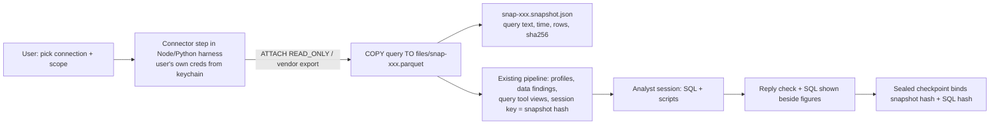
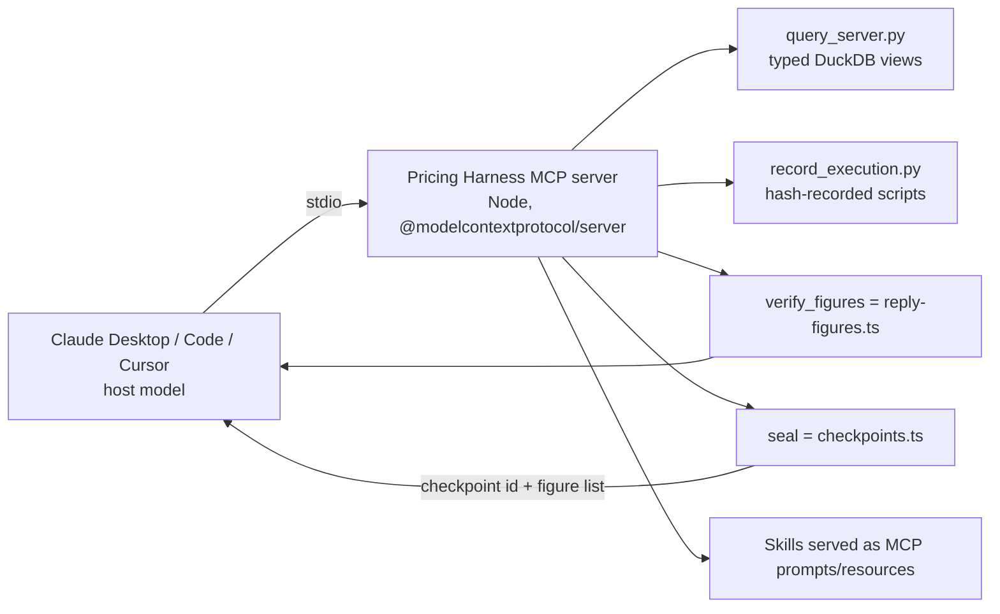

# 03 - Architecture reuse: what else can this engine become?

Date: 2026-10-18. Scope: read-only code review (Part A), vertical ranking (B), data-lake/enterprise deep dive (C), MCP both directions (D). Web claims carry a confidence tag; vendor-authored numbers are labelled as such. Search quality was uneven (many aggregator pages); items I could not confirm from a primary source are marked **low**.

## 0. Headline conclusions

1. **The engine is ~85% domain-neutral; the pricing lives almost entirely in Markdown.** The code in `src/agent/workflow/` and `bundled/harness-tools/` knows nothing about margin. Pricing knowledge is in `bundled/pricing-plugin/skills/**`, the `analystPrompt`, one prompt string in `session.ts`, and the `PRELOADED` path list in `stage-prompt.ts`. A new vertical is mostly "write 5-8 skills + a few lints + evals", not "change the engine".
2. **The owner's "MCP connector first" assumption is half right and mis-aimed.** (a) Pi 1.0.4, already installed, ships a built-in MCP *client* (`createMcpExtension()`), so consuming MCP servers is nearly free in code. (b) But anything an MCP tool returns goes straight into the model's context and **never passes through the `execute_analysis` / `query` record**, so the reply-figure check cannot see it. Raw MCP results would silently open a hole in the one thing the product sells. Connectors must land data as a **snapshot file in the workspace** (hash-recorded), then everything downstream is unchanged. (c) For databases, DuckDB's own `ATTACH` (Postgres, MySQL) is a better connector than MCP: no extra LLM hop, pushdown, deterministic.
3. **"Checked figures" proves provenance, not correctness.** It verifies that a number was printed by a script that ran. On a warehouse the dominant failure is a plausible wrong join or metric definition, which passes this check. Spider 2.0 / BIRD show this failure mode is large. Warehouse use needs the check extended (show the SQL beside each figure, metric definitions as confirmed context, row-count/fan-out guards - `same_rows.py` is already a start).
4. **Cheapest distribution experiment: expose the verifier and the query tool as a local MCP server** (option B below), not the whole analyst. ~300 lines with the official TS SDK, no model cost, reaches Claude Desktop/Code/Cursor users. Its weakness: the host model's final message is not controlled, so the guarantee changes from *enforced* to *available*.
5. **Best adjacent verticals by fit-to-effort:** procurement/spend (purchase-price variance is pricing's mirror image; detectors transfer almost unchanged) and FP&A variance commentary; the strongest *trust-premium* niche is audit/quality-of-earnings/due-diligence on confidential data where local-first and sealed evidence matter. Insurance/actuarial is a poor fit.

---

## A. Reuse map

Classes: **G** generic as-is; **GC** generic with changes; **P** pricing-specific.

| Component | Path | Class | Evidence / what changes |
|---|---|---|---|
| Orchestrator (session key, fresh vs follow-up, nudge turn, recheck turn, delivery) | `src/agent/workflow/orchestrator.ts` | **G** | No domain terms. Session key = hash(bundle fingerprint + source hashes). For live sources the key must hash a *snapshot*, see C. |
| Reply-figure check | `reply-figures.ts` (38 lines) | **G** | Pure function (reply, outputs) -> unmatched figures. Matches at reply precision, fractions as %, differences of two supported figures. Weaknesses: any printed number anywhere satisfies a figure (coincidental match possible); years 1900-2100 skipped; 3+ digit threshold. Usable as-is in FP&A/audit; for audit would want tighter binding (figure -> specific output row). |
| Checkpoints / sealing | `checkpoints.ts` (66 lines) | **G** | Copies recorded result files, hash-binds, schema v2. `stableRefs` re-hashes source files after delivery ("source changed"). Needs a snapshot concept for non-file sources. Natural base for audit workpaper evidence. |
| Query tool + DuckDB session | `query-tool.ts`, `bundled/harness-tools/query_server.py`, `data_workspace.py` | **GC** | Typed views over CSV/XLSX only. `ALLOWED` regex bans ATTACH/INSTALL/LOAD/SET - correct for an agent, so connectors must attach *harness-side* before the agent sees views (`attach_source`/`prepare_source` is the plug-in point; `format` currently `csv` or `xlsx` only). |
| Same-rows / peer-ratio / offsets guards | `same_rows.py`, `peer_ratio.py`, `offsets.py` | **G** | Facts only ("this statement changed the row count", ratio outliers). Same-rows guard is directly relevant to join fan-out on warehouses. |
| Data-findings detectors (parse, shape, domain, uniqueness, ratio, identity, time) | `data_findings.py` (309 lines), `data-findings.ts` | **G** | Labels like `x12`, `x1e3`, `decimal-comma`, `serial-date` are generic. "money-like columns" and `valueAtStake` are the only finance-ish concepts. Transfers to procurement/AP/audit almost verbatim. CSV/XLSX only - connector snapshots must be written as CSV/Parquet. |
| Source profiles | `source-profiles.ts`, `profile_source.py` | **G** | Columnar prompt form. |
| Analyst worker (Pi session, `execute_analysis`, bash recording, write sandboxing) | `worker.ts` (413 lines), `shell-evidence.ts`, `record_execution.py` | **G** | Records script hashes and file reads. Writable area = stage dir + `context.md`. Not an OS sandbox (BRIEFING). Credentials: `analysisEnvironment()` strips `*TOKEN/SECRET/PASSWORD/CREDENTIAL/API_KEY` env vars from the agent's shell - good for connector secrets. |
| Nudges / lints | `nudges.ts` (434 lines), `skills/references/lints.json` | **GC** | Engine generic; `lints.json` is pricing content (rate display etc.). SQL-error hints are DuckDB-generic. |
| Prompts | `role-prompts.ts` (`analystPrompt`), `stage-prompt.ts` `PRELOADED`, `session.ts` inline prompt | **P** | "pricing analyst", pricing skill paths. Small, but hard-coded in three places; a `vertical` config pointing at a bundle would be the one real refactor (S). |
| Skills (triage, intake, analyze, scan, recommend, design, execute) + knowledge cards | `bundled/pricing-plugin/skills/**` | **P** | The product's actual IP. `pricing-intake` (confirmed context -> `.pricing/context.md`) and `references/shared-rules.md` section 3 "bound first, then deliver or ask" are *method*, not pricing - keep verbatim in every vertical. |
| Visualisation skill + exploration binding | `bundled/harness-skills/analysis-visualize`, `exploration.ts`, `src/exploration.ts` | **G** | Charts/tables bind only to recorded result files. |
| Persistent business context | `.pricing/context.md`, intake skill | **G** | This is effectively a hand-written semantic layer (definitions, exclusions, calendars). The natural slot for metric definitions in a warehouse setting. |
| Conversations / state / event logs | `conversations.ts`, `event-log.ts`, `steps.ts`, `runs.ts` | **G** | |
| UI (assistant-ui chat, steps, sources, numbers) | `src/ui/*` | **GC** | Branding (critias) and `numbers.ts` formatting; otherwise generic. No export, no audit-trail UI. |
| Fastify server / routes | `src/server.ts`, `src/routes/{chat,files}.ts` | **GC** | Localhost-bound, single user, no auth. Becomes an MCP server host or a multi-user service only with new work. |
| Eval harness (oracle + judge, synthetic datasets, canary) | `tests/evals/*` | **GC** | Runner/spec/verify generic; datasets/keys/oracle are pricing. A new vertical needs its own synthetic data + keys (the expensive part, M each). |
| Bundle loader (skill inventory check) | `src/agent/bundle.ts`, `session.ts` | **GC** | Hard-fails if loaded skills != bundle inventory - good for a "vertical pack" model. |

**Net:** engine code to touch for a second vertical is ~3 prompt locations + bundle selection. Everything else is content and evals.

---

## B. Vertical ranking

Scoring 1 (poor) - 5 (excellent). "Competition" is scored so that 5 = little competition. Total is unweighted; my commentary overrides where the number misleads.

| # | Vertical | Fit with engine | Demand evidence | Competition | Effort (5 = small) | Total | Verdict |
|---|---|---|---|---|---|---|---|
| 1 | **Procurement / spend analysis** (purchase-price variance, duplicate invoices, supplier price creep) | 5 | 3 | 3 | 4 | 15 | Best near-neighbour. Price-per-unit by supplier is the same peer-ratio / unit-price-outlier logic; 3 of 5 detectors transfer; skills are new but short. |
| 2 | **FP&A variance commentary / budget-vs-actual / close** | 4 | 4 | 1 | 3 | 12 | Biggest pull, most crowded. Needs XLSX/PDF export and Excel-in-the-loop to be taken seriously. |
| 3 | **Audit analytics / quality-of-earnings / due diligence on client data** | 4 | 3 | 3 | 2 | 12 | Strongest *moat* fit: confidential data (local-first), evidence retention (sealed checkpoints), full-population testing. Regulated buyer, slow sales. |
| 4 | **Warehouse / lake "deep analysis" (Snowflake, Databricks, BigQuery, Postgres)** | 3 | 5 | 1 | 2 | 11 | Horizontal capability rather than a vertical; huge demand, vendor-native competitors. Treat as an *input channel* for 1-3, not a product. |
| 5 | **SaaS billing / subscription metrics (Stripe exports, MRR, churn, discounting)** | 5 | 3 | 2 | 4 | 14 | Strong candidate I would add: `knowledge/recurring-metrics.md` and `price-waterfall.md` already exist, and Stripe has a maintained MCP. Small-company buyer, low ticket. |
| 6 | **Retail/e-commerce merchant margin (Shopify/Amazon exports)** | 5 | 3 | 2 | 5 | 15 | Already half-served (`retail-economics.md`, retail evals). Zero engine work. Is a pricing sub-segment, not a new vertical. |
| 7 | **Insurance / actuarial pricing** | 1 | 2 | 2 | 1 | 6 | Skip. Needs GLM/GBM fitting, rate-filing documentation (NAIC Model Review Manual 2025) and regulator-facing artefacts; the engine's strength (verifying descriptive arithmetic) is not the bottleneck. |

(Insertion order is by my preference, not row number; ranked order: 1/6 procurement and retail (tied by score; retail is not a new vertical), 5 SaaS, 2 FP&A, 3 audit/QoE, 4 warehouse, 7 insurance.)

### Evidence per vertical

- **FP&A.** Vendors claim 60-85% commentary-time reductions, but with no primary methodology (low). One useful honest data point: ChatFin says accuracy on multi-driver variances above $500K falls to 74%, so they mandate human review; Datarails says accrual/materiality judgment and sign-off stay human (https://chatfin.ai/blog/ai-variance-analysis-commentary-automation-finance-2026/, https://www.datarails.com/blog/what-can-ai-actually-do-in-fpa/; confidence low-medium, both vendors). Tellius cites a Gartner 2025 survey (59% of finance functions use AI) and FP&A Trends 2025 (46% of FP&A time on collecting/validating data) - unverified secondary (https://www.tellius.com/resources/blog/12-best-ai-variance-analysis-software-tools-for-fp-a-in-2026). Competition includes Claude's own Excel add-in and finance skills (third-party descriptions only, low): https://www.rillet.com/blog/claude-excel-finance. **Critical:** the demand is real, but the incumbent is "Claude/ChatGPT inside Excel", and finance people live in Excel; a browser app that cannot write back to a workbook starts behind.
- **Audit.** Direction of travel is full-population testing; PCAOB's amended evidence rules raise the bar on data reliability (Field Guide, vendor, medium-low: https://www.fieldguide.io/resource-articles/audit-analytics-2026-full-population-testing-review). Incumbents: MindBridge (https://www.mindbridge.ai), Big Four internal platforms (names unverified). Fit: a sealed checkpoint with source hashes and executed-script hashes is close to what a workpaper needs, but auditors want tick-marks, sampling logic, and reproducibility by a second reviewer - features we do not have. Local-first is a genuine selling point for client-confidential data.
- **Procurement.** Active, funded category: Suplari "AI-ready procurement intelligence" (Feb 2026), SpendHQ acquired Sligo AI (Apr 2026), Magentic (London) reported at $18M (unverified amount) - https://app.dealroom.co/news/feed/suplari-debuts-ai-ready-procurement-intelligence-platform-to-replace-traditional-spend-analytics, https://aifunding.me/companies/magentic (low-medium). Those are enterprise platforms; a local analyst for mid-size teams with ERP exports is open ground. Main engineering gap: spend *classification* (taxonomy mapping of free-text item descriptions) is an LLM-per-row job that conflicts with "code never applies business treatments".
- **Insurance.** NAIC launched an AI systems evaluation pilot (11 states, March 2026) and regulators are moving toward interrogating GBMs (https://actuary.info/insights/naic-ai-evaluation-tool-predictive-model-rate-filing-2026, low). The core workload is model fitting and filing documentation. Poor fit.

---

## C. Data lake / enterprise deep dive

### C1. Pushdown vs pull-local

| Option | How | Pros | Cons | Fit with this repo |
|---|---|---|---|---|
| **Pull a snapshot into local DuckDB/Parquet** | Harness runs an extract (`COPY (SELECT ...) TO 'files/x.parquet'`), then treats the file as a normal source | Reproducible; hashes work (`stableRefs`, session key); offline follow-ups; zero change to checkpoints | Size (2 GiB cap on files today), staleness, user must scope the extract | **Best default.** Preserves the "source changed" invariant. |
| **DuckDB `ATTACH` live (pushdown)** | Postgres/MySQL core extensions; Iceberg/Delta/DuckLake extensions | Filters pushed down (Postgres filter pushdown is marked *experimental*), binary COPY, `READ_ONLY` option | Source is not hash-stable (breaks sealed-evidence story); docs state tables are read at query time and don't describe snapshot isolation; connection string may leak passwords in error messages | Use only inside a snapshot step, or add a "snapshot id" (query text + timestamp + row count + result hash) as the source identity. |
| **Warehouse-side compute via vendor MCP/semantic agent** (Cortex Analyst, Genie) | Delegate NL->SQL to the vendor | Uses vendor RLS/semantic models | Numbers arrive as tool results, outside our record; nondeterministic (Databricks docs say Genie "operates in a nondeterministic manner"); vendor-priced | Competitor, and as a *source* it undermines our check. Only usable through a fetch-to-file wrapper. |

Sources: DuckDB Postgres extension (https://duckdb.org/docs/current/core_extensions/postgres/overview.html - ATTACH `TYPE postgres`, `READ_ONLY`, experimental filter pushdown, binary copy, "for large tables copy into DuckDB"; **high**). Core extensions list includes Delta, DuckLake, Iceberg, MySQL, PostgreSQL (https://duckdb.org/docs/stable/core_extensions/overview; Iceberg listed as best-effort tier; **medium**). Snowflake/BigQuery/Databricks are not core DuckDB extensions; community extensions exist but I could not verify maturity (**low**) - for those, use the vendor Python connector or vendor MCP/CLI to export to Parquet inside a harness-run script.

**Concrete design that fits the code:** add a `source kind: 'snapshot'` produced by a harness-run connector script (`bundled/harness-tools/connect_*.py`), written under `files/` as Parquet with a sidecar `.snapshot.json` (connector, query text, timestamp, row count, sha256). `query_server.targets()` already enumerates files by extension; add `.parquet`. `data_findings.py` and `source-profiles` need Parquet read (DuckDB reads it natively, S effort). The session key and `stableRefs` then work unchanged.

### C2. Semantic layers and text-to-SQL error rates

- **dbt Labs benchmark (April 2026):** ACME Insurance dataset, 15 tables, 11 questions x 20 runs. Text-to-SQL 90.0% (Sonnet 4.6) / 84.1% (GPT-5.3-Codex) vs Semantic Layer 98.2% / 100%. Overall text-to-SQL accuracy rose 32.7% (2023) -> 64.5% (2026) before extra modelling; the 100% is for in-scope questions only. Authors assert semantic layer *fails loudly* out of scope while text-to-SQL returns plausible wrong numbers, but do not quantify that. Vendor-authored, one dataset (**medium**): https://docs.getdbt.com/blog/semantic-layer-vs-text-to-sql-2026
- **Cube** replicated at 100% on a smaller question set (vendor, low): https://cube.dev/blog/semantic-layers-the-missing-piece-for-ai-enabled-analytics
- **Snowflake** reports semantic models lift accuracy from ~51% (raw GPT-4o) to ~90% (vendor internal benchmark, 2024, **low-medium**): https://www.snowflake.com/en/blog/engineering/snowflake-cortex-analyst-behind-the-scenes/ ; Databricks claims 32% -> 90%+ for Genie with curated spaces (vendor, low).
- **Implication for us:** the winning pattern in every source is *constrain the model to predefined metrics and joins*. We already have the human-in-the-loop equivalent: `.pricing/context.md` holds confirmed definitions. A cheap upgrade is a **metrics file** (`metrics.yml` in MetricFlow/Malloy-lite format, or just named DuckDB views the user confirms) that the analyst must use. Do not build a semantic layer; read an existing one: dbt MetricFlow is open source (Apache-2.0, https://github.com/dbt-labs/metricflow - licence from memory, **verify**), Malloy (MIT, https://github.com/malloydata/malloy - **verify**), Cube core (Apache-2.0 / MIT parts - **verify**).

### C3. Benchmarks and what they imply

- **Spider 2.0** (enterprise workflows; 547 Snow/Lite examples + 68 DBT tasks): original paper reported o1-preview agent solves 21.3%; a vendor-hosted (not official) Lite table lists top systems around 50-53% in mid-2026. Official repo notes the Snowflake eval account was suspended as of Aug 12, 2026, so the official leaderboard may be stale (https://github.com/xlang-ai/Spider2; **medium**, the vendor table **low**).
- **BIRD:** top systems low 80s EX (Huawei DataGallery 82.39%; Google Gemini-SQL2 80.04% on the single-model track) vs human 92.96% (press, **medium**: https://aiweekly.co/alerts/googles-gemini-sql2-tops-bird-text-to-sql-at-8004). One secondary source reports an audit finding ~49% of financial-domain BIRD items contain some error (**low**; if true, the benchmark ceiling itself is shaky for finance).
- **Implication:** on realistic enterprise schemas, a one-shot NL->SQL answer is right perhaps half to four-fifths of the time, and the wrong ones look right. "Every number came from an executed query" is necessary but not sufficient. For a warehouse offering we must (1) print the SQL next to each sealed figure, (2) require the model to restate the metric definition and join keys in the reply, (3) surface row-count/fan-out checks (extend `same_rows.py` from the source views to every joined result), and (4) run the existing "bound first, then deliver or ask" rule on *definition* ambiguity. Position the product as "auditable", never "correct".

### C4. Governance, credentials, PII

- Local-first has a real enterprise advantage: **the user's own warehouse credentials give row-level security for free** because the warehouse enforces it; no service account, no shared proxy. Snowflake MCP docs and Databricks docs both make RBAC the enforcement layer (Snowflake: server access and tool access are separate grants; SQL-execution tool `read_only` defaults true; Snowflake recommends not exposing the raw SQL tool next to governed agents because it bypasses governance - https://docs.snowflake.com/en/user-guide/snowflake-cortex/cortex-agents-mcp, **high**).
- Credential handling in this repo: `analysisEnvironment()` already strips secret-looking env vars from the agent's shell; connectors must run in the Node/Python *harness* process, never in an agent-writable script, and attach strings must not appear in error output (DuckDB docs warn failed connections can echo the password). Store secrets via OS keychain, not `harness.config.json`. Agent bash is not sandboxed (BRIEFING), so a prompt-injected agent could read any credential file on disk: keychain + per-run short-lived tokens, not files.
- PII: no masking layer exists. The data goes to the model provider (OpenRouter) - this, not storage, is the enterprise blocker. Pi documents custom providers and local inference (`docs/custom-provider.md`, `docs/llama-cpp.md` in the installed package), so Bedrock/Azure/Vertex/Ollama endpoints are plausible; product work is surfacing "data leaves your machine to X" and offering an approved-endpoint setting. Confidence medium.
- Enterprise procurement checklist (vendor blogs, **low-medium**, convergent): SAML/OIDC SSO + SCIM, RBAC roles, exportable immutable audit log incl. user/tool/outcome/approval, VPC or self-hosted, SOC 2 Type II, DPA. https://www.basedash.com/enterprise, https://airbyte.com/agentic-data/ai-agent-data-access-control. **Judgement:** a local single-user app should not chase SSO/SCIM/SOC 2 at all. The achievable enterprise story is "runs on the analyst's laptop with their own creds, read-only, nothing stored remotely, models you approve, evidence files you can hand to audit." Anything needing central admin is a different (hosted) product.

---

## D. MCP in both directions

### D1. Harness as MCP client

**Fact (verified in repo):** `@earendil-works/pi-coding-agent` 1.0.4 (MIT) is installed and ships MCP: stdio and streamable HTTP, `mcp.json`, OAuth with token refresh, `exposure`/`toolExposure` controls, tool names `mcp__<server>__<tool>`. In SDK sessions it is not auto-loaded: add `createMcpExtension()` to `extensionFactories` of `DefaultResourceLoader` and call `session.bindExtensions()`; example `examples/sdk/14-codemode-mcp.ts` (`node_modules/@earendil-works/pi-coding-agent/docs/mcp.md`, `docs/sdk.md` lines ~112-137; **high**). `createPricingSession` already accepts `stage.extensions: ExtensionFactory[]` and builds the loader with `noExtensions: true` plus `extensionFactories`, so the plug-in point is one line. Pi's own docs mention SSE is unsupported.

**The hole to design around:** MCP tool results enter the model context without being recorded as an execution output. `unverifiedFigures(reply, outputs)` reads `execution-*` files only. So a figure read from `mcp__snowflake__run_sql` and quoted in the reply would be flagged as unverified (safe but annoying), or - worse - a model that pastes the figure into a script to "print" it would launder it into verified status. **Rule: MCP tools may only be called through a harness wrapper that writes the result to a recorded file in the stage dir** (a `fetch_to_file` tool, with the server/tool/args/hash in the record). Do not expose raw `mcp__*` tools to the analyst. Also: MCP results are untrusted text (prompt injection); Stripe's own docs warn about combining its MCP with other servers.

**Real servers (verified unless noted):**

| System | Server | Licence / maturity | Notes |
|---|---|---|---|
| Postgres/BigQuery/Snowflake/many | googleapis/genai-toolbox, https://github.com/googleapis/genai-toolbox | Apache-2.0; ~16.7k stars; v1.14.0 shown; stdio+HTTP (high) | Best general DB MCP; but for Postgres prefer DuckDB `ATTACH`. |
| BigQuery | Google managed remote BigQuery MCP, https://docs.cloud.google.com/bigquery/docs/use-bigquery-mcp | Google-hosted; status not confirmed by me (low) | IAM-governed. Verify GA vs preview. |
| Snowflake | Snowflake-managed MCP, https://docs.snowflake.com/en/user-guide/snowflake-cortex/cortex-agents-mcp | Vendor-hosted; GA status not stated on page (low); OAuth default, PAT supported; SQL tool `read_only` default true; 250 KB response truncation | The old Snowflake-Labs/mcp (Apache-2.0) is **deprecated** per its README - do not build on it. |
| Databricks | Managed MCP (Genie One GA; DBSQL via Unity Gateway beta; legacy `/api/2.0/mcp/sql` etc. in preview), https://docs.databricks.com/aws/en/agents/mcp-tools/managed-mcp | Vendor-hosted; mixed GA/beta (high) | Permissions follow Unity Catalog. |
| DuckDB / MotherDuck | motherduckdb/mcp-server-motherduck, https://github.com/motherduckdb/mcp-server-motherduck | MIT; 532 stars; PyPI + MCP registry (high) | Tools: `execute_query`, `list_*`; 1024-row/50k-char caps; README says read-only is "not sufficient" for third-party access. Mostly relevant as the *server-side peer* to compare against (D2). |
| Stripe | Official remote `https://mcp.stripe.com` (OAuth or restricted "agent" keys), https://docs.stripe.com/mcp | Vendor-maintained, production; `stripe_analytics` is preview; legacy full-access keys stop working Nov 30 2026 (high) | Read-only via `stripe_api_read`. Exports (Sigma/CSV) are simpler for us. |
| HubSpot | Official HubSpot MCP (beta per a guide) (low) | https://developers.hubspot.com/mcp (unverified) | |
| Salesforce | Vendor-listed official server (low) | Verify on Salesforce developer docs | |
| NetSuite | Oracle-managed MCP/AI connector (low); only a directory mention found | Verify | Large ERP exports are CSV anyway. |
| Google Sheets/Drive | No official server found (low); community servers exist; the official reference gdrive server was **archived** (https://github.com/modelcontextprotocol/servers, high) | | Use the Google APIs directly or ask for XLSX upload. |
| Reference Postgres/SQLite/GitHub | **Archived** in `servers-archived` (high) | | Do not depend on them. |

**TS SDK:** `modelcontextprotocol/typescript-sdk` v2 is stable and implements spec 2026-07-28; split packages `@modelcontextprotocol/client` / `server`; Apache-2.0 for new contributions, MIT for existing code; ~13.6k stars; v1.x kept for fixes at least six months (https://github.com/modelcontextprotocol/typescript-sdk; high). Spec 2026-07-28 changes the handshake (stateless HTTP), so pin versions and test.

**Assessment of the owner's "MCP connector is high priority":** *Weak as stated.* Reasons: (1) the first real connectors users ask for are a database or a CSV export from an ERP, which DuckDB and file upload serve better; (2) SaaS (Stripe, HubSpot) analytics needs are well served by exports for a first release; (3) the verification invariant forces a fetch-to-file wrapper, so MCP adds complexity, not removes it; (4) MCP server quality is uneven and vendor-gated (Snowflake's managed server GA status unclear; Databricks preview). Build the DuckDB Postgres/MySQL snapshot connector first; add the MCP fetch wrapper only for named SaaS sources that have no good export.

### D2. Harness as MCP server

Two possible shapes:

| Shape | What is exposed | Who pays for the model | Guarantee | Effort |
|---|---|---|---|---|
| **A. Whole analyst as a tool** | `analyse(question, sources) -> reply + sealed figures + checkpoint id` | Us/user via OpenRouter, a *second* LLM nested inside Claude Desktop's | Fully preserved (orchestrator runs) | M-L (long-running tool, progress notifications, timeouts, cost double-up) |
| **B. Primitives** | `register_source`, `query` (typed DuckDB views, same-rows guards, data findings), `run_script` (hash-recorded), `verify_figures(reply)` -> unmatched list, `seal(claims)` -> checkpoint, `read_context/append_context` | Host's model (user's own Claude subscription) | **Available, not enforced**: host may skip `verify_figures` or edit after | S-M (~300 lines on `@modelcontextprotocol/server`; reuse `query_server.py`, `reply-figures.ts`, `checkpoints.ts` directly) |

**Is it a cheaper distribution path than the web app?** Probably yes, for the technical early-adopter segment: Claude Desktop installs local servers as `.mcpb` bundles (one-click zip with `manifest.json`; CLI `@anthropic-ai/mcpb`; per-user install, admin allowlists on Team/Enterprise). Anthropic's docs steer public listing toward *remote* servers and treat `.mcpb` as private/internal distribution (https://claude.com/docs/connectors/building/mcpb, https://www.anthropic.com/engineering/desktop-extensions; medium). Costs/risks: (1) pricing/finance managers are not Claude Desktop power users, though the same people use Claude in chat; (2) Python dependency (DuckDB, pandas, openpyxl) inside an `.mcpb` is the hard part - bundling a Python runtime per OS is non-trivial; (3) you lose the UI (charts, steps, sidebar) unless MCP UI widgets work in the host (not verified); (4) you lose the enforced reply check, the product's core claim - mitigate by making `seal` return a claim list the model must quote, and by shipping a Skill/system-prompt snippet "never state a figure without verify_figures"; (5) competing, similar offers: MotherDuck's MCP server (MIT) already gives Claude local DuckDB query, minus verification. The differentiator is exactly `verify_figures` + `seal` + data findings + the pricing skills delivered as MCP prompts/resources.

**Recommendation (order):**
1. **Direct DB connectors via DuckDB `ATTACH` snapshots (Postgres/MySQL; Parquet/Iceberg later)** - M. Highest user value, no new trust hole.
2. **MCP server, shape B (primitives + verifier), as a distribution experiment** - S-M. Ship as `.mcpb` + `npx`; measure installs. Cheap, reversible, and exposes the verifier to the largest existing audience. Do not do shape A.
3. **MCP client via Pi's built-in extension, restricted to a `fetch_to_file` wrapper** - S-M, only for specific SaaS sources users ask for.
4. Enterprise warehouse (Snowflake/BigQuery/Databricks): by snapshot export scripts using vendor connectors; do not chase SSO/SCIM/SOC 2.

### D3. Architecture sketches

**Adaptation 1: warehouse/Postgres analyst (snapshot connector)**

Changes: Parquet support in `query_server.targets`/`data_workspace.prepare_source`, `data_findings.py` and profiles; connector scripts; keychain; UI to pick a connection; "show SQL" in sealed figures. No change to orchestrator beyond the `FileRef` shape.

**Adaptation 2: verifier-as-MCP-server (shape B)**

---

## E. Feature / adaptation candidates (with ease of integration)

| Feature | Why | Priority | Effort | **Ease of integration** |
|---|---|---|---|---|
| Postgres/MySQL snapshot connector via DuckDB | Real data lives in DBs; files-only is the top practical blocker; no trust hole if snapshotted | P0 | M | DuckDB `postgres`/`mysql` core extensions (MIT, DuckDB-maintained, mature): https://duckdb.org/docs/current/core_extensions/postgres/overview.html. Plug in via harness-side script run before analyst start, writing Parquet into `files/`; extend `query_server.targets` for `.parquet`. Credentials from OS keychain (e.g. `keytar` successor `@napi-rs/keyring`, MIT - verify) not config. |
| Parquet/Iceberg/Delta/DuckLake source support | Data lakes; makes snapshots compact and lets users drop in lake exports | P1 | S-M | DuckDB core `iceberg`, `delta`, `ducklake` extensions (docs: https://duckdb.org/docs/stable/core_extensions/overview). Parquet is native. `INSTALL/LOAD` must stay banned for the agent; load harness-side. |
| SQL shown beside each checked figure + metric-definition guard | Closes the "plausible wrong join" gap exposed by Spider 2.0 / BIRD | P0 for warehouse, P1 otherwise | S-M | Extend `emit_handoff`/present specs with `sql_hash`+text; reuse `same_rows.py` guard for all joined results. No external dependency. |
| Metrics/semantic file ingestion | Cuts wrong-definition errors (dbt: 90 -> 98-100% in-scope, vendor benchmark) | P1 | M | Read-only ingestion of dbt MetricFlow YAML (https://github.com/dbt-labs/metricflow, licence verify) or Malloy (https://github.com/malloydata/malloy). Minimal path: translate to named DuckDB views confirmed in `context.md`; do not implement MetricFlow execution. |
| MCP server exposing verifier + query (shape B) | Cheapest distribution test; reaches existing Claude users | P1 | S-M | `@modelcontextprotocol/server` v2 (Apache-2.0/MIT, https://github.com/modelcontextprotocol/typescript-sdk); bundle via `@anthropic-ai/mcpb` (https://github.com/modelcontextprotocol/mcpb). Reuse `reply-figures.ts`, `checkpoints.ts`, `query_server.py` unchanged. Python packaging is the sticking point. |
| MCP client with `fetch_to_file` wrapper | SaaS sources (Stripe, HubSpot, Salesforce) without writing bespoke clients | P2 | S-M | Pi built-in `createMcpExtension()` (MIT; pi-coding-agent 1.0.4 already a dependency; `examples/sdk/14-codemode-mcp.ts`). Wrap, do not expose raw `mcp__*`. Servers: Stripe `https://mcp.stripe.com`, genai-toolbox (Apache-2.0). |
| Snowflake / BigQuery / Databricks export connectors | Enterprise demand | P2 | M each | Vendor Python connectors in `bundled/harness-tools` (Snowflake `snowflake-connector-python` Apache-2.0 with `externalbrowser` SSO; `google-cloud-bigquery` Apache-2.0; `databricks-sql-connector` Apache-2.0 - licences from memory, verify). Each writes Parquet snapshot. Alternative: vendor-managed MCP via fetch wrapper. |
| Vertical pack mechanism (config selects bundle, prompts, PRELOADED) | Makes procurement/FP&A/SaaS skill packs possible without forks | P1 | S | Internal refactor: `role-prompts.ts`, `stage-prompt.ts`, `session.ts` read from bundle manifest. Existing bundle inventory check in `session.ts` already enforces integrity. |
| Procurement / spend skill pack (PPV, duplicate invoice, supplier price creep) | Best fit-to-effort adjacent vertical | P1 | M | New skills + knowledge cards; reuse `peer_ratio.py` and `data_findings.py` detectors. Reference taxonomy: UNSPSC (public code list; licence/fees verify). |
| FP&A variance pack + XLSX/PDF export | Largest demand; needs output formats | P1 | M-L | Skills new; export via `openpyxl` (MIT, already used for XLSX read) for tables and `exceljs` (MIT) for formulas; PDF via existing Playwright dependency. Excel add-in distribution is a separate, harder path (Office.js, https://github.com/OfficeDev/office-js). |
| Audit/QoE evidence pack (workpaper export of checkpoint with hashes, tick-marks) | Turns sealed checkpoints into the product | P2 | M | Export checkpoint.json + files into a ZIP/PDF with hash manifest; standard libs only. In-toto/SLSA-style attestation formats (https://in-toto.io, Apache-2.0) as a reference for a signed manifest. |
| Approved-model endpoint setting (Bedrock/Azure/Vertex/Ollama) | LLM data egress is the real enterprise blocker | P1 | S-M | Pi custom providers and local inference docs bundled in `node_modules/@earendil-works/pi-coding-agent/docs/custom-provider.md`, `llama-cpp.md`; Ollama (MIT). |
| Governance report (read-only attestation, audit log export) | Substitute for SSO/SOC 2 for a local tool | P2 | S | Already have `events.jsonl`/`steps.jsonl`/`run.json`; add export. |

### Top 10 ranked (by value / effort for a solo developer)

1. Postgres/MySQL snapshot connector via DuckDB (P0, M).
2. SQL-beside-figure + metric-definition/fan-out guards (the honest answer to text-to-SQL error rates) (P0/P1, S-M).
3. Vertical pack mechanism (S) - unlocks everything below cheaply.
4. MCP server shape B: verifier + query primitives as `.mcpb` (distribution experiment, S-M).
5. Parquet/Iceberg/DuckLake source support (S-M).
6. Procurement/spend skill pack (M).
7. FP&A variance pack with XLSX/PDF export (M-L).
8. Approved-model endpoint setting for enterprise data governance (S-M).
9. MCP client via Pi's built-in extension with `fetch_to_file` wrapper (S-M).
10. Audit/QoE evidence-pack export (M).

(Snowflake/BigQuery/Databricks exports sit just outside the top 10; build the first on demand.)

---

## F. Wrong or weak owner assumptions

1. **"MCP connector is a high priority."** Weak. Client-side MCP is nearly free (Pi built-in) but unsafe for the core claim unless wrapped; DuckDB `ATTACH` snapshots serve databases better; exports serve SaaS. The *server* direction is the more interesting MCP bet.
2. **"Checked figures" protects against wrong numbers.** It protects against numbers that no script printed. Wrong joins and wrong definitions pass. Marketing and design must say "auditable", and warehouse support needs the SQL-visible and definition-guard work.
3. **"Local-first = enterprise-ready."** It is a privacy advantage for one analyst, not an enterprise one: no SSO/SCIM/central audit/SOC 2, bash is unsandboxed, and the model provider (OpenRouter) is where the data actually goes. Fix the model-egress story before anything else.
4. **"Any model through OpenRouter" as a strength.** For professionals with regulated data it is a blocker; for demos it is a feature. Needs an approved-endpoint option.
5. **That a data lake means one more connector.** Source identity in this system is a file hash (session key, `stableRefs`, "source changed"). A live source changes the trust model; snapshotting is the thing to build, not a driver.
6. **Pricing as the only wedge.** The code says otherwise: ~85% of it is domain-neutral. The risk is spreading thin; but a vertical-pack refactor plus one adjacent pack (procurement) tests it for little cost.
7. **Insurance/actuarial and "enterprise warehouse deep analysis" as natural next steps.** Insurance is a poor fit (model fitting + regulatory documentation). Warehouse is a channel into other verticals, not a destination, and Snowflake/Databricks/Hex/Claude-with-MCP are already there with vendor-native governance.
8. **Demand numbers from vendor blogs** (60-85% commentary time savings, Spider/BIRD vendor tables) are not independent evidence; none of the demand claims above were validated by an independent survey. The ChatFin 74% accuracy figure on large multi-driver variances is the most honest data point for our "needs human review" design.

## G. Sources

- DuckDB Postgres extension: https://duckdb.org/docs/current/core_extensions/postgres/overview.html
- DuckDB core extensions overview: https://duckdb.org/docs/stable/core_extensions/overview
- dbt semantic layer vs text-to-SQL 2026: https://docs.getdbt.com/blog/semantic-layer-vs-text-to-sql-2026
- Cube: https://cube.dev/blog/semantic-layers-the-missing-piece-for-ai-enabled-analytics
- Snowflake Cortex Analyst: https://www.snowflake.com/en/blog/engineering/snowflake-cortex-analyst-behind-the-scenes/
- Snowflake managed MCP: https://docs.snowflake.com/en/user-guide/snowflake-cortex/cortex-agents-mcp
- Databricks managed MCP: https://docs.databricks.com/aws/en/agents/mcp-tools/managed-mcp
- Spider 2.0: https://github.com/xlang-ai/Spider2 ; BIRD coverage: https://aiweekly.co/alerts/googles-gemini-sql2-tops-bird-text-to-sql-at-8004
- genai-toolbox: https://github.com/googleapis/genai-toolbox ; Snowflake-Labs/mcp (deprecated): https://github.com/Snowflake-Labs/mcp ; MotherDuck MCP: https://github.com/motherduckdb/mcp-server-motherduck ; MCP reference servers: https://github.com/modelcontextprotocol/servers
- MCP TypeScript SDK: https://github.com/modelcontextprotocol/typescript-sdk ; MCPB: https://claude.com/docs/connectors/building/mcpb , https://www.anthropic.com/engineering/desktop-extensions
- Stripe MCP: https://docs.stripe.com/mcp
- Pi MCP (local, authoritative): `node_modules/@earendil-works/pi-coding-agent/docs/mcp.md`, `docs/sdk.md`, `CHANGELOG.md`; summary article https://letsdatascience.com/news/pi-10-adds-mcp-and-durable-harness-6241c6f7
- FP&A/AI: https://chatfin.ai/blog/ai-variance-analysis-commentary-automation-finance-2026/ , https://www.datarails.com/blog/what-can-ai-actually-do-in-fpa/ , https://www.tellius.com/resources/blog/12-best-ai-variance-analysis-software-tools-for-fp-a-in-2026
- Audit: https://www.fieldguide.io/resource-articles/audit-analytics-2026-full-population-testing-review , https://www.mindbridge.ai
- Procurement: https://app.dealroom.co/news/feed/suplari-debuts-ai-ready-procurement-intelligence-platform-to-replace-traditional-spend-analytics
- Insurance: https://actuary.info/insights/naic-ai-evaluation-tool-predictive-model-rate-filing-2026
- Enterprise requirements (vendor): https://www.basedash.com/enterprise , https://airbyte.com/agentic-data/ai-agent-data-access-control
