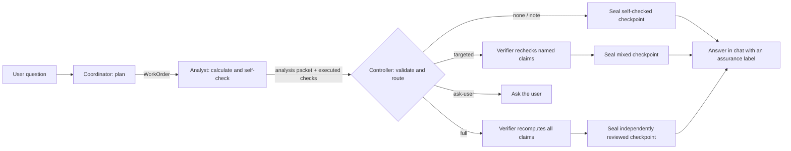

# Unix Audit Fixes Implementation Plan

> **For agentic workers:** REQUIRED SUB-SKILL: Use superpowers:subagent-driven-development (recommended) or superpowers:executing-plans to implement this plan task-by-task. Steps use checkbox (`- [ ]`) syntax for tracking.

**Goal:** Make the workflow controller safe and readable by fixing the 2026-10-10 Unix philosophy audit findings. No model behaviour or analysis method changes beyond what each task states.

**Architecture:** Each task is one small, self-contained change with its own tests and commit. First the code is auto-formatted so later edits are readable. Then the controller stops guessing from question wording: decisions move into the planner's `WorkOrder` and are validated by schema. Retired features and duplicated defaults are deleted. Two pure helpers are pulled out of the orchestrator. Docs get one current architecture page.

**Tech Stack:** TypeScript (Node 22, ESM), Vitest, Playwright, TypeBox, Python 3.12 (unchanged), Prettier 3.3.3 (new dev dependency).

---

## Read this first

- **Working directory.** Run every command from `pricing-harness/`. The Git repository root is its parent (`Pricing_harness/`). `git add` with paths relative to `pricing-harness/` works from there.
- **No paid model calls.** Never run `npm run eval`, `npm run eval:configured` without `--dry-run`, or anything that contacts OpenRouter. All tests here are offline.
- **Do not change** `bundled/pricing-plugin/**`, Python files, `docs/releases/**`, or `.env`.
- **Code style after Task 1** is Prettier output. Every code block below is written in that style. Find code by its content, not by line number, because line numbers shift as tasks land.
- **Test commands.** Unit and integration: `npx vitest run <file>`. Typecheck: `npm run typecheck`. Full suite: `npm test`.
- **A pre-existing flaky test.** `tests/unit/runs.test.ts › deduplicates before hashing…` fails about once in eight full-suite runs; it passes when run alone. If it is the only failure, rerun that file alone. Do not edit it.
- **When a step's expected output does not match, stop.** Report what you saw. Do not improvise a different fix.

## File map

| File | Change |
|---|---|
| `package.json`, `npm-shrinkwrap.json`, `package-lock.json`, `.prettierrc.json` | Task 1: Prettier |
| `src/agent/workflow/context-notes.ts` (new) | Task 2: build the confirmed-definitions text |
| `src/agent/workflow/orchestrator.ts` | Tasks 2, 3, 4, 6, 7 |
| `tests/fixtures/workflow-flow.ts` | Tasks 2, 3: `coordinatorData` option, `independentReview` |
| `src/agent/workflow/coordinator.ts`, `contracts.ts`, `output-contract.ts` | Task 3: `independentReview`, `cohortAction`; remove `classifyBudget` |
| `src/agent/workflow/delivery.ts` | Task 4: `assuranceNote`, `failureMessage` |
| `src/runtime.ts`, `src/settings.ts`, `src/application.ts`, `src/server.ts`, `src/headless.ts`, `src/agent/workflow/budget.ts`, `stage-runner.ts`, `role-prompts.ts`, `harness.config.json` | Task 5: remove retired features |
| `src/defaults.ts` (new) | Task 6: single home for built-in fallbacks |
| `src/agent/workflow/stage-prompt.ts`, `stage-metrics.ts` (new) | Task 7: extracted from the orchestrator |
| `scripts/eval-*.mjs`, `tests/unit/workflow-evaluation.test.ts` | Task 8: one eval runner |
| `docs/architecture.md` (new), `docs/design/HLD.md`, `docs/design/LLD.md`, `README.md` | Task 9 |

---

### Task 0: Start from a clean branch

**Files:** none

- [x] **Step 1: Check the working tree is clean**

Run: `git status --porcelain`
Expected: no output, except possibly this plan file and `.scratch/` entries.

If anything else is listed, **stop**. Ask the owner to commit or stash the in-progress `perf/latency-verification` work first. This plan assumes that work is committed.

- [x] **Step 2: Create the branch**

```bash
git switch -c fix/unix-audit
```

- [x] **Step 3: Record the baseline**

Run: `npm run build && npm run typecheck && npm test`
Expected: build and typecheck exit 0; Vitest reports all files passing (apart from the known flaky test above). Write the pass count down. Later tasks compare against it.

Recorded baseline (2026-10-11): **261 tests passed across 53 files**; build and typecheck exited 0.

`tests/unit/workflow-evaluation.test.ts` imports the compiled `dist/` output, so rebuild (`npm run build`) whenever a step says to.

---

### Task 1: Add Prettier and format the code

Audit finding: *Clarity*. Lines up to 1,389 characters make every later change unreviewable. Formatting changes layout only, never behaviour.

**Files:**
- Create: `.prettierrc.json`
- Modify: `package.json`, `npm-shrinkwrap.json`, `package-lock.json`, every `src/**/*.{ts,tsx}`, `tests/**/*.ts`, `scripts/**/*.mjs`

- [x] **Step 1: Install Prettier**

```bash
npm install --save-dev --save-exact prettier@3.3.3
```

Then keep the two lockfiles identical (they are identical today):

```bash
cp npm-shrinkwrap.json package-lock.json
```

- [x] **Step 2: Add the config file `.prettierrc.json`**

```json
{
  "printWidth": 120,
  "singleQuote": true,
  "trailingComma": "all",
  "arrowParens": "avoid",
  "bracketSpacing": false
}
```

- [x] **Step 3: Add scripts to `package.json`**

Inside `"scripts"`, after `"typecheck": "tsc --noEmit",` add:

```json
    "format": "prettier --write \"src/**/*.{ts,tsx}\" \"tests/**/*.ts\" \"scripts/**/*.mjs\"",
    "format:check": "prettier --check \"src/**/*.{ts,tsx}\" \"tests/**/*.ts\" \"scripts/**/*.mjs\"",
```

- [x] **Step 4: Format**

Run: `npm run format`
Expected: Prettier lists the files it wrote and exits 0.

- [x] **Step 5: Verify nothing changed in behaviour**

Run: `npm run typecheck && npm test && npm run format:check`
Expected: typecheck exits 0. The same test count as the Task 0 baseline passes. `format:check` prints "All matched files use Prettier code style!".

- [x] **Step 6: Commit**

```bash
git add .prettierrc.json package.json npm-shrinkwrap.json package-lock.json src tests scripts
git commit -m "style: format TypeScript and scripts with Prettier"
```

---

### Task 2: Save only confirmed definitions to `context.md`

Audit finding (High): *Least Surprise*. When the planner returns any `confirmedDefinitions` and the question contains words such as "use" or "compare", the orchestrator appends **the whole question** to `.pricing/context.md` under "Explicit user confirmation". Every later run then treats it as a confirmed business fact.

New behaviour: append only the planner's `confirmedDefinitions`, as bullets, and skip ones already present. No regex.

**Files:**
- Create: `src/agent/workflow/context-notes.ts`
- Create: `tests/unit/context-notes.test.ts`
- Create: `tests/integration/context-definitions.test.ts`
- Modify: `tests/fixtures/workflow-flow.ts`
- Modify: `src/agent/workflow/orchestrator.ts`

- [x] **Step 1: Write the failing unit test `tests/unit/context-notes.test.ts`**

```ts
import {expect, it} from 'vitest';
import {appendConfirmedDefinitions} from '../../src/agent/workflow/context-notes.js';
const base = '# Confirmed business context\n\nRevenue is in GBP.\n';
it('appends each new definition as a dated bullet', () => {
  const next = appendConfirmedDefinitions(base, ['Margin means gross margin after rebates.'], '2026-10-11');
  expect(next).toBe(
    '# Confirmed business context\n\nRevenue is in GBP.\n\n## Confirmed by the user (2026-10-11)\n- Margin means gross margin after rebates.\n',
  );
});
it('returns the context unchanged when nothing new was confirmed', () => {
  expect(appendConfirmedDefinitions(base, [], '2026-10-11')).toBe(base);
  expect(appendConfirmedDefinitions(base, ['  ', ''], '2026-10-11')).toBe(base);
  expect(appendConfirmedDefinitions(base, ['Revenue is in GBP.'], '2026-10-11')).toBe(base);
});
it('removes duplicates and surrounding whitespace', () => {
  const next = appendConfirmedDefinitions(base, [' A means B. ', 'A means B.'], '2026-10-11');
  expect(next.match(/- A means B\./g)).toHaveLength(1);
});
```

- [x] **Step 2: Run it and confirm it fails**

Run: `npx vitest run tests/unit/context-notes.test.ts`
Expected: FAIL, because `context-notes.js` cannot be found.

- [x] **Step 3: Create `src/agent/workflow/context-notes.ts`**

```ts
// Confirmed context only grows from definitions the planner extracted from the user's message.
export function appendConfirmedDefinitions(context: string, definitions: string[], date: string): string {
  const fresh = [...new Set(definitions.map(d => d.trim()).filter(Boolean))].filter(d => !context.includes(d));
  if (!fresh.length) return context;
  return `${context.trimEnd()}\n\n## Confirmed by the user (${date})\n${fresh.map(d => `- ${d}`).join('\n')}\n`;
}
```

- [x] **Step 4: Run the unit test and confirm it passes**

Run: `npx vitest run tests/unit/context-notes.test.ts`
Expected: PASS (3 tests).

- [x] **Step 5: Let tests shape the fake planner's output**

In `tests/fixtures/workflow-flow.ts`, add an option to `FlowOptions`, after the `profileSources` line:

```ts
  coordinatorData?: (data: any, question: string) => void;
```

Then replace the coordinator branch:

```ts
      if (r.role === 'coordinator')
        data = {
          schemaVersion: 1,
          originalRequest: envelope.originalRequest,
          scope,
          depth: 'analysis',
          operations: ['revenue'],
          visualize: false,
          confirmedDefinitions: [],
        };
      else {
```

with:

```ts
      if (r.role === 'coordinator') {
        data = {
          schemaVersion: 1,
          originalRequest: envelope.originalRequest,
          scope,
          depth: 'analysis',
          operations: ['revenue'],
          visualize: false,
          confirmedDefinitions: [],
        };
        options.coordinatorData?.(data, envelope.originalRequest);
      } else {
```

Check that the closing brace of the old `else { ... }` block still matches. The `else` body is unchanged.

- [x] **Step 6: Write the failing integration test `tests/integration/context-definitions.test.ts`**

```ts
import {expect, it} from 'vitest';
import {readFile} from 'node:fs/promises';
import {createFlow} from '../fixtures/workflow-flow.js';
it('saves the planner-confirmed definition and never the raw question', async () => {
  const f = await createFlow({
    coordinatorData: data => {
      data.confirmedDefinitions = ['Revenue means net invoice revenue.'];
    },
  });
  await f.run('Compare Q3 margins using net revenue');
  const context = await readFile(f.paths.context, 'utf8');
  expect(context).toContain('- Revenue means net invoice revenue.');
  expect(context).not.toContain('Compare Q3 margins');
  expect(context).not.toContain('Explicit user confirmation');
});
it('leaves context untouched when the planner confirms nothing', async () => {
  const f = await createFlow();
  const before = await readFile(f.paths.context, 'utf8');
  await f.run('Compare Q3 margins using net revenue');
  expect(await readFile(f.paths.context, 'utf8')).toBe(before);
});
```

- [x] **Step 7: Run it and confirm the first test fails**

Run: `npx vitest run tests/integration/context-definitions.test.ts`
Expected: the first test FAILS on `toContain('- Revenue means net invoice revenue.')`. The second passes.

- [x] **Step 8: Fix the orchestrator**

In `src/agent/workflow/orchestrator.ts`, add an import after the `import {checkedFigures} ...` line:

```ts
import {appendConfirmedDefinitions} from './context-notes.js';
```

Replace this block:

```ts
      if (order.confirmedDefinitions.length && /\b(?:means|compare|use|for this|by .*mean|define)\b/i.test(question)) {
        await writeFile(
          paths.context,
          (await readFile(paths.context, 'utf8')) + '\n## Explicit user confirmation\n' + question + '\n',
        );
        protectedRefs = protectedRefs.filter(r => r.path !== relative(paths.root, paths.context));
        protectedRefs.push({path: relative(paths.root, paths.context), sha256: (await hashFile(paths.context)).sha256});
      }
```

with:

```ts
      const currentContext = await readFile(paths.context, 'utf8');
      const updatedContext = appendConfirmedDefinitions(
        currentContext,
        order.confirmedDefinitions,
        new Date().toISOString().slice(0, 10),
      );
      if (updatedContext !== currentContext) {
        await writeFile(paths.context, updatedContext);
        protectedRefs = protectedRefs.filter(r => r.path !== relative(paths.root, paths.context));
        protectedRefs.push({path: relative(paths.root, paths.context), sha256: (await hashFile(paths.context)).sha256});
      }
```

- [x] **Step 9: Run the tests**

Run: `npx vitest run tests/integration/context-definitions.test.ts tests/unit/context-notes.test.ts && npm test`
Expected: both new files pass. The full suite passes at baseline count + 5.

- [x] **Step 10: Commit**

```bash
git add src/agent/workflow/context-notes.ts src/agent/workflow/orchestrator.ts tests/unit/context-notes.test.ts tests/integration/context-definitions.test.ts tests/fixtures/workflow-flow.ts
git commit -m "fix: save only planner-confirmed definitions to context.md, never the raw question"
```

---

### Task 3: Move review and cohort decisions into the work order

Audit finding (High): *Separation / Representation*. The controller decides by spotting words in the question:
- `requireIndependent` regex in the orchestrator ("audit", "second opinion", …);
- `classifyBudget` in `coordinator.ts`, which picks the planning budget and forces `report` depth. It also matches the literal default text of `context.md`;
- cohort carry-over regexes in `validateWorkOrder` ("re-rank", "use … instead").

New behaviour:
- The planner sets `independentReview: true` when the user asks for independent checking.
- The planner sets `cohortAction`: `'keep'` (the default, the same safe carry-over as today), `'replace'` (use the planner's new cohort) or `'rerank'` (drop the cohort).
- Planning always starts on the `analysis` budget, and the planner's `depth` is final.

The shipped `harness.config.json` gives `analysis` and `report` identical limits, so dropping the `report` override does not change budgets.

**Files:**
- Modify: `src/agent/workflow/contracts.ts`
- Modify: `src/agent/workflow/output-contract.ts`
- Modify: `src/agent/workflow/coordinator.ts`
- Modify: `src/agent/workflow/orchestrator.ts`
- Modify: `tests/unit/workflow-coordinator.test.ts`
- Modify: `tests/fixtures/workflow-flow.ts`
- Modify: `tests/integration/workflow-self-check.test.ts`
- Create: `tests/integration/review-request.test.ts`

- [x] **Step 1: Update the coordinator unit tests first**

In `tests/unit/workflow-coordinator.test.ts`:

1. Change the import line to:
   ```ts
   import {validateWorkOrder, compactHistory} from '../../src/agent/workflow/coordinator.js';
   ```
2. Delete the whole test `it('keeps an explicit detailed scenario in the report class when the planner under-classifies it', ...)`.
3. Delete the whole test `it('caps a direct recovery lookup and a fresh ambiguous definition request during planning', ...)`.
4. In the test `it('rejects invalid plans and routes uncached new claims to analysis without mandatory plots', ...)`, delete its last line:
   ```ts
   expect(classifyBudget('Give me the full pass-through and constrained scenario for a budget review')).toBe('report');
   ```
5. Replace the whole test `it('inherits fixed cohort in follow-ups and allows an explicit quarter reranking', ...)` with:
   ```ts
   it('keeps the fixed cohort by default and follows an explicit planner cohort action', () => {
     const cohortOf = (cohortAction: string | undefined, question: string) =>
       validateWorkOrder(
         {...order, originalRequest: question, cohortAction, scope: {...previous, cohort: ['C'], rankingWindow: 'Q3'}},
         question,
         previous,
       ).scope.cohort;
     expect(cohortOf(undefined, 'Did it recover?')).toEqual(['A', 'B']);
     expect(cohortOf('keep', 'Rank using only Q3')).toEqual(['A', 'B']);
     expect(cohortOf('replace', 'Use C instead')).toEqual(['C']);
     expect(cohortOf('rerank', 'Rank using only Q3')).toBeUndefined();
   });
   it('takes depth and review intent from the planner, not from question wording', () => {
     const question = 'Audit a detailed break-even scenario independently.';
     const plan = validateWorkOrder({...order, originalRequest: question, depth: 'analysis'}, question);
     expect(plan.depth).toBe('analysis');
     expect(plan.independentReview).toBeUndefined();
     expect(
       validateWorkOrder({...order, originalRequest: question, independentReview: true}, question).independentReview,
     ).toBe(true);
   });
   ```
6. In the test `it('fills only omitted controller schema metadata and rejects missing or malformed business fields', ...)`, add two entries to the `for (const raw of [ ... ])` list, after `{...order, operations: undefined},`:
   ```ts
       {...order, independentReview: 'yes'},
       {...order, cohortAction: 'drop'},
   ```

- [x] **Step 2: Run the coordinator tests and confirm they fail**

Run: `npx vitest run tests/unit/workflow-coordinator.test.ts`
Expected: FAIL. `cohortOf('replace', ...)` returns `['A','B']`, `cohortOf('keep', 'Rank using only Q3')` returns `undefined`, the detailed-scenario depth is `'report'`, and the two malformed entries are not rejected.

- [x] **Step 3: Add the fields to the `WorkOrder` type**

In `src/agent/workflow/contracts.ts`, inside `export type WorkOrder = { ... }`, after `confirmedDefinitions: string[];` add:

```ts
  independentReview?: boolean;
  cohortAction?: 'keep' | 'replace' | 'rerank';
```

- [x] **Step 4: Add the fields to the planner's output schema**

In `src/agent/workflow/output-contract.ts`, replace the `workOrder` schema:

```ts
const workOrder = object({
  schemaVersion: version,
  originalRequest: text(),
  scope,
  depth: Type.Union([Type.Literal('quick'), Type.Literal('analysis'), Type.Literal('report')]),
  operations: ids(),
  visualize: Type.Boolean(),
  confirmedDefinitions: strings(),
  blockingInput: Type.Optional(text()),
  cacheId: Type.Optional(text()),
  cachedClaimIds: Type.Optional(ids()),
});
```

with:

```ts
const workOrder = object({
  schemaVersion: version,
  originalRequest: text(),
  scope,
  depth: Type.Union([Type.Literal('quick'), Type.Literal('analysis'), Type.Literal('report')]),
  operations: ids(),
  visualize: Type.Boolean(),
  confirmedDefinitions: Type.Array(text(), {
    description:
      'Business definitions the user states in this message, one sentence each. They are saved to confirmed context.',
  }),
  independentReview: Type.Optional(
    Type.Boolean({
      description: 'true only when the user explicitly asks for independent verification, a second opinion or an audit.',
    }),
  ),
  cohortAction: Type.Optional(
    Type.Union([Type.Literal('keep'), Type.Literal('replace'), Type.Literal('rerank')], {
      description:
        'Follow-ups keep the previous ranked cohort by default. replace: the user names a different group. rerank: the user asks to rank again.',
    }),
  ),
  blockingInput: Type.Optional(text()),
  cacheId: Type.Optional(text()),
  cachedClaimIds: Type.Optional(ids()),
});
```

- [x] **Step 5: Rewrite `validateWorkOrder` and delete `classifyBudget`**

In `src/agent/workflow/coordinator.ts`:

1. Delete the line `import type {BudgetClass} from './budget.js';`.
2. Delete the whole function `export function classifyBudget(...) { ... }`.
3. In `validateWorkOrder`'s big validation `if (...)`, add two conditions after `(o.cachedClaimIds !== undefined && !strings(o.cachedClaimIds))`, joined with `||`:
   ```ts
    (o.independentReview !== undefined && typeof o.independentReview !== 'boolean') ||
    (o.cohortAction !== undefined && !['keep', 'replace', 'rerank'].includes(o.cohortAction))
   ```
   Remember to add `||` after the existing `(o.cachedClaimIds ...)` line.
4. Replace the two cohort statements:
   ```ts
   if (
     previous?.cohort &&
     !/\b(?:re.?rank|rank.*(?:only|latest|quarter)|change.*(?:rank|cohort|group)|use.*instead)\b/i.test(question)
   ) {
     o.scope.cohort = previous.cohort;
     o.scope.rankingWindow = previous.rankingWindow;
   }
   if (previous?.cohort && /\b(?:re.?rank|rank.*(?:only|latest|quarter))\b/i.test(question)) delete o.scope.cohort;
   ```
   with:
   ```ts
   // Keeping the previous cohort is the safe default; only an explicit planner action changes it.
   const cohortAction = o.cohortAction ?? 'keep';
   if (previous?.cohort && cohortAction === 'keep') {
     o.scope.cohort = previous.cohort;
     o.scope.rankingWindow = previous.rankingWindow;
   }
   if (previous?.cohort && cohortAction === 'rerank') delete o.scope.cohort;
   ```
5. Delete the final override and its comment:
   ```ts
   // Explicit scenario/report work must not lose its allowance merely because
   // the model labels it ordinary analysis. A truly blocking question stays quick.
   if (!o.blockingInput && classifyBudget(question) === 'report') o.depth = 'report';
   ```

- [x] **Step 6: Run the coordinator tests**

Run: `npx vitest run tests/unit/workflow-coordinator.test.ts`
Expected: PASS.

- [x] **Step 7: Write the failing integration test `tests/integration/review-request.test.ts`**

```ts
import {expect, it} from 'vitest';
import {createFlow} from '../fixtures/workflow-flow.js';
it('does not run the verifier just because the question says "audit"', async () => {
  const f = await createFlow();
  const result = await f.run('Audit revenue for Q3');
  expect(result.outcome.kind).toBe('complete');
  expect(f.calls).not.toContain('verifier');
});
it('runs the full verifier when the planner records an independent-review request', async () => {
  const f = await createFlow({
    coordinatorData: data => {
      data.independentReview = true;
    },
  });
  const result = await f.run('Please double-check revenue');
  expect(result.outcome.kind).toBe('complete');
  expect(f.calls).toContain('verifier');
});
```

- [x] **Step 8: Run it and confirm both tests fail**

Owner-approved order correction (2026-10-11): apply Step 9 items 1–2 before this step to remove the deleted `classifyBudget` import and caller. Run this failing test before applying Step 9 items 3–5, preserving the review-routing TDD check.

Run: `npx vitest run tests/integration/review-request.test.ts`
Expected: the first test FAILS ("audit" triggers the regex, so the verifier runs). The second test FAILS ("double-check" matches no regex, so the verifier does not run).

- [x] **Step 9: Use the work-order fields in the orchestrator**

In `src/agent/workflow/orchestrator.ts`:

1. Change the coordinator import to:
   ```ts
   import {validateWorkOrder, compactHistory} from './coordinator.js';
   ```
2. Replace:
   ```ts
       const planningClass = classifyBudget(question, await readFile(paths.context, 'utf8'));
       const budget = new WorkflowBudget(
         planningClass,
         Date.now,
         config.workflowLimits?.[planningClass],
         Date.parse(run.startedAt),
         config.workflowPolicy,
       );
   ```
   with:
   ```ts
       // Planning runs on the analysis allowance; the planner's chosen depth then selects the final class.
       const budget = new WorkflowBudget(
         'analysis',
         Date.now,
         config.workflowLimits?.analysis,
         Date.parse(run.startedAt),
         config.workflowPolicy,
       );
   ```
3. Replace the regex declaration:
   ```ts
       const requireIndependent =
         /\b(?:independent(?:ly)?\s+(?:verify|verification|review|check)|(?:verify|check|review)\b.{0,30}\bindependent(?:ly)?|second\s+(?:opinion|review)|audit|use\s+(?:the\s+)?verifier)\b/i.test(
           question,
         );
   ```
   with:
   ```ts
       // Set from the planner's work order once planning has finished.
       let requireIndependent = false;
   ```
4. Replace the compatible-entries loop:
   ```ts
         for (const entry of entries)
           if (await index.compatible(entry.id, entry.scope, sourceRefs)) {
             const cp =
               requireIndependent && entry.checkpoint
                 ? await loadCheckpoint(paths.root, entry.checkpoint, conversation, entry.scope)
                 : undefined;
             if (!requireIndependent || (cp && (cp.assurance ?? 'independently-reviewed') === 'independently-reviewed'))
               compatible.add(entry.id);
           }
   ```
   with:
   ```ts
         // Entries carry their assurance; the cache branch below refuses self-checked results for independent requests.
         for (const entry of entries)
           if (await index.compatible(entry.id, entry.scope, sourceRefs)) compatible.add(entry.id);
   ```
5. Directly after `order = validateWorkOrder(planned.data, question, scope, compatible);` add:
   ```ts
         requireIndependent = order.independentReview === true;
   ```

Leave the other `requireIndependent` uses (the cache check and both `routeReview(...)` calls) as they are.

- [x] **Step 10: Make the existing fake planners record review requests**

Three existing tests ask "Review revenue and independently verify it". Their fake planners must now say so explicitly.

In `tests/fixtures/workflow-flow.ts`, in the coordinator `data = {...}` object from Task 2, add after `confirmedDefinitions: [],`:

```ts
          ...(envelope.originalRequest.includes('independently') ? {independentReview: true} : {}),
```

In `tests/integration/workflow-self-check.test.ts`, in its coordinator `data = {...}` object, add the same line after `confirmedDefinitions: [],`.

- [x] **Step 11: Run the tests**

Run: `npx vitest run tests/integration/review-request.test.ts tests/integration/workflow-self-check.test.ts tests/integration/background-verification.test.ts tests/integration/checked-figures-delivery.test.ts && npm run typecheck && npm test`
Expected: all pass; typecheck exits 0.

- [x] **Step 12: Commit**

```bash
git add src/agent/workflow/contracts.ts src/agent/workflow/output-contract.ts src/agent/workflow/coordinator.ts src/agent/workflow/orchestrator.ts tests/unit/workflow-coordinator.test.ts tests/fixtures/workflow-flow.ts tests/integration/workflow-self-check.test.ts tests/integration/review-request.test.ts
git commit -m "refactor: take review and cohort decisions from the work order instead of question regexes"
```

---

### Task 4: Say what actually went wrong

Audit finding (Low): *Repair*. Today every failure produces "I could not independently verify an answer", even budget exhaustion, cancellation, changed sources, or a self-check run where no independent review was attempted.

**Files:**
- Modify: `src/agent/workflow/delivery.ts`
- Create: `tests/unit/delivery.test.ts`
- Modify: `src/agent/workflow/orchestrator.ts`

- [x] **Step 1: Write the failing test `tests/unit/delivery.test.ts`**

```ts
import {expect, it} from 'vitest';
import {assuranceNote, failureMessage} from '../../src/agent/workflow/delivery.js';
it('names the reason a run stopped', () => {
  expect(failureMessage('cancelled')).toBe(
    'Stopped before a checked answer was ready. Retained analysis files are drafts.',
  );
  expect(failureMessage('tool budget exhausted')).toBe(
    'Stopped: this request ran out of its time or call budget. Retained analysis files are drafts.',
  );
  expect(failureMessage('deadline exhausted')).toMatch(/ran out of its time or call budget/);
  expect(failureMessage('verification/finalization reserve')).toMatch(/ran out of its time or call budget/);
  expect(failureMessage('source or approved evidence changed')).toBe(
    'Stopped: a source file or checked evidence changed during the run. Ask again to recompute.',
  );
  expect(failureMessage('Invalid analysis packet: /claims/0 bad')).toBe(
    'Could not produce a checked answer. Retained analysis files are drafts.',
  );
  expect(failureMessage('x'.repeat(400)).length).toBeLessThan(400);
});
it('labels self-checked and mixed answers', () => {
  expect(assuranceNote('self-checked')).toBe('\n\nSelf-checked; no independent review.');
  expect(assuranceNote('mixed')).toBe('\n\nIncludes self-checked and independently reviewed results.');
  expect(assuranceNote('independently-reviewed')).toBe('');
  expect(assuranceNote(undefined)).toBe('');
});
```

- [x] **Step 2: Run it and confirm it fails**

Run: `npx vitest run tests/unit/delivery.test.ts`
Expected: FAIL, because `assuranceNote` and `failureMessage` are not exported.

- [x] **Step 3: Add the functions to `src/agent/workflow/delivery.ts`**

Append:

```ts
export function assuranceNote(assurance: Checkpoint['assurance']): string {
  if (assurance === 'self-checked') return '\n\nSelf-checked; no independent review.';
  if (assurance === 'mixed') return '\n\nIncludes self-checked and independently reviewed results.';
  return '';
}
const budgetStop = /budget exhausted|deadline exhausted|finalization reserve|no progress|group limit|planning consumed/;
// The user-facing reason a run ended without a checked answer. The full reason stays in run.json.
export function failureMessage(reason: string): string {
  if (reason === 'cancelled') return 'Stopped before a checked answer was ready. Retained analysis files are drafts.';
  if (budgetStop.test(reason))
    return 'Stopped: this request ran out of its time or call budget. Retained analysis files are drafts.';
  if (/changed/.test(reason))
    return 'Stopped: a source file or checked evidence changed during the run. Ask again to recompute.';
  return 'Could not produce a checked answer. Retained analysis files are drafts.';
}
```

Change the first line of the file to also import `Checkpoint`:

```ts
import type {Checkpoint, VerificationRecord} from './contracts.js';
```

- [x] **Step 4: Run the test**

Run: `npx vitest run tests/unit/delivery.test.ts`
Expected: PASS. If the `assuranceNote('mixed')` line fails to typecheck because `Checkpoint['assurance']` does not include `'mixed'`, open `contracts.ts` and look at `Checkpoint`. Use the type of its `assurance` field exactly (it is the same type the orchestrator compares against `'mixed'` today).

- [x] **Step 5: Use them in the orchestrator**

In `src/agent/workflow/orchestrator.ts`:

1. Change `import {remainingWork} from './delivery.js';` to:
   ```ts
   import {assuranceNote, failureMessage, remainingWork} from './delivery.js';
   ```
2. Delete the local helper:
   ```ts
       const assuranceNote = (cp: Checkpoint) =>
         cp.assurance === 'self-checked'
           ? '\n\nSelf-checked; no independent review.'
           : cp.assurance === 'mixed'
             ? '\n\nIncludes self-checked and independently reviewed results.'
             : '';
   ```
3. Replace each call `assuranceNote(cp)` with `assuranceNote(cp.assurance)`, and each `assuranceNote(checkpoint)` with `assuranceNote(checkpoint.assurance)`. Run `grep -n "assuranceNote(" src/agent/workflow/orchestrator.ts`. Every call must now pass an `.assurance` value.
4. Replace:
   ```ts
         await say(
           'I could not independently verify an answer within this request. Retained analysis files are drafts.',
         );
   ```
   with:
   ```ts
         await say(failureMessage(reason));
   ```

Owner-approved correction (2026-10-11): public failure messages use fixed explanations; full diagnostics remain in `run.json`. Keep the existing integration privacy assertions unchanged. The original Step 6 exposed a private path and diagnostic value through both raw-error branches.

- [x] **Step 5a: Add privacy regression tests and verify RED before changing the helpers**

Update Step 1's budget and unexpected-failure expectations to the safe messages above, and append:

```ts
it('keeps budget diagnostics out of public replies', () => {
  const message = failureMessage('tool budget exhausted: ENAMETOOLONG /private/internal/workflow/bad-result-123.45');
  expect(message).toBe(
    'Stopped: this request ran out of its time or call budget. Retained analysis files are drafts.',
  );
  expect(message).not.toMatch(/ENAMETOOLONG|\/private\/internal|123\.45/);
});
it('keeps unexpected failure diagnostics out of public replies', () => {
  const message = failureMessage('ENAMETOOLONG /private/internal/workflow/bad-result-123.45');
  expect(message).toBe('Could not produce a checked answer. Retained analysis files are drafts.');
  expect(message).not.toMatch(/ENAMETOOLONG|\/private\/internal|123\.45/);
});
```

Run: `npx vitest run tests/unit/delivery.test.ts`
Expected: FAIL. The reason-message test and both privacy regressions still receive raw diagnostic text (three failures; the assurance test passes).

- [x] **Step 5b: Apply the safe messages in Step 3 and verify GREEN**

Run: `npx vitest run tests/unit/delivery.test.ts tests/integration/workflow.test.ts`
Expected: all pass. Diagnostics remain available in the run outcome and `run.json`.

- [x] **Step 6: Run the tests**

Run: `npm run typecheck && npm test`
Expected: all pass.

- [x] **Step 7: Commit**

```bash
git add src/agent/workflow/delivery.ts src/agent/workflow/orchestrator.ts tests/unit/delivery.test.ts
git commit -m "fix: tell the user why a run stopped instead of one generic verification message"
```

---

### Task 5: Delete retired features

Audit finding (Medium): *Simplicity*. The following can never run but every reader must account for them:
- the `legacy` workflow mode;
- `render` and `preview` budget counters and policy keys;
- the always-"Retired" `reports`, `preview` and `vision` health entries;
- the `visualizer` role;
- packaged `bundled/**/*.html` and `*.mjs` globs that match no files.

While touching the startup error handlers, print the real error. Today a bad config key prints only a generic "Startup failed".

**Files:**
- Modify: `src/runtime.ts`, `src/settings.ts`, `src/application.ts`, `src/server.ts`, `src/headless.ts`
- Modify: `src/agent/workflow/budget.ts`, `contracts.ts`, `stage-runner.ts`, `role-prompts.ts`, `orchestrator.ts`
- Modify: `harness.config.json`, `package.json`, `scripts/eval-configured.mjs`, `scripts/eval-focused-workflow.mjs`
- Modify tests: `tests/unit/runtime.test.ts`, `tests/unit/settings.test.ts`, `tests/unit/workflow-budget.test.ts`, `tests/unit/workflow-runner.test.ts`, `tests/integration/workflow-chat-exploration.test.ts`

- [x] **Step 1: Update the tests to describe the new behaviour**

1. `tests/unit/runtime.test.ts`:
   - Delete the test `it('rejects explicit legacy execution with actionable bounded-mode guidance', ...)`.
   - Replace the test `it('keeps analysis Python usable while retired report and browser capabilities are inactive', ...)` with:
     ```ts
     it('reports only agent and Python readiness', async () => {
       const health = await checkRuntime(loadConfig({...env, PRICING_PYTHON: resolve('.venv/bin/python')}));
       expect(health.python.ready).toBe(true);
       expect(Object.keys(health).sort()).toEqual(['agent', 'python']);
     });
     ```
   - Delete the test `it('rejects an explicitly passed legacy application config before workspace or provider startup', ...)`.
2. `tests/unit/settings.test.ts`:
   - In the `settings` constant, change the policy line to:
     ```ts
         policy: {retry: 0, correction: 2, noProgressRepeats: 4, maxAnalysisGroups: 3},
     ```
   - In the test `it('uses configured retry/repair ceilings and repeated-evidence cutoff in the real budget', ...)`, delete these five lines:
     ```ts
       const r = new WorkflowBudget('analysis', () => 0, config.workflowLimits!.analysis, 0, (config as any).workflowPolicy);
       r.debit('render');
       r.debit('render');
       r.debit('render');
       expect(() => r.debit('render')).toThrow(/render/);
     ```
   - Add a new test at the end of the file:
     ```ts
     it('rejects retired workflow settings', () => {
       for (const workflow of [{mode: 'bounded'}, {mode: 'legacy'}, {policy: {render: 2}}, {policy: {preview: 2}}])
         expect(() => loadConfig({...base, PRICING_CONFIG_FILE: fixture({...settings, workflow})})).toThrow(
           /Unknown settings key/,
         );
     });
     ```
3. `tests/unit/workflow-budget.test.ts`: in the test `it('shares one correction and two renders/previews and stops only identical evidence pairs', ...)`:
   - Rename it to `it('shares one correction and stops only identical evidence pairs', () => {`.
   - Delete these eight lines:
     ```ts
       const r = new WorkflowBudget('report');
       r.debit('render');
       r.debit('render');
       expect(() => r.debit('render')).toThrow(/render/);
       const p = new WorkflowBudget('report');
       p.debit('preview');
       p.debit('preview');
       expect(() => p.debit('preview')).toThrow(/preview/);
     ```
4. `tests/unit/workflow-runner.test.ts`: replace the whole first test `it('rejects retired presentation workers before creating any child or provider session', ...)` with:
   ```ts
   it('rejects unknown roles before creating any child or provider session', async () => {
     const runner = new StageRunner();
     await expect(
       runner.execute(
         {role: 'visualizer', operation: 'present'} as any,
         new WorkflowBudget('quick'),
         new AbortController().signal,
         () => {},
       ),
     ).rejects.toThrow(/Unknown workflow role/);
     expect(runner.activeCount).toBe(0);
     expect(stageToolNames('analyst', 'analyse')).toEqual(['read', 'write', 'edit', 'bash', 'execute_analysis']);
     expect(() => stageToolNames('visualizer' as any, 'present')).toThrow(/Unknown workflow role/);
   });
   ```
5. `tests/integration/workflow-chat-exploration.test.ts`: change
   ```ts
     expect(run.workflow?.budget.counters).toMatchObject({render: 0, preview: 0, handoffRepair: 0});
   ```
   to
   ```ts
     expect(run.workflow?.budget.counters).toMatchObject({handoffRepair: 0});
     expect(run.workflow?.budget.counters).not.toHaveProperty('render');
   ```

- [x] **Step 2: Run these tests and confirm they fail**

Run: `npx vitest run tests/unit/runtime.test.ts tests/unit/settings.test.ts tests/unit/workflow-runner.test.ts tests/integration/workflow-chat-exploration.test.ts`
Expected: FAIL. Health still has five keys; `workflow.mode` is still accepted; the runner still throws "retired"; counters still contain `render`.

- [x] **Step 3: Remove `render`/`preview` from the budget**

In `src/agent/workflow/budget.ts`:
- In `export type Counter = ...`, delete the `| 'render'` and `| 'preview'` lines.
- In the `counts` initializer, delete `render: 0,` and `preview: 0,`.
- In `debit`, replace `: kind === 'render' || kind === 'preview' || kind === 'revisionRounds'` with `: kind === 'revisionRounds'`. (Task 6 rewrites this expression again.)

In `src/agent/workflow/contracts.ts`, inside `StageMetrics`, delete `render: number;` and `preview: number;`.

In `src/agent/workflow/orchestrator.ts`, in the `metrics = {...}` object inside `stage`, delete `render: 0,` and `preview: 0,`.

- [x] **Step 4: Remove the `visualizer` role**

In `src/agent/workflow/contracts.ts`, change:

```ts
export type Role = 'coordinator' | 'analyst' | 'visualizer' | 'verifier';
```

to:

```ts
export type Role = 'coordinator' | 'analyst' | 'verifier';
```

In `src/agent/workflow/role-prompts.ts`, replace `assertActiveStage`:

```ts
export function assertActiveStage(role: Role, operation: string): asserts role is ActiveRole {
  if (role === 'visualizer' || (role === 'verifier' && operation === 'visual'))
    throw Error('Presentation stages are retired; use bounded numerical analysis with optional in-chat exploration.');
  if (!['coordinator', 'analyst', 'verifier'].includes(role)) throw Error('Unknown workflow role');
}
```

with:

```ts
export function assertActiveStage(role: Role, _operation: string): asserts role is ActiveRole {
  if (!['coordinator', 'analyst', 'verifier'].includes(role)) throw Error(`Unknown workflow role: ${role}`);
}
```

In `src/agent/workflow/stage-runner.ts`, replace:

```ts
    if ((request.role as string) === 'visualizer' || (request.role === 'verifier' && request.operation === 'visual')) {
      try {
        assertActiveStage(request.role, request.operation);
      } catch (error) {
        return Promise.reject(error);
      }
    }
```

with:

```ts
    try {
      assertActiveStage(request.role, request.operation);
    } catch (error) {
      return Promise.reject(error);
    }
```

**Careful:** the role check now runs for every request. Three tests in `tests/unit/workflow-runner.test.ts` pass requests with no role, and they will now fail with "Unknown workflow role". Add `role: 'analyst', operation: 'analyse'` to each request object and change nothing else:
- `{optional: true} as any` → `{role: 'analyst', operation: 'analyse', optional: true} as any`
- `{stageDir: dir} as any` → `{role: 'analyst', operation: 'analyse', stageDir: dir} as any`
- `{} as any` → `{role: 'analyst', operation: 'analyse'} as any`

These tests use fixture workers (`workerPath`) that ignore the role. Do not change any assertion.

- [x] **Step 5: Remove the legacy mode and retired health entries**

In `src/runtime.ts`:
- Delete `workflowMode?: 'bounded' | 'legacy';` from `HarnessConfig`.
- In `Health`, delete the `reports`, `preview` and `vision` lines so it becomes:
  ```ts
  export type Health = {
    agent: Capability;
    python: Capability;
  };
  ```
- Delete `LEGACY_RETIREMENT_MESSAGE` and `assertBoundedWorkflow` (both declarations).
- In `loadConfig`, delete these three lines:
  ```ts
    const workflowMode = env.PRICING_WORKFLOW_MODE ?? 'bounded';
    assertBoundedWorkflow({workflowMode: workflowMode as HarnessConfig['workflowMode']});
    if (workflowMode !== 'bounded') throw new Error('PRICING_WORKFLOW_MODE must be bounded');
  ```
  and delete `workflowMode: workflowMode as HarnessConfig['workflowMode'],` from the returned object.
- At the end of `checkRuntime`, replace:
  ```ts
    const retired: Capability = {ready: false, detail: 'Retired: rich results are rendered locally in chat'};
    return {agent, python, reports: {...retired}, preview: {...retired}, vision: {...retired}};
  ```
  with:
  ```ts
    return {agent, python};
  ```

In `src/settings.ts`:
- In `WorkflowPolicy`, delete `render?: number;` and `preview?: number;`.
- In `HarnessSettings.workflow`, delete `mode?: string;`.
- Change `const w = object(s.workflow, 'workflow', ['mode', 'limits', 'policy', 'review']);` to `const w = object(s.workflow, 'workflow', ['limits', 'policy', 'review']);`.
- Delete the line `if (w.mode !== undefined && !['bounded', 'legacy'].includes(w.mode)) throw Error('Invalid settings workflow.mode');`.
- In both policy key lists (the allowed-keys list and the "may be 0" list), delete `'render',` and `'preview',`.
- In `settingsForRuntime`, delete `put('PRICING_WORKFLOW_MODE', settings?.workflow?.mode);`.

In `src/application.ts`:
- Change the import to `import {loadConfig, checkRuntime, resolveModel, type HarnessConfig} from './runtime.js';`.
- Delete the line `assertBoundedWorkflow(config);`.

In `src/server.ts`:
- Delete `import {LEGACY_RETIREMENT_MESSAGE} from './runtime.js';`.
- Replace the startup catch body:
  ```ts
      process.stderr.write(
        (error instanceof Error && error.message === LEGACY_RETIREMENT_MESSAGE
          ? LEGACY_RETIREMENT_MESSAGE
          : 'Startup failed. Check required configuration, bundled resources and Python setup.') + '\n',
      );
  ```
  with:
  ```ts
      process.stderr.write(
        `Startup failed: ${error instanceof Error ? error.message : String(error)}\nCheck required configuration, bundled resources and Python setup.\n`,
      );
  ```

In `src/headless.ts`:
- Delete `import {LEGACY_RETIREMENT_MESSAGE} from './runtime.js';`.
- Replace the catch body the same way, with this text:
  ```ts
      process.stderr.write(
        `Harness failed: ${error instanceof Error ? error.message : String(error)}\nCheck configuration, dependencies and model credentials.\n`,
      );
  ```

These messages never include credentials: `loadConfig` errors name variables, not values.

- [x] **Step 6: Update config, packaging and eval scripts**

`harness.config.json`: delete the line `"mode": "bounded",` from `workflow`. In `workflow.policy`, delete `"render": 2,` and `"preview": 2,`.

`package.json` `"files"`: delete the lines `"bundled/**/*.mjs",` and `"bundled/**/*.html",`.

`scripts/eval-configured.mjs`: delete the line
```js
  if (config.workflowMode !== 'bounded') throw Error('Configured evaluation requires bounded workflow');
```

`scripts/eval-focused-workflow.mjs`: delete the line `PRICING_WORKFLOW_MODE: 'bounded',`.

Owner-approved correction (2026-10-11): complete the omitted retirement cleanup before Step 7. Remove the deleted `assertBoundedWorkflow` import/call from `src/agent/runs.ts`; narrow `VerificationRecord.correction.role` to `'analyst'`; remove the unused `VisualReview` type and unused visual-only fields from `VerificationRecord`. Retain the existing handoff rejection fixture and no-visualizer assertion: they test useful safeguards, rather than active retired functionality.

- [x] **Step 6a: Verify the omitted caller failure before fixing it**

Run: `npx vitest run tests/integration/workflow-controller.test.ts`
Expected: FAIL with `assertBoundedWorkflow is not a function` while constructing the controller.

- [x] **Step 6b: Complete the cleanup described above**

- [x] **Step 7: Find leftovers**

Run: `grep -rn "workflowMode\|LEGACY_RETIREMENT\|assertBoundedWorkflow\|'visualizer'\|PRICING_WORKFLOW_MODE" src scripts tests`
Expected: no source/script matches; four test matches only: the two unknown-role test lines from Step 1, the existing invalid correction fixture in `workflow-handoff.test.ts`, and the existing no-visualizer assertion in `workflow.test.ts`.

Run: `grep -rn "render: 0\|preview: 0\|'render'\|'preview'" src`
Expected: no matches.

- [x] **Step 8: Run everything**

Run: `npm run build && npm run typecheck && npm test`
Expected: all pass. If typecheck reports `health.reports` (or similar) in a test or fixture, delete that property access. Extra properties in `as any` fixture objects (`tests/unit/runs.test.ts`, `tests/integration/workflow-controller.test.ts`, `tests/browser/fixture-server.ts`) are harmless; leave them.

- [x] **Step 9: Commit**

```bash
git add -A src tests scripts harness.config.json package.json
git commit -m "refactor: remove retired legacy mode, render/preview counters, visualizer role and retired health entries"
```

---

### Task 6: One home for built-in defaults

Audit finding (Medium): *Representation*. The same fallbacks are written in several places:
- **budget limits:** `runtime.ts` and `budget.ts`;
- **policy fallbacks:** `?? 2`, `?? 3`, `?? 4` scattered across `budget.ts`, `worker.ts` and `orchestrator.ts`;
- **review escalation thresholds:** `review-policy.ts`;
- **thinking levels:** `settings.ts` and `runtime.ts`.

They are to live in one file. Values do not change.

**Files:**
- Create: `src/defaults.ts`
- Create: `tests/unit/defaults.test.ts`
- Modify: `src/runtime.ts`, `src/settings.ts`, `src/agent/workflow/budget.ts`, `worker.ts`, `orchestrator.ts`, `review-policy.ts`

- [x] **Step 1: Write the failing test `tests/unit/defaults.test.ts`**

```ts
import {expect, it} from 'vitest';
import {DEFAULT_LIMITS, DEFAULT_POLICY, DEFAULT_REVIEW_ESCALATION} from '../../src/defaults.js';
import {loadConfig} from '../../src/runtime.js';
import {WorkflowBudget, defaultLimits} from '../../src/agent/workflow/budget.js';
import {parseReviewPolicy} from '../../src/agent/workflow/review-policy.js';
const env = {
  PRICING_CONFIG_FILE: '',
  PRICING_WORKSPACE: '/tmp/pricing-defaults',
  PRICING_PROVIDER: 'openrouter',
  PRICING_MODEL: 'explicit/model',
  PRICING_PYTHON: '/usr/bin/python3',
};
it('uses src/defaults.ts for limits when no config file is loaded', () => {
  const config = loadConfig(env);
  for (const kind of ['quick', 'analysis', 'report'] as const) {
    const d = DEFAULT_LIMITS[kind];
    const expected = {milliseconds: d.seconds * 1000, model: d.modelAttempts, tool: d.toolCalls};
    expect(config.workflowLimits![kind]).toEqual(expected);
    expect(defaultLimits[kind]).toEqual(expected);
  }
});
it('uses src/defaults.ts for budget and review fallbacks', () => {
  const b = new WorkflowBudget('analysis');
  for (let i = 0; i < DEFAULT_POLICY.handoffRepair; i++) b.debit('handoffRepair');
  expect(() => b.debit('handoffRepair')).toThrow(/handoffRepair/);
  expect(new WorkflowBudget('analysis').revisionRoundsRemaining).toBe(DEFAULT_POLICY.revisionRounds);
  expect(parseReviewPolicy({}).escalateToFullWhen).toEqual(DEFAULT_REVIEW_ESCALATION);
});
```

- [x] **Step 2: Run it and confirm it fails**

Run: `npx vitest run tests/unit/defaults.test.ts`
Expected: FAIL, because `src/defaults.ts` does not exist.

- [x] **Step 3: Create `src/defaults.ts`**

```ts
// Built-in fallbacks. harness.config.json and PRICING_* variables override every value here.
export const THINKING_LEVELS = ['off', 'minimal', 'low', 'medium', 'high', 'xhigh', 'max'] as const;
export const DEFAULT_LIMITS = {
  quick: {seconds: 120, modelAttempts: 12, toolCalls: 20},
  analysis: {seconds: 300, modelAttempts: 24, toolCalls: 60},
  report: {seconds: 600, modelAttempts: 36, toolCalls: 90},
} as const;
export const DEFAULT_POLICY = {
  revisionRounds: 2,
  handoffRepair: 4,
  handoffRepairPerStage: 1,
  retry: 1,
  correction: 1,
  noProgressRepeats: 3,
  maxAnalysisGroups: 3,
} as const;
export const DEFAULT_REVIEW_ESCALATION = {claimsAffectedOver: 10, shareOfClaimsOver: 0.3};
```

- [x] **Step 4: Use it in `budget.ts`**

Add the import after `import type {WorkflowPolicy} ...`:

```ts
import {DEFAULT_LIMITS, DEFAULT_POLICY} from '../../defaults.js';
```

Replace:

```ts
export const defaultLimits: Record<BudgetClass, Limits> = {
  quick: {milliseconds: 120000, model: 12, tool: 20},
  analysis: {milliseconds: 300000, model: 24, tool: 60},
  report: {milliseconds: 600000, model: 36, tool: 90},
};
```

with:

```ts
export const defaultLimits = Object.fromEntries(
  Object.entries(DEFAULT_LIMITS).map(([kind, d]) => [
    kind,
    {milliseconds: d.seconds * 1000, model: d.modelAttempts, tool: d.toolCalls},
  ]),
) as Record<BudgetClass, Limits>;
```

In `debit`, replace the whole `const maximum = ...;` statement with:

```ts
    const maximum =
      kind === 'model' || kind === 'tool' ? this.limits[kind] : (this.policy[kind] ?? DEFAULT_POLICY[kind]);
```

Replace `(this.policy.revisionRounds ?? 2)` with `(this.policy.revisionRounds ?? DEFAULT_POLICY.revisionRounds)`.

In `observe`, replace:

```ts
    if (this.repeats >= (this.policy.noProgressRepeats ?? 3))
      this.stop(`no progress: ${this.policy.noProgressRepeats ?? 3} identical operation/result pairs`);
```

with:

```ts
    const limit = this.policy.noProgressRepeats ?? DEFAULT_POLICY.noProgressRepeats;
    if (this.repeats >= limit) this.stop(`no progress: ${limit} identical operation/result pairs`);
```

- [x] **Step 5: Use it in `runtime.ts`**

Add the import: `import {DEFAULT_LIMITS, THINKING_LEVELS} from './defaults.js';`

Replace `!['off', 'minimal', 'low', 'medium', 'high', 'xhigh', 'max'].includes(thinkingLevel)` with `!(THINKING_LEVELS as readonly string[]).includes(thinkingLevel)`. Keep the error message text unchanged.

Replace the `workflowLimits` computation:

```ts
  const workflowLimits = Object.fromEntries(
    [
      ['quick', 120, 12, 20],
      ['analysis', 300, 24, 60],
      ['report', 600, 36, 90],
    ].map(([kind, seconds, model, tool]) => {
      const prefix = `PRICING_${String(kind).toUpperCase()}`,
        total = integer(`${prefix}_SECONDS`, Number(seconds)),
        reserve = `${prefix}_FINALIZATION_SECONDS`;
      return [
        kind,
        {
          milliseconds: total * 1000,
          model: integer(`${prefix}_MODEL_ATTEMPTS`, Number(model)),
          tool: integer(`${prefix}_TOOL_CALLS`, Number(tool)),
```

with:

```ts
  const workflowLimits = Object.fromEntries(
    Object.entries(DEFAULT_LIMITS).map(([kind, d]) => {
      const prefix = `PRICING_${kind.toUpperCase()}`,
        total = integer(`${prefix}_SECONDS`, d.seconds),
        reserve = `${prefix}_FINALIZATION_SECONDS`;
      return [
        kind,
        {
          milliseconds: total * 1000,
          model: integer(`${prefix}_MODEL_ATTEMPTS`, d.modelAttempts),
          tool: integer(`${prefix}_TOOL_CALLS`, d.toolCalls),
```

The rest of that expression (the `finalizationMilliseconds` spread and the closing brackets) stays the same.

- [x] **Step 6: Use it in `settings.ts`, `review-policy.ts`, `worker.ts`, `orchestrator.ts`**

`src/settings.ts`: add `import {THINKING_LEVELS} from './defaults.js';`. Replace `!['off', 'minimal', 'low', 'medium', 'high', 'xhigh', 'max'].includes(o.thinkingLevel)` with `!(THINKING_LEVELS as readonly string[]).includes(o.thinkingLevel)`.

`src/agent/workflow/review-policy.ts`: add `import {DEFAULT_REVIEW_ESCALATION} from '../../defaults.js';` at the top. In `parseReviewPolicy`, replace `escalateToFullWhen: {claimsAffectedOver: 10, shareOfClaimsOver: 0.3},` with `escalateToFullWhen: {...DEFAULT_REVIEW_ESCALATION},`. Do **not** change `legacyReviewPolicy`; its `1`/`1` thresholds are intentional ("always full review").

`src/agent/workflow/worker.ts`: add `import {DEFAULT_POLICY} from '../../defaults.js';`. Make two replacements:
- `?? config.workflowPolicy?.revisionRounds ?? 2` → `?? config.workflowPolicy?.revisionRounds ?? DEFAULT_POLICY.revisionRounds`
- `maxRepairs: request.config.workflowPolicy?.handoffRepairPerStage,` → `maxRepairs: request.config.workflowPolicy?.handoffRepairPerStage ?? DEFAULT_POLICY.handoffRepairPerStage,`

`src/agent/workflow/orchestrator.ts`: add `import {DEFAULT_POLICY} from '../../defaults.js';`. Replace `config.workflowPolicy?.maxAnalysisGroups ?? 3` with `config.workflowPolicy?.maxAnalysisGroups ?? DEFAULT_POLICY.maxAnalysisGroups`.

- [x] **Step 7: Check that no stray literals remain**

Run: `grep -rn "?? 2\b\|?? 3\b\|?? 4\b\|'xhigh', 'max'\]" src`
Expected: only `src/defaults.ts` lists the thinking levels. No `?? 2`, `?? 3` or `?? 4` remain in `budget.ts`, `worker.ts` or `orchestrator.ts`. If a match remains elsewhere, report it; do not change unrelated code.

- [x] **Step 8: Run everything**

Run: `npx vitest run tests/unit/defaults.test.ts && npm run typecheck && npm test`
Expected: all pass.

- [x] **Step 9: Commit**

```bash
git add src/defaults.ts src/runtime.ts src/settings.ts src/agent/workflow/budget.ts src/agent/workflow/worker.ts src/agent/workflow/orchestrator.ts src/agent/workflow/review-policy.ts tests/unit/defaults.test.ts
git commit -m "refactor: keep built-in limits, policy fallbacks and thinking levels in src/defaults.ts"
```

---

### Task 7: Pull two pure helpers out of the orchestrator

Audit finding (High): *Clarity / Modularity*. `executeWithLog` is one very long function. This task moves out the two biggest self-contained pieces: building the stage prompt and counting stage metrics. Both are pure and testable. The routing logic stays where it is; splitting it is a follow-up (see "Not in this plan").

**Files:**
- Create: `src/agent/workflow/stage-prompt.ts`
- Create: `src/agent/workflow/stage-metrics.ts`
- Create: `tests/unit/stage-helpers.test.ts`
- Modify: `src/agent/workflow/orchestrator.ts`

- [x] **Step 1: Write the failing test `tests/unit/stage-helpers.test.ts`**

```ts
import {expect, it} from 'vitest';
import {buildStagePrompt} from '../../src/agent/workflow/stage-prompt.js';
import {newStageMetrics, recordStageEvent} from '../../src/agent/workflow/stage-metrics.js';
import {WorkflowBudget} from '../../src/agent/workflow/budget.js';
import {selfChecksSchema} from '../../src/agent/workflow/output-contract.js';
const budget = () =>
  new WorkflowBudget(
    'analysis',
    () => 1000,
    {milliseconds: 100000, model: 10, tool: 10, finalizationMilliseconds: 20000},
    0,
  );
const input = (optional: boolean) =>
  ({
    run: {id: 'run1', requestId: 'req1'},
    conversation: 'c1',
    question: 'Review revenue',
    role: 'analyst',
    operation: 'analyse',
    context: '# ctx',
    scope: {population: 'all', period: 'Q3', basis: 'GBP'},
    stageDir: '/w/analyses/run1/2-analyst',
    paths: {root: '/w', cache: '/w/.pricing/data-cache', tmp: '/w/.pricing/tmp'},
    config: {pythonPath: '/py', bundledRoot: '/b', duckdbMemoryLimit: '4GB', duckdbThreads: 4},
    sources: [{relativePath: 'files/a.csv', sha256: 'abc', kind: 'csv'}],
    sourceProfiles: [],
    history: undefined,
    input: {tasks: []},
    budget: budget(),
    optional,
  }) as any;
it('builds the stage envelope and reserves finalization time only for optional stages', () => {
  const optional = JSON.parse(buildStagePrompt(input(true)));
  const required = JSON.parse(buildStagePrompt(input(false)));
  expect(required.timeBudget.stageRemainingMilliseconds).toBe(99000);
  expect(optional.timeBudget.stageRemainingMilliseconds).toBe(79000);
  expect(optional.timeBudget.stageDeadlineUTC).toBe(new Date(80000).toISOString());
  expect(optional.sources).toEqual([
    {path: 'files/a.csv', absolutePath: '/w/files/a.csv', sha256: 'abc', kind: 'csv'},
  ]);
  expect(optional.duckdb.module).toBe('/b/harness-tools/data_workspace.py');
  expect(optional.checkOutputSchema).toEqual(JSON.parse(JSON.stringify(selfChecksSchema)));
  expect(optional.revisionRoundsRemaining).toBe(2);
});
it('aggregates debits, cost and model timing from stage events', () => {
  const m = newStageMetrics('analyst', 'analyse');
  recordStageEvent(m, {type: 'configuration', sessionId: 's1'});
  recordStageEvent(m, {type: 'debit', kind: 'model'});
  recordStageEvent(m, {type: 'debit', kind: 'correction'});
  recordStageEvent(m, {type: 'usage', usage: {cost: {total: 0.5}}});
  recordStageEvent(m, {type: 'model_timing', timeToFirstTokenMs: 30, generationMs: 100, outputTokens: 7});
  recordStageEvent(m, {type: 'model_timing', timeToFirstTokenMs: 50, generationMs: 10, outputTokens: 3});
  expect(m).toMatchObject({
    sessionId: 's1',
    model: 1,
    estimatedCostUSD: 0.5,
    usageComplete: true,
    modelTiming: {requests: 2, timeToFirstTokenMs: 80, maxTimeToFirstTokenMs: 50, generationMs: 110, outputTokens: 10},
  });
  expect(m).not.toHaveProperty('correction');
  recordStageEvent(m, {type: 'usage', usage: {}});
  expect(m.usageComplete).toBe(false);
});
```

- [x] **Step 2: Run it and confirm it fails**

Run: `npx vitest run tests/unit/stage-helpers.test.ts`
Expected: FAIL, because the modules do not exist.

- [x] **Step 3: Create `src/agent/workflow/stage-metrics.ts`**

```ts
import type {ActiveRole, StageMetrics} from './contracts.js';
export function newStageMetrics(role: ActiveRole, operation: string): StageMetrics {
  return {
    role,
    operation,
    startedAt: new Date().toISOString(),
    model: 0,
    tool: 0,
    retry: 0,
    handoffRepair: 0,
    revisionRounds: 0,
    estimatedCostUSD: 0,
    usageComplete: true,
  };
}
// Folds one runner event into the stage's metrics. Counters not tracked per stage are ignored.
export function recordStageEvent(metrics: StageMetrics, event: Record<string, any>): void {
  if (event.type === 'configuration') metrics.sessionId = event.sessionId;
  if (event.type === 'debit' && event.kind in metrics) (metrics as any)[event.kind]++;
  if (event.type === 'usage') {
    const cost = event.usage?.cost?.total;
    if (typeof cost === 'number' && Number.isFinite(cost) && cost >= 0) metrics.estimatedCostUSD += cost;
    else metrics.usageComplete = false;
  }
  if (event.type === 'model_timing') {
    const t = (metrics.modelTiming ??= {
      requests: 0,
      timeToFirstTokenMs: 0,
      maxTimeToFirstTokenMs: 0,
      generationMs: 0,
      outputTokens: 0,
    });
    t.requests++;
    t.timeToFirstTokenMs += event.timeToFirstTokenMs ?? 0;
    t.maxTimeToFirstTokenMs = Math.max(t.maxTimeToFirstTokenMs, event.timeToFirstTokenMs ?? 0);
    t.generationMs += event.generationMs ?? 0;
    t.outputTokens += event.outputTokens ?? 0;
  }
}
```

- [x] **Step 4: Create `src/agent/workflow/stage-prompt.ts`**

```ts
import {join} from 'node:path';
import type {HarnessConfig} from '../../runtime.js';
import type {WorkspacePaths} from '../../workspace.js';
import type {RunRecord, SourceFile} from '../../contracts.js';
import type {ActiveRole, Scope} from './contracts.js';
import type {WorkflowBudget} from './budget.js';
import type {SourceProfile} from './source-profiles.js';
import {outputSchema, numericalChecksSchema, selfChecksSchema, numericalToleranceRule} from './output-contract.js';
export type StagePromptInput = {
  run: Pick<RunRecord, 'id' | 'requestId'>;
  conversation: string;
  question: string;
  role: ActiveRole;
  operation: string;
  context: string;
  scope?: Scope;
  stageDir: string;
  paths: Pick<WorkspacePaths, 'root' | 'cache' | 'tmp'>;
  config: Pick<HarnessConfig, 'pythonPath' | 'bundledRoot' | 'duckdbMemoryLimit' | 'duckdbThreads'>;
  sources: Pick<SourceFile, 'relativePath' | 'sha256' | 'kind'>[];
  sourceProfiles: SourceProfile[];
  history?: unknown;
  input: unknown;
  budget: WorkflowBudget;
  optional: boolean;
};
// The JSON envelope every stage receives. Optional stages must finish before the finalization reserve.
export function buildStagePrompt(p: StagePromptInput): string {
  const reserve = p.optional ? p.budget.finalizationMilliseconds : 0;
  return JSON.stringify({
    schemaVersion: 1,
    requestId: p.run.requestId,
    runId: p.run.id,
    conversationId: p.conversation,
    originalRequest: p.question,
    operation: p.operation,
    confirmedContext: p.context,
    scope: p.scope,
    stageDir: p.stageDir,
    workspaceRoot: p.paths.root,
    python: p.config.pythonPath,
    duckdb: {
      helper: join(p.config.bundledRoot, 'harness-tools/data-analysis.md'),
      module: join(p.config.bundledRoot, 'harness-tools/data_workspace.py'),
      memory: p.config.duckdbMemoryLimit,
      threads: p.config.duckdbThreads,
      cache: p.paths.cache,
      temp: join(p.paths.tmp, p.run.id),
    },
    sources: p.sources.map(s => ({
      path: s.relativePath,
      absolutePath: join(p.paths.root, s.relativePath),
      sha256: s.sha256,
      kind: s.kind,
    })),
    sourceProfiles: p.sourceProfiles,
    history: p.history,
    input: p.input,
    outputSchema: outputSchema(p.role, p.operation),
    remaining: p.budget.remaining(),
    revisionRoundsRemaining: p.role === 'analyst' ? p.budget.revisionRoundsRemaining : undefined,
    checkOutputSchema:
      p.role === 'analyst' ? selfChecksSchema : p.role === 'verifier' ? numericalChecksSchema : undefined,
    numericalToleranceRule,
    timeBudget: {
      nowUTC: new Date().toISOString(),
      stageRemainingMilliseconds: Math.max(0, p.budget.remaining().milliseconds - reserve),
      stageDeadlineUTC: new Date(p.budget.started + p.budget.limits.milliseconds - reserve).toISOString(),
      finalizationReserveMilliseconds: p.budget.finalizationMilliseconds,
    },
  });
}
```

- [x] **Step 5: Run the helper test**

Run: `npx vitest run tests/unit/stage-helpers.test.ts`
Expected: PASS. If `RunRecord` has no `requestId` field, open `src/contracts.ts`, find the field the orchestrator reads as `run.requestId`, and use the same name. Do not change the test's expectations.

- [x] **Step 6: Use the helpers in the orchestrator**

In `src/agent/workflow/orchestrator.ts`:

1. Add imports:
   ```ts
   import {buildStagePrompt} from './stage-prompt.js';
   import {newStageMetrics, recordStageEvent} from './stage-metrics.js';
   ```
2. Inside `stage`, replace the `const metrics = { ... } as (typeof stageMetrics)[number];` object literal with:
   ```ts
         const metrics = newStageMetrics(role, operation);
   ```
   Keep the next line, `stageMetrics.push(metrics);`.
3. Replace the block from `const context = await readFile(paths.context, 'utf8');` through the end of the `const prompt = JSON.stringify({ ... });` statement with:
   ```ts
         const prompt = buildStagePrompt({
           run,
           conversation,
           question,
           role,
           operation,
           context: await readFile(paths.context, 'utf8'),
           scope,
           stageDir,
           paths,
           config,
           sources,
           sourceProfiles,
           history: role === 'coordinator' ? compactHistory(this.options.history()) : undefined,
           input,
           budget,
           optional,
         });
   ```
4. In the `runner.execute(..., event => { ... })` callback, replace the body with:
   ```ts
           event => {
             void log.append({at: new Date().toISOString(), role, operation, ...event});
             recordStageEvent(metrics, event);
             if (event.type === 'usage') usage++;
             if (event.type === 'execution') executions.push(event.record);
           },
   ```
5. Change the `output-contract.js` import line. The orchestrator no longer uses those four names, so delete the whole line:
   ```ts
   import {outputSchema, numericalChecksSchema, selfChecksSchema, numericalToleranceRule} from './output-contract.js';
   ```
   Then run `grep -n "outputSchema\|numericalChecksSchema\|selfChecksSchema\|numericalToleranceRule" src/agent/workflow/orchestrator.ts`. Expected: no matches.

- [x] **Step 7: Run everything**

Run: `npm run typecheck && npm test`
Expected: all pass. The integration tests (`tests/integration/workflow*.test.ts`, `review-routing.test.ts`, `background-verification.test.ts`) prove the envelope and metrics are unchanged.

- [x] **Step 8: Commit**

```bash
git add src/agent/workflow/stage-prompt.ts src/agent/workflow/stage-metrics.ts src/agent/workflow/orchestrator.ts tests/unit/stage-helpers.test.ts
git commit -m "refactor: extract stage prompt and stage metrics helpers from the orchestrator"
```

---

### Task 8: One evaluation runner

Audit finding (Medium): *Composition / Parsimony*. Six one-off scripts copy and lock old experiment manifests. `eval-configured.mjs` already runs any manifest from config. Give it a `--manifest` flag and delete the copies. The manifests and release reports stay in `docs/` as history.

**Files:**
- Delete: `scripts/eval-luna-high-ten-minutes.mjs`, `scripts/eval-luna-high-100-calls.mjs`, `scripts/eval-luna-medium-100-calls.mjs`, `scripts/eval-luna-medium-single.mjs`, `scripts/eval-delivery-repair.mjs`, `scripts/eval-deepseek-comparison.mjs`
- Modify: `scripts/eval-configured.mjs`
- Modify: `tests/unit/workflow-evaluation.test.ts`

- [x] **Step 1: Update the evaluation tests**

In `tests/unit/workflow-evaluation.test.ts`, delete these whole tests:
- `it('locks the ten-minute rerun to the same prompt, model and seven/three split', ...)`
- `it('locks the fresh high-reasoning experiment to the same single Luna prompt and limits', ...)`
- `it('locks the wider-budget experiment to one Luna/medium prompt and exactly 100 model attempts', ...)`
- `it('locks the Luna medium experiment to one original group-review prompt without extra paid messages', ...)`
- `it('allows only the approved DeepSeek model change with identical repair prompts and limits', ...)`
- `it('locks the repair evaluation to original prompts and tighter limits without expanding or seeding it', ...)`

Then add at the end of the file:

```ts
it('runs any manifest given with --manifest instead of the configured one', async () => {
  const {prepareConfiguredEvaluation} = await import('../../scripts/eval-configured.mjs');
  const manifest = resolve('docs/superpowers/plans/2026-10-08-luna-medium-single-evaluation.json');
  const experiment = await prepareConfiguredEvaluation(resolve('harness.config.json'), {}, manifest);
  const original = JSON.parse(await readFile(manifest, 'utf8'));
  expect(experiment.manifest.id).toBe(`configured-${original.id}`);
  expect(experiment.turns.length).toBe(original.plannedMessages);
});
```

- [x] **Step 2: Run it and confirm the new test fails**

Run: `npm run build && npx vitest run tests/unit/workflow-evaluation.test.ts`
Expected: the new test FAILS on the `id` assertion (`configured-luna-high-ten-minutes-2026-10-08` instead of `configured-luna-medium-single-2026-10-08`), because the third argument is ignored and the configured manifest is used instead.

If it fails for a different reason, for example `validateConfiguredManifest` rejecting that manifest's shape, stop and report. Do not loosen the validator.

- [x] **Step 3: Add the `--manifest` option to `scripts/eval-configured.mjs`**

Change the function signature:

```js
export async function prepareConfiguredEvaluation(
  configPath = resolve(appRoot, 'harness.config.json'),
  env = process.env,
) {
```

to:

```js
export async function prepareConfiguredEvaluation(
  configPath = resolve(appRoot, 'harness.config.json'),
  env = process.env,
  manifestPath = undefined,
) {
```

Replace:

```js
  const manifest = JSON.parse(await readFile(resolve(appRoot, e.manifestPath), 'utf8'));
```

with:

```js
  const manifest = JSON.parse(await readFile(manifestPath ?? resolve(appRoot, e.manifestPath), 'utf8'));
```

In the command-line block, replace:

```js
  let path = process.env.PRICING_CONFIG_FILE ?? resolve(appRoot, 'harness.config.json');
  for (let i = 0; i < args.length; i++) {
    if (args[i] === '--config' && args[i + 1]) path = resolve(args[++i]);
    else if (args[i] !== '--dry-run')
      throw Error('Usage: node scripts/eval-configured.mjs [--config path] [--dry-run]');
  }
```

with:

```js
  let path = process.env.PRICING_CONFIG_FILE ?? resolve(appRoot, 'harness.config.json');
  let manifestPath;
  for (let i = 0; i < args.length; i++) {
    if (args[i] === '--config' && args[i + 1]) path = resolve(args[++i]);
    else if (args[i] === '--manifest' && args[i + 1]) manifestPath = resolve(args[++i]);
    else if (args[i] !== '--dry-run')
      throw Error('Usage: node scripts/eval-configured.mjs [--config path] [--manifest path] [--dry-run]');
  }
```

and change `const experiment = await prepareConfiguredEvaluation(path);` to `const experiment = await prepareConfiguredEvaluation(path, process.env, manifestPath);`.

- [x] **Step 4: Delete the one-off scripts**

```bash
git rm scripts/eval-luna-high-ten-minutes.mjs scripts/eval-luna-high-100-calls.mjs scripts/eval-luna-medium-100-calls.mjs scripts/eval-luna-medium-single.mjs scripts/eval-delivery-repair.mjs scripts/eval-deepseek-comparison.mjs
```

- [x] **Step 5: Check nothing still imports them**

Run: `grep -rn "eval-luna\|eval-delivery-repair\|eval-deepseek" scripts src tests package.json README.md docs/local-setup.md docs/acceptance.md`
Expected: no matches. Matches in `docs/releases/` and `docs/superpowers/` are history; leave them.

- [x] **Step 6: Run the tests and a dry run**

Run: `npx vitest run tests/unit/workflow-evaluation.test.ts && npm run build && node scripts/eval-configured.mjs --dry-run`
Expected: tests pass; the build exits 0; the dry run prints the planned experiment and makes **no** model calls. If the dry-run output mentions sending requests, press Ctrl+C and report.

- [x] **Step 7: Commit**

```bash
git add scripts/eval-configured.mjs tests/unit/workflow-evaluation.test.ts
git commit -m "chore: replace one-off evaluation scripts with eval-configured --manifest"
```

---

### Task 9: One current architecture page

Audit finding (Medium): *Transparency*. The HLD and LLD describe the retired HTML report workflow, and there is no single description of today's workflow.

**Files:**
- Create: `docs/architecture.md`
- Modify: `docs/design/HLD.md`, `docs/design/LLD.md`, `README.md`, `package.json`

- [x] **Step 1: Create `docs/architecture.md`**

````markdown
# How the pricing harness works today

Workflow 2.2. This page describes the current code. `docs/design/HLD.md` and `LLD.md` describe the original, retired report design. `docs/releases/` holds dated evaluation evidence.

## One question, start to finish



1. **Coordinator** (`role-prompts.ts`, `coordinator.ts`). It reads the question, the confirmed context, source profiles and the cache index, and returns a `WorkOrder`: scope, depth, operations, `visualize`, `confirmedDefinitions`, `independentReview` and `cohortAction`. It cannot read tabular files.
2. **Analyst** (`worker.ts`). It writes Python, runs it through `execute_analysis` (which records hashes and file reads), and prints self-check JSON with `harness_output.py`.
3. **Controller** (`orchestrator.ts`, `checkpoints.ts`, `review-policy.ts`). It checks the evidence and maps findings to `none`, `note`, `repair`, `targeted`, `full` or `ask-user`, using `workflow.review` in `harness.config.json`. `independentReview: true` always means `full`.
4. **Verifier**. It recomputes from raw sources with its own script and may not reuse analyst code.
5. **Delivery** (`delivery.ts`). The reply comes from the sealed checkpoint and is labelled self-checked, mixed or independently reviewed. Charts and tables bind only to approved claim IDs.

## Where state lives (inside the business workspace)

| Path | What it is |
|---|---|
| `files/` | Original uploads. Never modified. |
| `.pricing/context.md` | Confirmed business facts. Grows only from planner `confirmedDefinitions`. |
| `.pricing/workflow/conversation.json` | Chat messages shown in the UI. |
| `.pricing/workflow/<conversation>/state.json` | Current scope and last checkpoint. |
| `.pricing/workflow/<conversation>/analysis-index.json` | Reusable verified results (the cache). |
| `.pricing/workflow/<conversation>/checkpoints/<id>/checkpoint.json` | Sealed, hash-bound answers. |
| `analyses/<run>/run.json`, `work-order.json`, `events.jsonl` | One run: outcome, plan, and every stage event. |
| `analyses/<run>/<n>-<role>/` | One stage: scripts, outputs, `stage-result.json`. |

## Settings

`harness.config.json` holds the model, limits per depth (`quick`, `analysis`, `report`), the repair/retry policy, review routing and evaluation settings. `src/defaults.ts` holds the built-in fallbacks. `PRICING_*` environment variables override both.

## Skills

Pi lists all seven bundled pricing skills and `analysis-visualize` to every stage, and the model chooses which to read. Recorded runs show `pricing-analyze`, `knowledge/metric-verification.md` and `knowledge/margin-drivers.md` doing almost all of the work.

## Evaluations

`npm run eval:configured -- --dry-run` previews a run. `--manifest <path>` runs a different manifest. Live runs are paid; see `docs/acceptance.md`.
````

- [x] **Step 2: Mark the old design documents**

Insert this as the second line of both `docs/design/HLD.md` and `docs/design/LLD.md` (directly under the `# ...` title line), followed by a blank line:

```markdown
> **Superseded.** This describes the original HTML-report design, which is retired. For the current workflow see [architecture](../architecture.md).
```

- [x] **Step 3: Link it from the README**

In `README.md`, at the end of the "Analysis checks" section's paragraph, add a new line:

```markdown
For the current workflow, state files and settings, see [architecture](docs/architecture.md).
```

- [x] **Step 4: Stop shipping dated evaluation logs**

In `package.json` `"files"`, replace `"docs/releases/*.md",` with `"docs/architecture.md",`.

Run: `npm pack --dry-run 2>&1 | grep -c "docs/releases"`
Expected: `0`.

- [x] **Step 5: Commit**

```bash
git add docs/architecture.md docs/design/HLD.md docs/design/LLD.md README.md package.json
git commit -m "docs: add current architecture page and mark original design documents superseded"
```

---

### Task 10: Full verification

**Files:** verification record, the two formatting corrections below, and the owner-approved browser assertion.

Owner-approved continuation (2026-10-11): apply Prettier to `src/agent/workflow/output-contract.ts` and `tests/unit/delivery.test.ts`, the two files flagged by the first format check, then restart Step 1. This changes formatting only.

- [x] **Step 1: Run every offline check**

```bash
npm run format:check
npm run typecheck
npm test
.venv/bin/python -m pytest tests/python -q
npm run build
npm run test:browser
```

Expected: every command exits 0 and Vitest has zero failures, apart from the known flaky test. The test count will differ from the Task 0 baseline: tests were added in Tasks 2, 3, 4, 6, 7 and 8, and tests for retired features were deleted in Tasks 3, 5 and 8. Report both numbers.

If `npm run test:browser` needs browsers, run `export PLAYWRIGHT_BROWSERS_PATH="$PWD/.cache/browsers"` first, as the README says.

Recorded partial verification (2026-10-11): format/typecheck/build exited 0; Vitest **269 passed across 59 files** (Task 0: 261); Python **18 passed**. Browser **5 passed / 1 failed**: `tests/browser/workflow.spec.ts:40` still expects `/I could not independently verify/`; Playwright reported `element(s) not found` after 5000 ms. Stopped without changing the assertion.

- [x] **Step 2: Check the audit regressions directly**

Run: `grep -rn "Explicit user confirmation\|classifyBudget\|requireIndependent = /\|could not independently verify an answer" src`
Expected: no matches.

Owner-approved browser correction and verification (2026-10-11): `workflow.spec.ts` now checks the exact safe replacement message; its diagnostic-privacy assertion is unchanged. Fresh format check exited 0 and all **6 browser tests passed**. Together with the recorded Vitest/Python/build/typecheck results above, all offline checks pass; the direct audit-regression grep had no matches. The initial review identified two correctness defects subsequently fixed in Tasks 11/12 and one timeout tradeoff accepted by the owner.

- [x] **Step 3: Report**

Write a short summary for the owner: commits made, test counts before and after, and anything that did not match an expected output.

### Execution report (2026-10-11)

- Task 0: **261 Vitest tests / 53 files passed**. Task 10: **269 tests / 59 files passed**. Python: **18 passed**. Browser: **6 passed**. Format, typecheck and build exit 0. Audit-regression grep has no matches. Protected files have no changes since the approved checkpoint. No paid evaluation, push or pull request.
- Commits: `63d1923` checkpoint; `7acc0eb` formatting; `d1eb846` confirmed context; `a02e2d5` planner decisions; `5a3206c` failure messages; `3802038` retired features; `97f8db4` defaults; `24bec84` stage helpers; `65e9271` evaluation runner; `0b3caf8` architecture. The final formatting/browser assertion and verification/review record use `test: align browser failure assertion and record audit verification` (Task 10 specifies no commit message).
- Task 0 initially found unrelated dirty changes; execution stopped until the owner authorized checkpoint `63d1923`.
- Task 1 install initially returned `ENOTFOUND registry.npmjs.org`; the identical command succeeded with approved escalation. The first format check warned `src/server.ts`; a second formatter pass stabilized the Prettier 3.3.3 output. The known flaky test sometimes returned `expected +0 to be 1`; each sole-failure rerun passed alone.
- Task 2 Step 7 failed at `toContain('- Revenue means net invoice revenue.')`, before the expected raw-question assertion. The owner approved correcting the Expected description; test assertions stayed intact.
- Task 3 Step 8 returned `TypeError: (0 , classifyBudget) is not a function`. The owner approved moving the import/caller removal ahead of the review-routing RED test; that test then failed on the intended routing assertions before their fix.
- Task 4 Step 6 exposed `ENAMETOOLONG /private/var/folders/ks/93d8rcl53rn2cgtgbcdn0txc0000gn/T/workflow-1gSQlW/bad-result-123.45` in the public budget message. The owner approved fixed safe budget/unexpected-failure messages, revised unit expectations and two privacy regressions; existing integration privacy assertions stayed intact.
- Task 5 Step 7 found an omitted `assertBoundedWorkflow` import/call, visualizer types and negative-test references. The owner approved removing the omitted caller/unused types and retaining the useful rejection tests. The controller test first reproduced `assertBoundedWorkflow is not a function`, then passed after cleanup.
- Task 10's first format check warned `src/agent/workflow/output-contract.ts` and `tests/unit/delivery.test.ts`; owner-approved formatting resolved both. Browser testing then reported `element(s) not found` after 5000 ms for `/I could not independently verify/`. The owner approved replacing only that stale assertion with the exact safe message; fresh format/browser checks pass, with the diagnostic-privacy assertion retained.

### Initial final review (2026-10-11)

One fresh, read-only whole-branch reviewer examined the audit changes and pending final diff. No Critical or Minor findings; the reviewer originally reported three Important findings. These reproduce with the built modules, without model calls:

1. Task 2's specified `context.includes(d)` treats a definition contained inside a longer definition as a duplicate. Existing `Revenue means net invoice revenue including freight` suppresses newly confirmed `Revenue means net invoice revenue` (without terminal punctuation). Actual: `Definition dropped: true`.
2. Task 3's specified validator accepts `cohortAction: 'replace'` without `scope.cohort`, even when the previous scope has `['A', 'B']` and the request is `Use C instead`. Actual: `Replacement accepted without cohort: true`. The previous restriction disappears without a replacement.
3. Task 3 starts planning with the analysis allowance, then applies the selected depth to total elapsed time. With the shipped 1,200-second analysis and 120-second quick limits, at 180 seconds actual output is `Analysis planning still allowed after 180 seconds: true`, then `Selecting quick after planning: deadline exhausted`.

The reviewed code matched the plan's explicit implementations. Under the owner's exact-plan/no-improvised-fix rule, these were recorded rather than silently changing definition matching, replacement validation or timeout policy. At that checkpoint the final review gate remained open for findings 1 and 2, and the plan's ignored workspace was retained for follow-up. The owner subsequently authorized Tasks 11/12 and the repeat review recorded below.

Owner decision (2026-10-11): finding 3 is an accepted timeout tradeoff. Keep one shared deadline covering planning and execution, including quick requests; do not introduce a separate execution clock. If the current allowance proves insufficient, increase the overall limit rather than split the budget. No limit increase is requested now. Cost: planning can consume the quick allowance before an answer is delivered.

Review rulings (each includes the cost if wrong):

- At the original review, keep the three findings open pending a plan amendment, because all three arise from explicitly specified behavior. Cost: a confirmed definition may be dropped, a replacement cohort may be lost, or a slow quick request may fail after planning. The later owner decision above resolves finding 3 as an accepted tradeoff; findings 1 and 2 remain open.
- Keep detailed startup errors as Task 5 requires for local troubleshooting; no concrete secret exposure was found. Cost: diagnostics may include local paths or exception text.
- Keep the removed verifier/visual-operation rejection removed; no current caller or reachable user path was found. Cost: a future caller would need an appropriate active-operation rule.
- Leave hash caches, source-read integrity and background verification unchanged as explicit owner decisions. Cost: the existing integrity/performance and early-delivery tradeoffs remain.
- Leave settings round-trip and duplicate-validation cleanup out of scope. Cost: conversion overhead and duplicated checks remain.
- Leave routing extraction and unused bundled pricing skills to their listed follow-ups. Cost: orchestration complexity and unused skill-list entries remain.

Deferred Minor findings: none. At this initial stop, no review fixes had been implemented and no second reviewer had been dispatched.

### Owner-approved follow-up (2026-10-11)

The owner authorized fixes for review findings 1 and 2, followed by a fresh full final review. Finding 3 remains an accepted shared-deadline tradeoff. Preserve the original implementation record above; these steps amend its specified behavior.

#### Task 11: Match complete confirmed definitions

- [x] Add regressions to `tests/unit/context-notes.test.ts`: retain a shorter definition contained in a longer existing definition; recognize an exact definition in an indented bullet with surrounding whitespace.
- [x] Run `npx vitest run tests/unit/context-notes.test.ts`. Expected: the shorter-definition test fails because its new bullet is absent; the other four tests pass.
- [x] Replace substring deduplication with exact matching against trimmed complete context lines, stripping their leading Markdown dash bullet. Keep definition trimming, blank filtering, dated appending and duplicate removal. Preserve existing context; do not infer supersession or rewrite historical facts.
- [x] Run the same test command. Expected: all five tests pass. Format the changed files and run `npm run typecheck && npm test`. Expected: exit 0 and 271 tests pass, subject to the documented sole flaky-test exception.
- [x] Commit: `fix: deduplicate complete confirmed definitions`.

#### Task 12: Require a cohort for executable replacement

- [x] Add coordinator, handoff/schema and integration regressions. Executable replacement rejects missing, empty or blank cohort identifiers; a valid replacement is accepted; keep/rerank/default behavior and clarification-only requests remain valid. A malformed replacement never starts the analyst and returns the existing `no-verified-answer` outcome; a malformed planner handoff can use the existing repair path.
- [x] Run `npx vitest run tests/unit/workflow-coordinator.test.ts tests/unit/workflow-handoff.test.ts tests/integration/cohort-replacement.test.ts`. Expected: missing/empty replacements are wrongly accepted, blank replacements are wrongly accepted by the controller, the handoff repair is skipped, and invalid integration plans start analysis. Existing schema rejection of blank identifiers and valid/clarification cases pass.
- [x] Add the conditional replacement rule to the planner output schema and controller validator: when `cohortAction` is `replace` and no `blockingInput` is supplied, require at least one nonblank cohort identifier. Clarification-only work orders stop before analysis as before. Preserve the shared budget and all keep/rerank behavior.
- [x] Run the same focused tests. Expected: all pass. Format changed files.
- [x] Run `npm run format:check`, `npm run typecheck`, `npm test`, `.venv/bin/python -m pytest tests/python -q`, `npm run build`, and `PLAYWRIGHT_BROWSERS_PATH="$PWD/.cache/browsers" npm run test:browser`. Expected: exit 0, except the already documented sole flaky Vitest failure may be rerun alone. No paid calls.
- [x] Commit: `fix: reject executable cohort replacements without identifiers`.
- [x] Run a fresh read-only review of the full audit range from checkpoint `63d1923` through both fixes. The owner explicitly requests this repeat review. Expected: no unresolved findings; report any actual findings before claiming a clean review.
- [x] If clean, create `docs/reviews/2026-10-11-unix-audit-final-review.md` covering the final review, verification, implementation decisions and changes from the original scope. Commit: `docs: record unix audit final review and implementation decisions`.

Follow-up execution record (2026-10-11): Task 11 committed as `f91b32c`; RED 1 failed / 4 passed, GREEN 5 passed, typecheck exit 0 and full Vitest **271 passed / 59 files**. Task 12 RED matched the described gaps: 10 failed / 42 passed. After implementation, coordinator/integration/repair behavior passes, but the focused GREEN run stopped at **2 failed / 50 passed**. The two new missing/empty planner-schema tests expect `.toThrow(/cohort/)`; actual TypeBox error is `/ must match "then" schema`. These assertions overconstrain framework error wording rather than rejection behavior. No assertions were changed after this mismatch, and Task 12 remains uncommitted. The full verification, repeat review and conditional review document have not run. Proposed smallest correction: change only those new schema assertions to check rejection with `.toThrow()`, preserving strict validation and the positive/repair/controller/integration tests; requires authorization under the owner's stop-on-mismatch rule.

Owner-approved continuation (2026-10-11): change the new parameterized planner-schema rejection assertion from `.toThrow(/cohort/)` to `.toThrow()`, then continue verification, fresh review and conditional documentation. This checks rejection behavior without imposing TypeBox error wording; validation and all other assertions remain unchanged.

Continuation verification (2026-10-11): focused cohort tests **52/52 passed**; full Vitest **291/291 across 60 files**; Python **18/18**; browser **6/6**. Format, typecheck and build exit 0. No flaky rerun needed. Definition fix `f91b32c` and the cohort replacement fix address findings 1 and 2; fresh whole-audit review remains pending. The build retains the existing large-chunk warning, and Playwright reports the existing `NO_COLOR`/`FORCE_COLOR` warning; both commands exit 0.

### Completed final review (2026-10-11)

The owner-requested fresh, read-only review covered the full `63d1923..f1992c6` audit range. Critical: **none**; Important: **none**; Minor: **none**. Reviewer verdict: **Ready to merge, Yes**. No required recommendations and no deferred minors. The reviewer used the observed verification record and made no file or Git changes. Both correctness findings are fixed; the shared deadline remains the explicit accepted owner decision.

The [final review and implementation-decision report](../../reviews/2026-10-11-unix-audit-final-review.md) preserves the review scope, verification, every ruling and its cost, original-scope departures, unexpected outputs, and commit history. The local branch is retained with no merge, push, pull request, or paid evaluation. Only this plan's ignored execution workspace is cleaned after the report commit; `.scratch/` and sibling plan workspaces are preserved.

---

## Not in this plan (owner decisions)

These audit findings need a product decision or a measurement first, so they are not executed here.

1. **Speed tricks (*Optimization*).** Recorded runs spend 89–93% of their time inside model requests. Two decisions:
   - **Hash caches.** Keep or revert the TypeScript and Python hash caches. Only reverting would let the source-read integrity check (removed in 8a66ffa) come back. Measure first: add hashing time to `scripts/latency-report.mjs` and run it on a recorded run.
   - **Early delivery.** Keep `workflow.review.background: true` or turn it off. While it is on, users see "Verifying…" answers that can change after review.
2. **Settings round trip (*Representation*).** `harness.config.json` values are copied into `PRICING_*` environment variables and parsed again. Removing that touches every eval script and env override, so it is worth doing only after Task 8.
3. **Duplicate validation (*Generation*).** `validatePacket` and `validateWorkOrder` re-check fields their TypeBox schemas already check. Some hand checks add rules the schemas lack (finite numbers, evidence ⊆ results, unique claim IDs). Merging them needs care.
4. **Splitting the routing code (*Modularity*).** After Task 7, the next step is to move the self-check, targeted, full-verify and delivery branches of `executeWithLog` into named functions with explicit state. That is a larger refactor and should start from this plan's formatted, tested code.
5. **Unused pricing skills.** Recorded runs never opened `pricing-intake`, `pricing-scan`, `pricing-recommend`, `pricing-design` or `pricing-execute`. The `WorkOrder` only carries numerical claims, so the recommendation and design skills have no place to put their output. Options: keep them bundled (harmless; each costs a line of the skill list in every prompt), list only the skills a stage can use, or add a recommendation output to the workflow.
