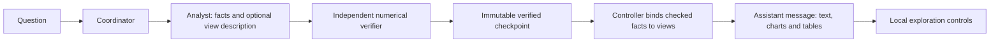

# In-chat exploration design

**Date:** 9 October 2026  
**Status:** Implementation-ready design; product code is unchanged. The user requested the spec and implementation plan directly, followed by a prompt for a new implementation session.  
**Companion plan:** [Implementation plan](../plans/2026-10-09-in-chat-exploration.md)

## 1. Product outcome

Make interactive analysis inside the conversation a core product capability. Retire standalone report generation. A substantial answer contains concise findings, its scope and limitations, and useful charts/tables directly in the assistant message. Small answers remain text-only. Exports are deferred.

The user chose result exploration for v1: chart hover/zoom/pan/legend controls and table sorting/filtering. These actions use the already delivered result and make no model call, execute no Python/SQL, submit no chat message, and create no run. Click-to-drill, scenario inputs, recalculation, generated forms and writeback are outside v1.

Use native React components and browser Plotly. OpenUI is deferred: v1 needs controlled chart/table rendering, not a second UI-generation language or a replacement agent runtime. Keep Pi, Fastify, the existing event transport and app-owned conversation persistence.

## 2. Evidence and expected benefit

Workflow 1.0.17's successful Lighting & Candles baseline took 712.633 seconds: numerical verification 101.052s; initial presentation 97.058s; first visual review 31.572s; presentation correction 190.289s; final visual review 28.859s. The first verified numerical answer arrived at 360.366s. Evidence: [baseline release record](../../releases/minimal-visual-review-live-evaluation-2026-10-09.md) and ignored `.cache/configured-agent-evaluations/2026-10-09T10-58-08.955Z-b12610cd/analyses/F01-1/run.json` at the repository root.

The 347.778-second presentation branch is the reduction target, not a promised saving. Numerical verification remains independent and is not made faster by embedding charts. A future live comparison must measure end-to-end latency, first verified answer, model/tool counts and output correctness; local fixtures cannot establish live latency or reliability. Preserve the later failed DeepSeek/high evidence as well.

## 3. Workflow and trust



Keep analyst calculation/revision behavior, final JSON and bounded format repair. Add no preflight, submission tool, model stage or UI repair conversation. Remove the post-checkpoint visualizer, screenshot reviewer, rendering tools and their correction loop. UI appearance is covered by application/browser checks rather than a model inspecting screenshots on every question.

A checkpoint file containing a CSV does not certify every CSV value. Every numerical table cell and chart point must resolve to a fact independently approved by the existing verifier. Do not read arbitrary CSVs into the UI, trust analyst-provided numerical arrays, or independently reaggregate values in the browser. Keep the current exact agreement/tolerance, raw-source access, execution identity, hashing, scope, ranking and completion checks.

The analyst can describe views while returning its numerical candidate; the existing verifier receives that description alongside the claims and assesses the row/column meaning and units during its ordinary check. Numerical check JSON remains unchanged. The controller enforces bindings and units; this does not prove that every chart choice is analytically ideal. Manual chart-choice acceptance remains necessary.

## 4. Small shared contract

Create `src/exploration.ts` for browser-safe types and bounded structural validation. Use the following types; existing `Scope`, `Claim` and `FileRef` remain in their current module.

```ts
type ExplorationSpec = {
  schemaVersion: 1;
  tables: TableSpec[];
  charts: ChartSpec[];
};
type TableSpec = {
  id: string; title: string; rowHeader: string;
  columns: {key: string; label: string; unit: string}[];
  rows: {key: string; label: string; claimIds: Record<string, string>}[];
};
type ChartSpec = {
  id: string; title: string; kind: 'line' | 'bar';
  tableId: string; series: string[];
};
type HeldFact = {id: string; label: string; unit: string; reason: string};
type ResultCell = {
  claimId: string; value: number | null;
  status: 'approved' | 'held'; reason?: string;
};
type ResultTable = Omit<TableSpec, 'rows'> & {
  rows: {key: string; label: string; cells: Record<string, ResultCell>}[];
};
type ExplorationResult = {
  schemaVersion: 1; runId: string; checkpoint: FileRef;
  scope: Scope; coverage: string[];
  tables: ResultTable[]; charts: ChartSpec[];
};
```

The candidate's optional `exploration` field is advisory. Validate it independently of the financial handoff: malformed view descriptions must not reject otherwise valid financial evidence, consume a format repair, or trigger another model call. The normalized `AnalysisPacket` and newly sealed `Checkpoint` can carry optional `exploration: ExplorationSpec` and controller-derived `explorationIssues: string[]`. Persist these issues so a malformed description cannot become an apparently absent description after normalization/restoration. New checkpoints also carry optional `heldDetails: HeldFact[]`, populated from executed held-check reasons and original claim labels/units. Existing `held: string[]` stays intact; old checkpoints lacking these fields remain readable.

Limits: four tables, four charts, one to twelve numeric columns and one to 1,000 rows per table, 5,000 cells across all tables, one to four series per chart, and a 1 MiB UTF-8 serialized `ExplorationResult`. IDs/column keys/row keys use `[A-Za-z][A-Za-z0-9_-]{0,63}`. Titles/column labels/rowHeader are nonblank and at most 160 characters; row labels are nonblank and at most 256. Units are nonblank. Claim IDs retain the existing claim contract. No silent truncation: omit an invalid/oversized view with a concise limitation, preserving the verified text and valid views.

Rows must supply exactly the declared column keys. Each binding references either an approved finite numeric claim or an explicitly held claim. Column units must match the fact unit exactly. Unknown IDs, string/ranking-array values, conflicting units, duplicate view/row/column keys and dangling chart/table references are invalid. Charts inherit x labels and original row order from their table. Each chart's selected columns must have the same unit; use separate charts for currency, units and percentages. A held cell renders as unavailable with its executed reason; it becomes a gap in a chart, never zero or an interpolated value.

An absent view description when `WorkOrder.visualize` is true produces simple fact tables grouped by unit, using approved numeric claim labels as rows, plus held facts when metadata exists. Apply the same limits. An explicitly malformed description produces a limitation instead of inventing replacement charts/tables. Valid explicit descriptions are checked per table/chart; reject an affected view and dependent charts while retaining independent valid views. `visualize:false` produces text only. This flag now requests exploration, not a report.

For continuation groups, merge valid sealed descriptions without overwriting previous view IDs; omit colliding new views and dependent charts with a limitation. References can use earlier approved facts. Reused old checkpoints without a description may show simple fact tables only for an explicitly requested full-checkpoint exploration; the existing selected-claim quick-cache path stays text-only and must not expose unrelated results.

## 5. Delivery, restoration and failure

Extend `ChatMessage` additively with `runId?: string`, `exploration?: ExplorationResult` and `explorationNotice?: string`. Keep `text`, `id`, `role` and `complete`, so old conversations and headless text consumers remain compatible. `ChatMessage.runId` identifies the delivery run; `ExplorationResult.runId` identifies the producing checkpoint run, which may differ for cached evidence. Metadata is not shown as implementation detail in the product.

At numerical approval, bind views from the sealed checkpoint, attach them to the same assistant message as the verifier's reply, persist the conversation and emit the existing `message` event. Do not add a new SSE protocol or a second answer-generation call. Propagate the existing `requireVisualization:false` application option as a runtime `explorationEnabled:false` override; it suppresses rich delivery even when a work order requests visualization, without changing saved settings. Subsequent groups append their checked answer normally. Show scope, basis, period and material coverage once with the result. Filtering never changes the narrative or financial totals.

On restart, rehydrate rich messages from their frozen checkpoint references using `loadCheckpoint` and rebuild values/specifications from sealed evidence, rather than trusting serialized conversation numbers. Check conversation identity, producing run, scope, sources and frozen hashes. For changed/missing evidence or unsupported payload versions, retain historical text, remove the rich payload and show a generic rerun notice without a verified badge. Never rerun an analysis automatically. Older text-only messages load unchanged.

Source mutation detected during finalization must retract already emitted rich results for the affected delivery run, emit message replacements with the same IDs and persist the invalidation. Cancellation before approval publishes no numerical UI; cancellation after an intact checkpoint retains the checked partial answer and UI. Failure to assemble/render optional views preserves the numerical answer with a presentation limitation. It must not convert financially complete work to `no-verified-answer` or falsely mark pending numerical work complete. Browser Plotly failure keeps the associated readable table and text.

## 6. Interaction and presentation

The chat result contains the verifier's answer, a compact scope/coverage block, and useful charts/tables. Tables use label search, numeric column sorting and 25-row pages; filtering searches all delivered row labels. Show filtered and total row counts and visible page range. Empty matches display a clear empty state and a reset control. Default row order is the analysis order. Sort numeric values before formatting; held values stay last in either direction. Reset restores original order/filter/page.

Charts support tooltips, zoom, pan, legend toggles and reset. Table filtering/sorting does not reorder/filter chart points in v1; label the controls as table controls. There is no client-side financial recomputation. Keep controls/state local to each assistant message; resets do not affect another result. Refresh restores the original view, not ephemeral sorting/zoom state.

Use `plotly.js-basic-dist-min@4.1.2`, pinned exactly and loaded as a local lazy Vite chunk. This bundle provides bar/scatter traces, sufficient for bar and line charts; use Plotly directly from a small React adapter, without `react-plotly.js`. No other UI/chart dependency is required. Verify package availability before installation; do not silently choose another version. Apply one app-owned theme, explicit units and responsive containers. All numeric values retain their canonical claim units: a `%` fact of `36.09` displays as `36.09%`, not `3,609%`; percentage points and bps are distinct. Apply rounding only for display. No CDN, arbitrary HTML/JS, remote images, custom Plotly expressions or export controls.

Render labels as literal text, including in Plotly's markup-capable text fields; escape markup characters before passing labels/units to Plotly. At 1280px and 390px, the page must not overflow horizontally. A wide table may have its own keyboard-accessible horizontal scroller with a visible scroll hint. Chart labels/tooltips must remain readable and missing values explicit. Keyboard users can operate table search/sort/page/reset; charts have an accessible title/description and their data table alternative. Clean up Plotly and resize listeners on unmount. Preserve user scroll position while exploring older messages; activity updates must not drag the viewport to the bottom.

## 7. Removal and compatibility

Remove active report assembly/publication, report modal/sidebar, visualizer/visual-review workers, counted render/preview tools and report-specific bundled scripts/templates/references. Rewrite the existing `analysis-visualize` skill for fact-bound in-chat exploration and retain applicable chart-selection guidance. Preserve the pricing plugin and its license/provenance unchanged. Python dependency locks and the installed environment do not need modification in this phase; runtime must cease requiring Plotly/Jinja/Chromium/model vision to answer questions. Playwright remains a development browser-test dependency.

Retire the unbounded legacy execution entry point: reject an explicit `legacy` workflow mode at startup before any provider call, with guidance to use `bounded`. Do not silently substitute modes. Preserve historical messages, checkpoints, artifacts and read-only download endpoints; remove new artifact/export publication from the normal analysis path. Internal scripts, results and independent-check evidence remain frozen in analysis/checkpoint storage. Do not delete or regenerate past user outputs or evaluation evidence.

Keep the `report` budget-class/config key as compatibility naming for detailed analysis. Existing model/reasoning settings, limits, reserves and repair/correction ceilings are unchanged. Retired render/preview policy fields and historical counters remain readable but inactive; new runs use zero renders/previews. Historical stage records may still name `visualizer`; active stage requests may not. Set new workflow version to `2.0.0` and visualization guidance version to `0.2.0`, preserving pricing/data/SDK versions.

## 8. Acceptance and implementation boundary

Required local evidence: focused unit/integration checks; real installed-SDK analyst lifecycle check with synthetic provider stream; executed independent-check synthetic workflow through rich-message persistence; browser interactions at desktop/narrow sizes with no additional request/model/tool activity; reconnect/restart/cancellation/source-change checks; typecheck; build; configured evaluation dry run. Verify exact chart x/y data and units against checked fixtures, not just the presence of SVG. Save screenshots and logs in a unique ignored directory.

Update the configured evaluator to record rich messages and zero report/render/preview stages without changing its saved manifest/model/budgets or retroactively editing historical results. Old report-oriented acceptance cases remain documented historical gaps; do not claim that the full acceptance suite passes. No paid evaluation, full suite, scale benchmark, fallback model, commit, push or deployment is authorized by this implementation handoff.

### Global constraints (copied into the plan)

- Implement native React/Plotly in-chat exploration; no OpenUI, new agent runtime, UI-generation model stage, preflight or submission tool.
- Interactions are local chart exploration and table search/sort/pagination only; no new model/tool calls, drilldown, what-if calculations or exports.
- Every displayed numeric cell/point binds to independently approved facts; held values remain unavailable, never zero.
- Preserve source/execution/checkpoint guards, independent numerical verification, final JSON/repair, scope/ranking continuity and verified partial answers.
- Preserve existing user changes, source data, historical outputs/evidence, credentials, saved model/reasoning settings and budgets; no Python dependency or environment changes.
- Keep report budget/config keys and historical counters readable; retire report-producing execution and new artifact publication.
- Pin plotly.js-basic-dist-min exactly to 4.1.2; workflowVersion becomes 2.0.0 and visualizationVersion becomes 0.2.0; pricing/data/SDK versions stay unchanged.
- Stop after focused local checks, browser checks, typecheck/build and the configured dry run; no paid evaluation, full suite, scale run, fallback, commit, push or deployment.

## 9. Design sources and self-review

Current implemented files, rather than the original HLD, govern migration: `src/agent/workflow/{orchestrator,checkpoints,handoff,worker,role-prompts}.ts`, `src/agent/{runs,events}.ts`, `src/contracts.ts`, `src/ui/{Chat,App,Outputs}.tsx`, `src/ui/{state,useSession}.ts`, and `src/{application,runtime,files}.ts`.

Plotly primary references checked on 9 October 2026: [partial bundles](https://github.com/plotly/plotly.js/blob/v4.1.2/dist/README.md), [4.1.2 package metadata](https://github.com/plotly/plotly.js/blob/v4.1.2/package.json), [react/resize/purge functions](https://plotly.com/javascript/plotlyjs-function-reference/). OpenUI remains a future option via [schema-defined React components](https://www.openui.com/docs/openui-lang/defining-components).

Self-review: numeric provenance is per fact rather than per file; held labels/reasons survive sealing; descriptor failures cannot consume financial repair allowance; cumulative groups and cache subsets do not leak results; restore rebuilds rich payloads from intact checkpoints; source changes retract rich answers; report compatibility naming does not enable a report execution path. No deferred design choice blocks the plan.
